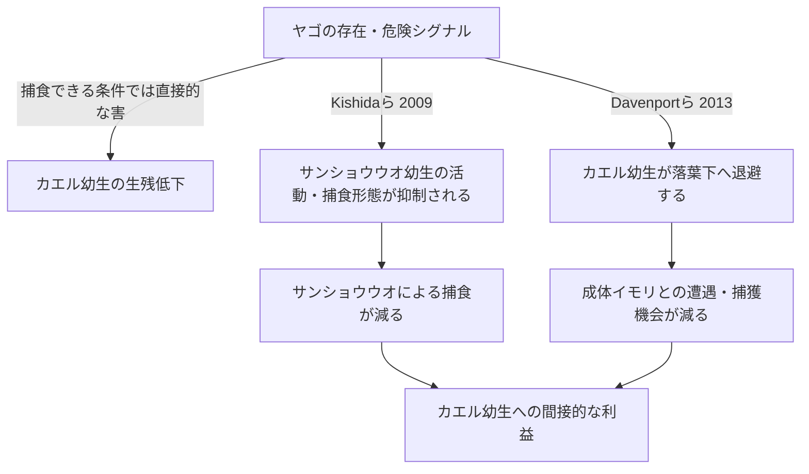
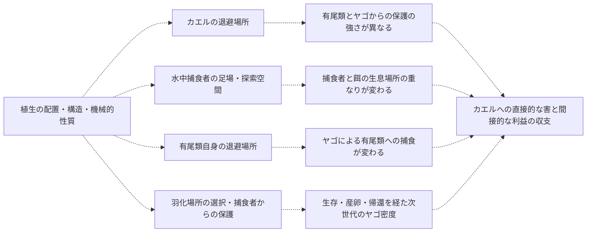
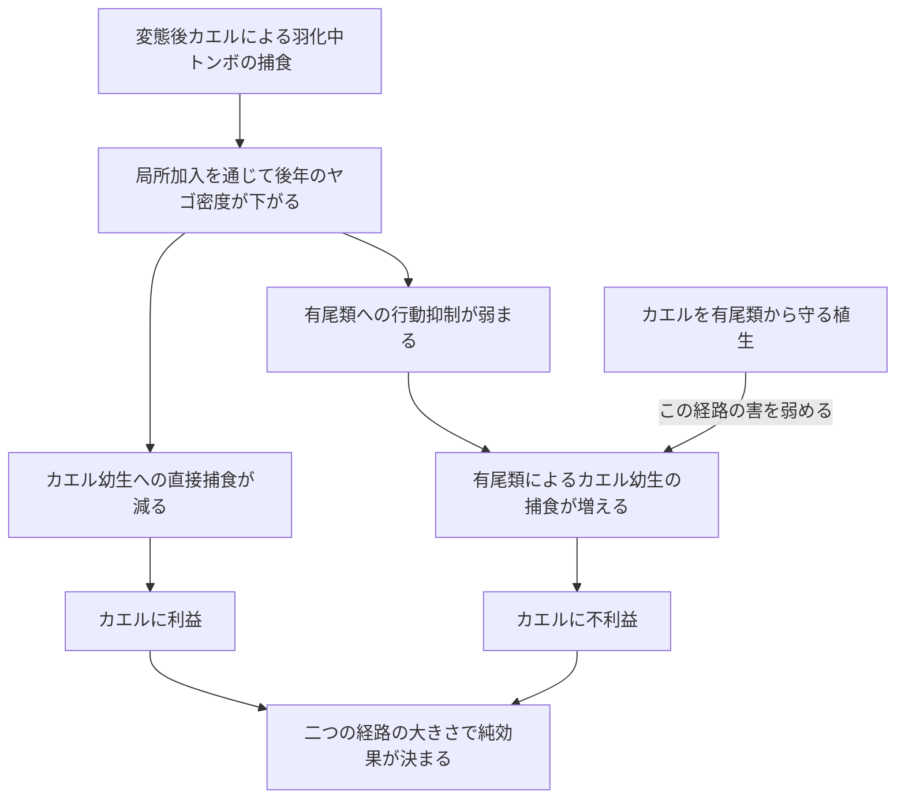

# 有尾類と植生がカエルとトンボの関係を変える経路

## 考察の中心

**有尾類が加わると、ヤゴはカエルにとって「直接食べる相手」であると同時に「別の捕食者の作用を弱める相手」になりうる。植生は、その直接的な害と間接的な利益のどちらを強く変えるかによって、純効果を変える。** この収支を、生息場所の利用と発生段階を通して説明する。

以下では、文献で操作された経路、今回のモデルに組み込まれた経路、マクロ解析への移送仮説を分ける。図1は異なる原著にある経路を並置したもので、同じ池で同時に実証された網ではない。図2は候補経路、図3はモデル内の比較である。

## 図1 有尾類が効く二つの行動経路

Kishida, Trussell & Nishimura (2009)は、隔離したヤゴの危険シグナルにより、サンショウウオ幼生の活動・形態が変わり、カエル幼生に間接的な利益が生じる経路を示した。ヤゴは実験個体を食べられないため、直接捕食を加えた総効果とは区別する。[原著](https://doi.org/10.1890/08-0238.1)

Davenport & Chalcraft (2013)では、ヤゴによってカエル幼生が落葉下を利用し、そこで採餌しにくい成体イモリの捕食効率が下がった。変わった中心は被食者の場所利用であり、有尾類自身の危険応答とは異なる。落葉量は一定なので、植生量の増加実験として引用しない。[原著](https://doi.org/10.1002/ece3.691)

この区別から、有尾類の関与を「捕食者が一種増えたから」とだけ説明することはできない。同じ個体数でも、誰がどこにいて、どの程度活動できるかでカエルへの作用は変わる。成体イモリとサンショウウオ幼生を同じ行動主体として扱わず、種・段階の組合せを明記する。

## 図2 植生は異なる経路を同時に変える

破線は文献とモデルから検討する候補であり、冠水植生被覆から機能を測定した矢印ではない。羽化場所から次世代密度への矢印には、複数の未観測の移行過程を含む。

### カエルの保護は捕食者ごとに異なりうる

有尾類からの保護が強いと、ヤゴが有尾類を抑えることで得られる利益は小さくなりうる。すると、カエルの絶対的な生残が改善していても、ヤゴを追加したときの純効果は負に見えやすくなる。これは単季節モデルで実際に生じた比較である。ただし、文献の特定のイモリ・落葉の結果から、すべての池性有尾類や水草で同じ非対称性を仮定しない。

### 隠れ場と捕食者の足場は両立する

Hossie & Murray (2010)では、落葉がヤゴの機能的反応を変え、追跡の足場にもなった。しかし構造による捕獲成功率の差は明確でなく、「植生が多いほどヤゴの捕食効率が上がる」という一般則にはならない。[著者公開原著](https://www.thomashossie.ca/uploads/6/0/6/0/60609931/hossie_and_murray_2010_-_oecologia.pdf)

Klecka & Boukal (2014)の人工植生を用いた水生無脊椎動物の実験では、植物上を利用する捕食者による浮遊性の餌への捕食は増え、底生の餌の死亡は減った。捕食者・餌の空間利用の組合せが重要である。これは構造の作用の先例であり、カエルと有尾類について同じ方向を直接示した実験ではない。[原著要旨・書誌](https://pubmed.ncbi.nlm.nih.gov/25085443/)

### 羽化場所の提供と羽化生残を分ける

Grof-Tisza et al. (2017)では、複雑な構造への羽化場所選好と、植物の機械的防御による鳥からの保護を区別している。固定した餌を使う実験では、機械的防御の効果は認められたが、構造複雑性の効果は認められなかった。したがって「植生の複雑性が常に羽化生残を高める」とせず、場所選択と保護の機構を分ける。[原著方法・結果](https://onlinelibrary.wiley.com/doi/10.1002/ece3.2705)

羽化の局所的な利益が翌年のヤゴ増加になるには、産卵や局所への帰還が必要である。モデルではこの接続を仮定して比較したが、同論文からその年次経路やカエルによる捕食を実証済みとして引用しない。

## 図3 逆転捕食の利益が有尾類によって反転する理由

図3の矢印は今回のモデルにおける因果経路である。植生からBへの矢印は、Bを増やすという意味ではなく、ラベル通り捕食を弱める修飾を示す。

全植生機能・到着50日・局所加入重み0.5の対応比較では、ヤゴから強く保護する設定で逆転捕食の効果は二者系+0.1252、三者系−0.0613だった。有尾類の指数は2.8618から2.8641とほぼ不変だが、ヤゴの減少により有尾類の作用が強くなった。行動抑制を除くと負の差は消えた。一方、有尾類から強く保護する設定では三者系の差は+0.1924だった。これは第三者の効果に、密度だけでなく行動と曝露が関与することをモデル内で示している。

現在のモデルでは、植生による「有尾類の隠れ場」はヤゴ→有尾類の死亡率を下げるだけで、危険シグナルによる行動抑制を直接解除しない。したがって「植生が有尾類を安心させて採餌を回復させた」とモデル結果を説明するのは不正確である。また、Davenportらのカエルの動的な退避行動そのものは、モデルに明示的な行動状態として実装していない。文献の二経路を同じ実装と扱わない。

## マクロ解析の符号とどう結び付けるか

重要なのは、ヤゴによる有尾類の抑制は、それ自体としてはカエルに間接的な利益を与えるという点である。**この経路だけでは、池性有尾類適合度が高い地点でトンボ類との負の発声関連が強まった理由を説明できない。** さらに、モデルの「逆転捕食on/offによる後年の密度差」と、観測の「トンボ適合度と発声の相関」は異なる比較である。どちらも負になる例があるというだけで対応付けない。

| 観測した関係 | 検討する説明 | 現状の位置付け |
|---|---|---|
| トンボ適合度との負の関連が高有尾類適合度で強い | 直接捕食・間接利益・段階の重なりの収支が地域間で異なる。共通の環境勾配や種組成でも生じうる | 抑制経路一つでは説明不足。相乗的捕食を実証したとしない |
| トンボ×植生が負、有尾類×植生が正方向 | カエルへの保護が捕食者間で非対称、または植生がトンボ側の生活史を支える | 候補として整合しうる。両係数は条件付きで、有尾類側は仕様により不確か |
| 三者項の正の推定 | 植生が第三者を含む関係を緩和する可能性 | 背景・尺度・ルート内で不確実。階層全体の実証とはしない |

共有環境の説明は単に余分な注意書きではない。三群の適合度は環境変数から推定され、景観植生も池内構造とは異なるため、湿地タイプや種組成の違いが交互作用として現れる可能性を、機構仮説と並べて比較する必要がある。今のデータで原因の優先順位を決め切ることはできない。

## 論文用の考察文

有尾類の存在は、カエルに対する捕食圧を単純に加算するだけでなく、トンボ類が及ぼす直接作用と間接作用の収支を変えうる。危険シグナルによる有尾類の行動抑制と、カエル幼生の退避による有尾類との遭遇低下は、異なる機構から同じ間接的利益を生む先例である。このため、有尾類適合度が高い環境でトンボ類との関連が異なることは、第三者の個体数のみでなく、段階・活動・場所利用の違いを検討する動機になる。ただし、間接的利益の存在そのものは、観測された負の条件差を説明する十分条件ではない。

植生は、この収支を変える複数の役割を持ちうる。同じ構造がカエルには退避場所、ヤゴには移動や採餌の足場、有尾類には捕食者からの避難場所、羽化個体には場所選択と保護の条件となる。したがって、植生被覆の主効果だけでは、生物間の関係に及ぼす影響は要約できない。今回のトンボ類と有尾類に対する非対称な係数は、捕食者ごとに異なる保護と、トンボ類側の生活史支援を比較する理由となるが、どの植生機能が働いたかを識別したものではない。

複数年モデルは、逆転捕食でヤゴが減ることが、カエルへの捕食を軽減すると同時に、有尾類への抑制を解除しうることを示した。後者が大きい条件ではカエルへの利益が反転し、有尾類からの保護が強い条件では利益が維持された。この結果は、第三者と植生によって逆転捕食の帰結が変わる可能性を示す。広域の発声との接続には、こうした幼生期の作用から成体への加入、または成体の場所利用への経路が必要であり、モデルの密度差を発声頻度の差に直接読み替えることはできない。

## 説明を区別する観測予測

- 有尾類の行動抑制なら、同じ有尾類密度でもヤゴの危険情報に応じて活動・採餌が変わる。
- カエルの退避なら、主な変化はカエル幼生の微小生息場所利用と有尾類との空間的重なりに現れる。
- 非対称な植生保護なら、構造量だけでなく、捕食者別の接触・死亡割合が異なる。
- 羽化支持なら、羽化場所選好・羽化生残と翌季のヤゴ密度を別に測定し、移入・帰還を区別する必要がある。

これらは今回のモデルや文献から導く予測であり、新しく実施した野外検証ではない。体サイズと段階の重なり、水域の持続期間は、それぞれの経路が成立する条件として測る対象となる。
