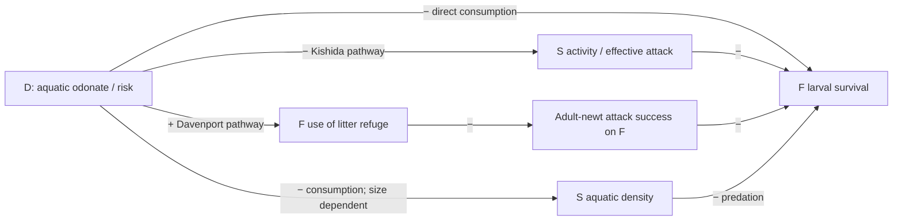
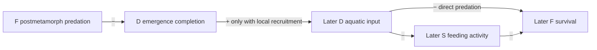

# Caudate–vegetation causal-path audit

2026-10-26. Bounded audit of three primary studies, `stage_vegetation_network.py`, the current two-part manuscript, and saved seasonal/multiyear model reports. No empirical reanalysis or simulation rerun was performed for this memo. O denotes observed odonate suitability; D denotes modeled aquatic odonates. They are not interchangeable. F is the focal frog; S is the modeled caudate.

## Main conclusion

The third party matters because it gives D two opposing routes to F: direct predation harms F, whereas suppression/removal of an F predator can benefit F. Vegetation can change their relative weights. This explains why a pairwise account can be incomplete, but **D suppressing S alone predicts a positive indirect F response and cannot explain the observed strengthening of a negative O–calling association at high S suitability**. A negative net D effect can coexist with antagonism between predators; negative net effects do not establish synergistic predation.

The empirical target remains conditional association: weak negative O–calling overall, more negative at high pond-S suitability; O×V negative; S×V positive point estimates with a target-group interval spanning zero; O×S×V uncertain across specifications. Opposite O×V and S×V signs do not themselves demonstrate vegetation modification of the third-party effect. The three-way term addresses that question. Suitability is not local density and landscape flooded vegetation is not measured pond refuge structure. See [current manuscript](../../../../research/manuscript/TWO_PART_MANUSCRIPT_DRAFT_2026-10-26.md).

## Three primary studies: what travels and what does not

| Study | Verified system and result | Permitted use and limit |
|---|---|---|
| [Kishida, Trussell & Nishimura 2009](https://esajournals.onlinelibrary.wiley.com/doi/10.1890/08-0238.1) | Dragonfly larvae *Aeshna nigroflava*, salamander larvae *Hynobius retardatus*, and *Rana pirica* tadpoles. Dragonfly risk reduced antagonistic morphological responses. Salamander activity was more affected than tadpole activity; the authors link these changes to reduced salamander-caused tadpole mortality. | Supports a positive trait-mediated indirect D→F pathway involving larval S behavior/morphology. Does not show vegetation changes that pathway, calibrate its strength, or establish it at NAAMP sites. Publisher abstract verified; detailed experimental methods were not retrieved in this audit. |
| [Davenport & Chalcraft 2013](https://doi.org/10.1002/ece3.691), [author institutional full text](https://thescholarship.ecu.edu/server/api/core/bitstreams/86142f29-7234-416a-9d23-5debe0580545/content) | Larval *Anax*, adult *Notophthalmus viridescens*, and *Bufo* tadpoles. Dragonfly cues increased tadpole use of litter and reduced newt foraging success; newt-induced tadpole behavior did not equivalently alter dragonfly success. | The mediator is F refuge use, not demonstrated suppression of S activity. This supports asymmetric exposure in existing litter; litter amount was not the manipulated vegetation gradient. Adult-newt evidence cannot calibrate a larval-salamander state. Full text, especially methods and pp. 3069–3070, verified. |
| [Anderson & Semlitsch 2016](https://doi.org/10.1111/1365-2656.12462), [author full text](https://tlandersonresearch.weebly.com/uploads/7/8/9/5/78953960/anderson_et_al-2016_jae_final.pdf) | Outdoor mesocosms combined larval *Ambystoma annulatum* (IG predator), *A. maculatum* (IG prey), top-predator treatments, and vertical shade-cloth structure above a litter baseline. Top predators affected the IG predator; cover had little effect on its survival/condition. Cover modified some relationships between the two salamanders, depending on predators. | Evidence that structure and predator identity condition IGP, not direct evidence of an F–S–D vegetation mechanism. Their suggested behavioral interpretation with aeshnids was not a demonstrated mediator. Does not justify a universal S-refuge benefit or generalized synergistic mortality. Full text verified. |

These systems differ in geography, species, stage, and structure. Preserve those distinctions instead of combining them into a single observed natural food web.

## Signed paths: distinguish the mediators

Arrows below mean the effect of increasing the source on the named target, not energy-flow arrows. Signs are local path signs; complete-network net effects can differ.

The two behavioral chains have the same positive indirect sign for F but different mediators. The model directly implements the S-suppression chain; it does not contain an explicit D-induced F-refuge behavior state. Its static F-cover multiplier is only an abstract representation of differential protection. Citations for the two chains are in the study table above; D consumption of S is an implemented scenario, whose application requires stage/size validation.

## Vegetation changes particular edges, not a single ecological quality

The following are code-level assumptions, verified in [seasonal model source](../../../../research/scripts/stage_vegetation_network.py), not estimates of field effects.

| Model role | Implemented edge | Consequence for F and boundary |
|---|---|---|
| F refuge | V decreases S→F and D→F hazards, with alternative relative strengths | Direct protection is positive for F. Preferential protection from S reduces the benefit available from D suppressing S, so adding D can become less beneficial/more harmful despite improved F survival. |
| D aquatic support | V increases D→F and D→S hazards | First path harms F; second can release F from S. The net sign is unresolved without their weights. Increased D capture efficiency is a scenario assumption, not inferred from O×V. |
| S refuge | V decreases D→S mortality | Preserving S can increase its predation on F, but S also consumes D in the optional model edge; net effects require calculation. **This role does not weaken the cue multiplier** `1/(1+cue*D)`. |
| Emergence support | V lowers D emergence failure and increases F-postmetamorph attack on emerging D | Competing effects on D completion. Neither changes earlier same-season F larval survival in the fixed-cohort model. Later F effects require recruitment feedback. |

In particular, do not write that the current model demonstrates vegetation letting S resume foraging by hiding from D. That would require V-dependent risk perception/activity; current S refuge changes survival only. Likewise S→D consumption is an optional size-dependent hypothetical edge, not established for every caudate in the suitability grouping.

## Why the observed negative O×S remains a problem to explain

The seasonal model contains mutually suppressive predator interactions and no prey-fuelled predator growth or displacement into another predator's attack zone. Consequently its log-survival interaction is nonnegative relative to independent hazards, as explicitly recognized in the [seasonal report](STAGE_VEGETATION_SIMULATION_REPORT_2026-10-26.md). This supports conditional antagonism, not a mechanism generating synergistic F mortality. The ecological model contrast and the observational O×S coefficient also have different estimands.

Candidate explanations should be separated:

1. **Supported countervailing pathway:** D suppresses S and benefits F indirectly. It can coexist with stronger direct D harm, but cannot alone supply the negative third-party sign.
2. **Habitat-dependent loss of this benefit:** F protection from S makes S suppression less valuable. This is represented in the model and can make the D-addition contrast more negative across V; it does not identify the empirical O×S or O×S×V mechanism.
3. **Possible facilitation absent from this model:** one predator may displace F toward another, or resource consumption may change predator growth/size. These are rival hypotheses requiring system-specific evidence; the three audited papers do not establish generalized F–S–D synergy. Do not add such paths merely to match a coefficient.
4. **Observation-level rivals:** shared environmental gradients, turnover in frog/caudate/odonate species or stages, and calling/detection differences may generate conditional associations without local trophic facilitation. Existing suitability and landscape variables do not distinguish these routes.

## Stage reversal makes the third party consequential across years

Reducing later D can therefore help F directly while releasing S feeding and harming F indirectly. The saved [multiyear report](MULTIYEAR_STAGE_NETWORK_RESULTS_2026-10-26.md) demonstrates such a reversal in a selected setting and reports that removing cue suppression eliminates its negative effect. In that example S density barely changes, so “S increases” is an inaccurate explanation; **S feeding suppression is released**. These are reported model interventions, not independently rerun here or established natural processes. The effect depends on recruitment/survival assumptions and is not a calling-rate prediction.

## Suggested manuscript wording

有尾類を第三者として扱う意義は、カエルを捕食する相手を一群追加することにとどまらない。有尾類への作用を通じて、ヤゴはカエルに対する直接の害と間接の利益を同時に持ちうる。ただし、ヤゴによる有尾類の活動抑制と、ヤゴを避けたカエル幼生の隠れ場利用によるイモリの捕食効率低下は、異なる経路である。いずれもカエルに対する間接的な利益を与えるため、高い有尾類適合度の下で観測されたトンボ適合度との負の関連の強まりを、それだけで説明することはできない。植生がどの捕食経路を弱め、どの段階を支えるかによって直接・間接作用の重みが変わるというモデルの結果を、観測された条件付き関連を考える候補機構として位置付ける。自然界での機構の識別には、同じ水域における種・段階・体サイズ、密度、行動、構造、加入を対応づける必要がある。
