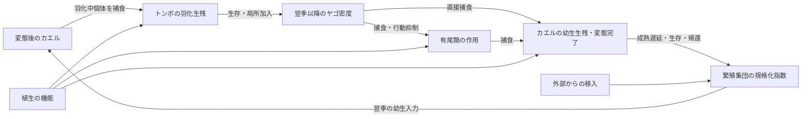

# 三者・植生・発生段階逆転をつないだ複数年モデル

## 今回追加したものと結論

**羽化・変態後の加入を翌季以降の個体数に接続すると、カエルによる羽化中トンボの捕食が、後年のカエルに利益として返る場合が生じた。しかし、有尾類を第三者として加えると、その利益は相殺され、一部の設定では負に転じた。植生がどの捕食者からカエルを守るかによって、符号も変わった。**

これは合成モデル内の条件付き結果であり、北米NAAMPの相関やベルギーINBOの時間的関連に合わせた推定ではない。加入・生存の仮定を変えると符号も変わるため、普遍的な負のフィードバックを発見したとは結論しない。

既存の季節内モデルに、任意の初期密度と複数年の加入待ち行列を追加した。従来の単季節18,432シナリオと7つの数値表は再実行して完全一致した。季節内の捕食式の符号を変えて結果を作ったのではない。

## 年をまたぐ接続



図はモデルの接続を要約する。Bから変態後Fまでは実際には幼生期を経由する。植生の機能は、カエルの隠れ場、ヤゴの遭遇・採餌支持、有尾類のヤゴからの隠れ場、羽化支持を個別に切り替えた。羽化支持は羽化失敗の低下と変態後カエルからの接触増加を同時に含む、既存モデルから引き継いだ仮定である。

規格化繁殖指数Bをその年の幼生入力密度に一対一で対応させ、季節内モデルから変態・羽化完了密度Cを得る。更新式は以下。

`B[g,t+1] = s[g]B[g,t] + rho*b[g]*j[g]^(m[g]-1)*C[g,t+1-m[g]]/(1+C[g,t+1-m[g]]/K) + (1-rho)*(1-s[g])*I[g]`

局所加入の項には成熟遅延m、追加の未成熟期間の生存j、規格化加入換算b、加入段階の密度依存Kを含む。sは成体の年越し、Iは外部供給源。存在しない群はIも0となり、勝手に加入しない。rhoは局所加入と外部供給の混合重みであり、独立に推定した分散率ではない。rhoを変えると二つの項が同時に変わる。

主設定はs=(0.4,0.5,0)、b=(4,4,4)、j=(0.8,0.8,0.8)、m=(2,2,1)、K=1。すべて仮説検討のための任意値で、実種の生活史推定値ではない。成熟待ち個体は季節内の捕食から外れており、複数年水中で暮らすヤゴの越冬を表現していない。初期指数は各群1、観測開始前の未成熟コホートは0。発声行動・検出過程は含まない。

## 主比較

FD（二者）／FSD（三者）、植生機能6種類、植生量0/1、カエルを有尾類／ヤゴのどちらから強く守るかの2設定、カエル到着10/30/50日、rho=0/0.5/1、逆転捕食on/offの864シナリオを80季節計算した。効果は同一設定のon−offを取り、最後の20季節の平均で比較した。平衡・共存を証明したわけではない。

以下は全植生機能、植生1、カエル到着50日、有尾類0日、ヤゴ35日、rho=0.5の例である。結果を説明するために選んだ例で、全条件を別表に保存した。

| 植生によるカエルの保護 | 群構成 | 逆転なしのカエル指数 | 逆転あり | 差 |
|---|---|---:|---:|---:|
| ヤゴから強く保護 | FD | 1.0801 | 1.2052 | +0.1252 |
| ヤゴから強く保護 | FSD | 1.1155 | 1.0542 | −0.0613 |
| 有尾類から強く保護 | FD | 0.5352 | 0.5357 | +0.0005 |
| 有尾類から強く保護 | FSD | 1.2796 | 1.4719 | +0.1924 |

前半では、有尾類を加えることで逆転捕食の効果が+0.1252から−0.0613に変わる。対応する第三者による効果修飾は−0.1865。後半では+0.0005から+0.1924となり、修飾は+0.1918。二つの群構成の別々の最大値を比べたのではなく、同じ設定で比較した値である。

## 負に転じる原因をモデル内で追う

ヤゴから強く保護する三者条件では、逆転捕食を入れるとヤゴの指数が0.8558から0.7365へ低下した。有尾類の指数は2.8618から2.8641とほぼ同じだが、ヤゴ密度による行動抑制が弱まり、有尾類がカエルへ及ぼす作用が強くなる。

この例で、初期カエル密度に対する有尾類による死亡割合はおよそ0.601から0.655に上昇し、ヤゴによる死亡割合は0.130から0.097に低下した。直接的なヤゴ捕食の軽減よりも、有尾類側の作用増加が大きかった。単なる「有尾類が大幅に増えたから」という説明ではない。

ヤゴによる有尾類の行動抑制を取り除く感度解析では、この例のカエル指数差は−0.0613から+0.000018に変わり、負の効果は消えた。これは当該設定におけるモデル内の介入結果であり、野外でその行動経路を測った証拠ではない。

反対に、カエルを有尾類から強く守る植生では、有尾類からの害が抑えられ、ヤゴ減少による利益が残りうる。植生は一律にカエルに良い／悪いのではなく、二つの捕食経路の相対的な重みを変える。

## 移入・加入・初期条件への依存

rho=0では、外部供給によって翌季の入力密度が常に1に維持されるため、逆転捕食の後年のカエル指数への効果は全条件で0だった。これは実装の対照条件で、自然の移入量を推定した結果ではない。

rho=1では、外部供給がなく、カエルやヤゴがほぼ0へ向かう設定も多い。図示したヤゴ保護例では、カエル指数はFDで約10^-6、FSDで約10^-18となる。そこでon/offの差が小さいことを、相互作用が弱い証拠とはしない。二者では局所加入がある主グリッドに負の差はなかったが、三者ではrho=0.5で正・負の双方が生じた。

設定数の符号集計も保存したが、同じ生態学的条件になる重複（植生0での機能切替など）を含む設計格子である。割合を自然界での発生確率と解釈しない。

全植生機能の144シナリオで13種類の設定を保存した。代表例の効果は以下。

| 感度設定 | ヤゴから強く保護したFSD | 有尾類から強く保護したFSD |
|---|---:|---:|
| 基準 | −0.0613 | +0.1924 |
| 成熟遅延1/1/1 | −0.0087 | +0.0084 |
| 成熟遅延3/3/2 | −0.0156 | +0.1153 |
| 加入換算2 | +0.0054 | +0.0198 |
| 加入換算8 | 約0 | −0.0045 |
| 未成熟期間の生存0.5 | +0.0441 | +0.0123 |
| 成体年越しなし | +0.0463 | +0.0051 |
| 行動抑制なし | 約0 | +0.0030 |

したがって、**第三者による利益の反転は可能だが、頑健な普遍則ではない。** 一方、初期密度0.25/2と160季節への延長では、上記基準の正負と値はほぼ維持された。全植生機能の144シナリオでは80→160季節でカエル平均指数が最大0.1271変わるものもあり、80季節の結果を一律に平衡と扱わない。

積分刻み0.25日→0.125日の全植生機能サブセットで、最後20季節の三群の平均密度・完了密度の最大差は0.00891。図示した二つの三者条件の逆転効果は−0.06132→−0.06121、+0.19235→+0.19067で、符号は維持された。全864条件を半刻みで再計算したわけではない。

## 論文への追加位置

実測結果は引き続き「トンボ適合度と発声の関連が、有尾類と植生の文脈で変わる」である。今回のモデルはその相関を再現・説明し切ったものではなく、**発生段階の逆転という自然史が、第三者を通じて予想と逆の人口動態効果を持ちうる**ことを示す機構セクションとして追加する。

INBOの幼生→後年の発声の関連は、時間をまたぐ接続を考える動機になるが、本モデルの加入係数や因果経路を実測で支持したことにはならない。リモセン植生被覆から、図のどちらの隠れ場機能が強いかも識別していない。植生構造、捕食者の行動、加入と移入の分離が、今後の機構検証で測る対象となる。

### English manuscript text

We extended the seasonal stage-structured model by linking metamorphic and emergence completion to subsequent aquatic cohort inputs through delayed, density-regulated local recruitment and an external immigration reservoir. Across 864 synthetic scenarios, stage-reversed predation on emerging odonates could benefit subsequent frog cohorts in the two-guild system. Adding caudates could attenuate or reverse this benefit. In an illustrative setting, the reversal-induced change in the final-window frog breeding-pool index shifted from +0.125 in the frog–odonate system to −0.061 in the three-guild system when refuge preferentially protected frogs from odonates. When refuge instead protected frogs more strongly from caudates, the corresponding changes were +0.001 and +0.192. Removing odonate-induced suppression of caudate activity eliminated the negative effect in the former setting. These signs depended on recruitment and survival assumptions and were not universal. The model therefore demonstrates a conditional pathway by which stage reversal, a third party, and vegetation function can jointly alter multiyear outcomes; it does not identify the mechanism underlying the observed calling associations.

### Figure caption

Synthetic annual feedback under stage-reversed predation. F=frog, D=odonate, S=caudate. A–B: frog breeding-pool trajectories with reversal on/off, under alternative refuge ordering. C: reversal effects in the three-guild system (FSD), with individual vegetation functions or all functions enabled. D: dependence on the local-recruitment mixture; near-zero effects at rho=1 in this illustration accompany very low frog abundance. The displayed example uses frog arrival day50, caudate day0, odonate day35, vegetation1, and rho=0.5 except panelD. PanelsC–D summarize years60–79. Scenarios were selected to explain the mechanism; the full factorial grid and all sensitivity trajectories are retained. Values are normalized model indices, not estimated field densities or calling rates.

## 再現・保存物

```powershell
python -m unittest discover -s research/scripts -p 'test_*.py'
python research/scripts/multiyear_stage_network.py --out work/multiyear-replay
python research/scripts/plot_multiyear_stage_network.py --results work/multiyear-replay
python research/scripts/verify_macro_snapshot.py
```

`research/results/multiyear_stage_network_20261026/`に全軌跡、最終20季節要約、逆転on/off、第三者・植生による対応の取れた修飾、全感度設定の軌跡と要約を保存。原典を用いた新たな当てはめは行っていない。従来の894ファイルの固定結果は保持する。
