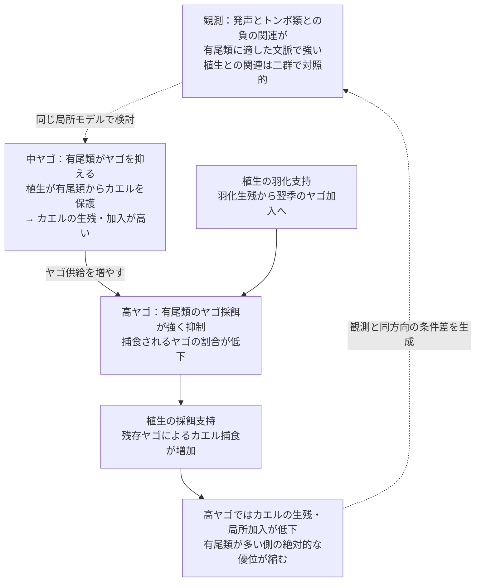

# 三者モデルの経路検証：有尾類の利益はなぜ高ヤゴ側で縮むか

## 結論

**選択済みの局所モデルでは、有尾類がヤゴを捕食する経路と、ヤゴ密度に応じてその採餌が抑制される経路の組合せが、三方向一致を生んだ。植生の作用は、カエルを有尾類から保護する機能、ヤゴのカエル捕食を支える機能、トンボの羽化失敗を減らす機能に分離できた。**

高ヤゴ側では有尾類が食べるヤゴの総量は増えるが、供給・加入したヤゴのうち捕食される割合は低下する。残存ヤゴによるカエル死亡が大きくなり、カエルの変態完了と局所加入が低下する。このため、有尾類供給の多い側のカエル指数の優位は、中ヤゴ側の+0.289から高ヤゴ側の+0.088へ縮む。

これは**モデル内での介入による機構の検証**である。NAAMPの適合度を実測個体数とみなしたり、この機構が野外の原因だと同定したりする結果ではない。パラメータを観測へ合わせ直してはいない。全範囲ではなく、以前から三方向が一致していた局所区間の説明である。

## 固定した設計

- 全植生機能、カエルを有尾類から相対的に強く保護、カエル登場50日、攻撃尺度1.5、局所加入重み0.5。
- S供給・D供給それぞれ0.25/1/2、植生0/1をすべて計算。主要な説明対象はD=1→2、S=0.25→2。全範囲D=0.25→2も出力。
- 80季節、最後20季節平均。個体数は規格化されたモデル密度であり、実際の動物の頭数ではない。
- 一方向ずつの捕食と行動抑制、植生機能の除去、捕食者経路4要因の全16組合せ、植生5機能群の全32組合せを含む66設定、計1,188シナリオ。
- 個別経路除去の18設定について半刻み・160季節を各324シナリオ。計1,836シナリオ。
- 同一の基準初期コホートを使う一季節再計算も行い、季節内効果と年をまたいだ効果を区別した。

三方向の判定は、植生によるD傾きの変化DV<0、S傾きの変化SV>0、植生1における高S−低SのD傾き差SD<0で、さらに高SのD傾きが負であること。DVはS供給1、SVはD供給1で比較する。観測の順位回帰係数との効果量比較ではない。

## 1．誰が誰をどれだけ食べたか

植生1の基準設定。数値は最後20季節平均の規格化密度。

| S供給 | D供給 | 開始時F | 開始時S | 開始時D | Sが食べたF | Dが食べたF | Sが食べたD | Dが食べたS | F変態完了 |
|---|---|---:|---:|---:|---:|---:|---:|---:|---:|
| 低0.25 | 中1 | 1.1690 | 2.3610 | 0.8852 | 0.2209 | 0.6131 | 0.5113 | 0.0416 | 0.3350 |
| 低0.25 | 高2 | 0.5451 | 2.3300 | 2.0504 | 0.0303 | 0.4976 | 0.6496 | 0.1138 | 0.0172 |
| 高2 | 中1 | 1.4578 | 3.4815 | 0.5799 | 0.6646 | 0.2327 | 0.5040 | 0.0276 | 0.5605 |
| 高2 | 高2 | 0.6330 | 3.4608 | 1.8166 | 0.0754 | 0.5052 | 0.9218 | 0.1318 | 0.0525 |

開始個体数が異なるので、総死亡数だけから捕食リスクを比較しない。以下はそれぞれの季節開始コホートに対する死亡・完了割合。

| S供給 | D供給 | FがSに食べられた | FがDに食べられた | F変態完了 | DがSに食べられた |
|---|---|---:|---:|---:|---:|
| 低 | 中 | 18.90% | 52.45% | 28.66% | 57.76% |
| 低 | 高 | 5.56% | 91.29% | 3.16% | 31.68% |
| 高 | 中 | 45.59% | 15.96% | 38.45% | 86.92% |
| 高 | 高 | 11.90% | 79.80% | 8.29% | 50.74% |

高Sでは、ヤゴ供給の増加に伴い、有尾類によるF死亡割合は**減少**した。一方、ヤゴによるF死亡割合が15.96%から79.80%へ増えた。したがって、この結果を「二つの捕食者の害が同時に強まった」と説明できない。

## 2．ヤゴが増えると、有尾類は消えるのではなく採餌が抑制される

実装では、有尾類のヤゴ捕食ハザードは次の形である。

`h(S eats D) = 0.020 × attack_scale × S × size_gate / (1 + cue × D)`

危険情報による抑制はもともとS→FとS→Dの両方に入っていた。今回は二つを独立に操作した。高SでD供給1→2にすると、S開始密度は3.482→3.461でほぼ同じだが、D水中期のS累積密度は121.25→118.66、抑制を掛けたS累積活動量は69.37→24.15となった。

したがって、有尾類がヤゴに大量に食べられて消えることが主因ではない。高DでS→Dの採餌抑制が強まり、増えたヤゴのうち有尾類が除去できる割合が下がる。この抑制は実測した行動ではなく、モデルに与えた密度依存関数であり、介入はその関数の結果への寄与を調べたものである。

**S→Dへの採餌抑制だけを除く**と、高SでD供給1→2でも、ヤゴの被食割合は97.17%→97.14%に保たれた。カエル指数は1.4366→1.4713となり、元の1.4578→0.6330という低下が消えた。

基準と同じ初期コホートで一季節だけ再計算しても、高S・高DでSが食べるDは0.9218→1.7627へ増え、Dが食べるFは0.5052→0.0984へ減った。F変態完了は0.0525→0.2499へ増えた。D減少によりS→Fの抑制も緩み、Sが食べるFは増えるが、ここではDによる死亡減少が上回る。さらに年間フィードバックを許すと、Dの翌季加入も下がる。

## 3．何を外すと三方向一致が消えるか

SDは有尾類供給によるD傾きの変化。元の値は−0.2009。

| 一つだけ除く作用 | SD | 三方向一致 |
|---|---:|---|
| 除去なし | −0.2009 | あり |
| 有尾類がヤゴを食べる | +0.0015 | 消える |
| ヤゴが有尾類の「ヤゴを食べる活動」を抑える | +0.1025 | 消える |
| ヤゴが有尾類を食べる | −0.1422 | 残る |
| ヤゴが有尾類の「カエルを食べる活動」を抑える | −0.3145 | 残る |
| 有尾類がカエルを食べる | −0.2613 | 残る |
| 変態後カエルが羽化中トンボを食べる | −0.4526 | 残る |

4経路の全16組合せでも、三方向一致した4設定はすべて「S→D捕食あり、S→D採餌抑制あり」を共有した。D→S捕食とS→F採餌抑制の有無は、この固定した他条件の下では一致の必須条件ではなかった。これはこの設定内の因果的な切り分けであり、どの系でも必要十分であるという一般命題ではない。

## 4．植生は何をしていたか

| 植生機能を一つだけ除く | SD | 三方向一致 | 切り分けた意味 |
|---|---:|---|---|
| 有尾類からカエルを保護 | +0.1347 | 消える | 中Dでカエルが有尾類の捕食から生き残り、利益が表れる条件を作る |
| ヤゴからカエルを保護 | −0.5051 | 残る | 二種類の保護は同じ役割ではない |
| ヤゴのカエル捕食を支持 | +0.5747 | 消える | 高Dで残存ヤゴがカエルへ与える死亡を強める |
| ヤゴの有尾類捕食を支持 | −0.1678 | 残る | ヤゴ支持のうち、効いていたのは主にD→F側 |
| 有尾類をヤゴから保護 | −0.2805 | 残る | 有尾類自身の隠れ場が主説明ではない |
| トンボの羽化失敗を減らす | +0.1375 | 消える | 羽化生残と翌季加入を通じ、高D側のヤゴを支える |
| 羽化時のカエルとの接触を増やす | −0.3235 | 残る | 羽化支持と逆転捕食機会は区別できる |

植生機能群の全32組合せでは、三方向一致した4設定はいずれも「F隠れ場あり、D採餌支持あり、羽化失敗低下あり」を共有し、有尾類の隠れ場と羽化時の接触増加はどちらでも成立した。さらに個別除去でF隠れ場のS→F側、D採餌支持のD→F側を識別した。これら七つの個別機能の全128組合せを調べたわけではない。

### 隠れ場：中ヤゴ側で利益が成立する条件

高S・D=1で有尾類からのF保護を外すと、カエル指数は1.4578→0.6164となる。固定コホート再計算でも、SによるF死亡は0.6646→1.2361、F変態完了は0.5605→0.0994となった。植生は、有尾類がヤゴを抑えていても同時にカエルを強く食べてしまう状況を変える。

### 採餌支持：残ったヤゴがカエルに作用する強さ

高S・D=2でD→Fの植生支持を外すと、F指数は0.6330→1.3371へ増えた。同一コホートの一季節でもF変態完了は0.0525→0.1823へ増えた。S→Dの採餌抑制があっても、残存DのF捕食が弱ければ、元の強いカエル低下にはつながらない。

### 羽化支持：当季の幼生ではなく翌季のヤゴ加入

高S・D=2で羽化失敗低下だけを外すと、D羽化完了は0.6900→0.3781、D局所加入は0.8166→0.5487、翌季を含むD開始密度は1.8166→1.5487へ減り、F指数は0.6330→0.7418へ増えた。固定コホートの一季節ではF変態完了は変わらず、D羽化完了だけが0.6900→0.5239へ下がる。したがって、この機能のFへの効果は年間接続を介する。

羽化支持だけの除去でF指数が大幅に回復するわけではない。SDの符号は低S側の応答も含めて決まるため、すべてのS・D・Vセルを比較して判定した。

## 5．「利益の縮小」はどの尺度で起きたか

高S−低Sのカエル変態完了割合の差を、競合する死亡要因の収支として分けると以下になる。

| 植生 | D供給 | DによるF死亡の減少 | SによるF死亡の増加 | 差引き生残利益 |
|---|---|---:|---:|---:|
| 0 | 1 | +14.49ポイント | −28.12ポイント | −13.63ポイント |
| 0 | 2 | +23.71ポイント | −21.99ポイント | +1.72ポイント |
| 1 | 1 | +36.48ポイント | −26.69ポイント | +9.79ポイント |
| 1 | 2 | +11.48ポイント | −6.35ポイント | +5.14ポイント |

この表は死亡割合の算術的収支であり、互いに独立な因果効果への分解ではない。片方の捕食を除けば、もう片方の餌・行動・加入も変わる。

重要なのは、**全尺度で有尾類の保護作用が弱くなったわけではない**こと。有尾類供給増加による累積F捕食ハザードの低下は、D=1で0.2939、D=2で0.9664とむしろ大きく、Fの相対的な生残改善も高D側で大きい。しかし高Dでは絶対生残が低く、変態完了割合の差は9.79→5.14ポイントへ縮む。絶対個体数・割合と、相対効果を区別する必要がある。

年モデルにはFの外部加入0.3と年越し率0.4があり、局所加入が失われても外部供給だけならF指数は0.5に向かう。高Dでは低S・高Sとも局所加入が小さくなり、F指数がこの水準に近づく。したがって、+0.289→+0.088という絶対利益の縮小には、季節内の捕食過程に加え、低生残域の非線形性と年モデルの加入構造も関わる。

「有尾類がヤゴを食べなくなった」「有尾類の効果は常に高Dで小さい」「負の修飾だけで直接の促進効果を示した」とは言わない。

## 6．マクロ解析との接続



実線は検証したモデル内の作用、点線は観測パターンとの対応を示す。発声の観測モデルはなく、適合度から供給・密度への換算もない。モデルは「有尾類の個体数が減る」経路より、「有尾類の対ヤゴ採餌が抑えられる」経路を、この条件で検証すべき候補として絞った。次の実証では、有尾類の存在だけでなく、ヤゴ密度に対する有尾類の摂餌、植生内でのカエルへの捕食、羽化生残と翌季加入を測る。

## 検証と再現

- 元の18供給・植生セルとの最大差4.44×10⁻¹⁶。既存結果を再現。
- 全軌跡のF/S/Dコホート収支誤差は最大6.32×10⁻¹⁵。
- F生残割合と`exp(−累積S捕食ハザード−累積D捕食ハザード)`の誤差2.78×10⁻¹⁵。
- 植生0では植生機能操作の効果は厳密に0。
- 半刻み・160季節で、個別除去と基準の三方向一致判定に不一致なし。全因子組合せの感度再計算は未実施。
- 入力・全結果・固定コホート再計算・収支表・検証JSONを`research/results/pathway_audit_20261027/`に保存。

```text
python -m unittest discover -s research/scripts -p test_pathway_audit.py
python research/scripts/run_pathway_audit.py
python research/scripts/run_pathway_audit.py --sensitivity
python research/scripts/assess_pathway_audit.py
```

コード：`stage_vegetation_network.py`の任意の経路操作と診断出力、`multiyear_stage_network.py`の診断転記。既定値では元の機構を維持する。モデルの捕食抑制関数・人口学を観測へ適合させる変更はしていない。
