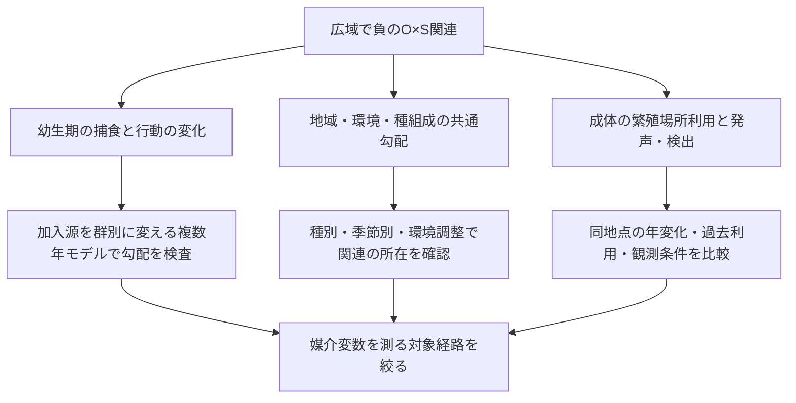

# 経路の追加検証：密度勾配と固定発声ペア

## 結論

追加検証によって、説明できる部分と不足を絞れた。現在の単季節モデルの第三者経路は、今回試した条件すべてでヤゴの負の効果を弱める方向に働き、マクロ解析の負のO×S修飾とは逆だった。一方、固定4,040ペアの条件付き関連ではO×Sは負方向を保ったが区間は0を含み、第三者・植生の交互作用を局所比較で確証できなかった。これは「相関だから分からない」という一般論より踏み込んだ、候補機構の具体的な適合性検査である。

既存の凍結結果894ファイルは検証済みで変更していない。本追加は探索的解析で、事前登録や独立データによる追試ではない。

## 1. 比較軸を修正したモデル検査

従来の逆捕食on/offによる長期個体数差は、観測されたトンボ適合度勾配に沿う相関とは異なる。今回は変更していない季節内モデルに初期ヤゴ密度0.25/0.5/1/2、有尾類密度0/0.5/1/2を与え、カエル初期密度を1に固定した。

植生の16機能組合せ×保護の相対強度2設定×カエル到着10/30/50日×植生0/1の192条件を、通常・行動抑制なし・捕食者間捕食なし・両者なしで検査した。計12,288シナリオ。植生0では機能間で等価な設定も含むため、192は独立した証拠の数でも自然界の出現頻度でもない。

各条件でD密度0.25→2の割線傾きを計算し、それがS密度0→2でどう変わるかを求めた。負なら、有尾類がヤゴの負の効果を強める。カエルの変態完了量とその対数の両方で評価し、独立死亡過程の生残尺度による見かけの交互作用を区別した。

| モデル | 負の修飾条件数（対数尺度） | 正の修飾条件数 | 修飾の範囲 |
|---|---:|---:|---:|
| 通常 | 0/192 | 192/192 | +0.0753〜+1.2729 |
| 行動抑制なし | 0/192 | 192/192 | +0.0377〜+2.4047 |
| 捕食者間捕食なし | 0/192 | 192/192 | +0.0541〜+0.8097 |
| 両者なし | 0/192 | 0/192 | 数値誤差内で0 |

通常モデルは非対数尺度でも全192条件で正。したがって、今回の単季節・固定コホート条件では、捕食者間の抑制は観測の負の修飾を生成していない。長期フィードバック全体の否定ではなく、現モデルの単季節経路についての限定された反証である。密度と適合度、変態完了と発声は異なるため、自然系の機構そのものを棄却したとはしない。

数値検証：時間刻み半減の変態完了最大差0.0007611、負の修飾判定は一致。独立捕食者の対数修飾誤差は1.33e-15。

## 2. 同一runの固定4,040ペアで同時調整

既存の強発声・無発声ペアを再マッチングせず利用した。388ルート成分でクラスタを構成し、同一地点の反復をまとめた。応答は「ペア内でどちらが強発声側か」であり、4,248地点の強発声訪問割合とは異なる推定対象である。

各地点のO（トンボ適合度）、S（池性有尾類適合度）、V（3km flooded植生指標）について全下位項と三者項を作り、強発声側から無発声側の値を引いた説明変数を、切片なしのペア条件付きロジスティック尤度へ投入した。差の積ではなく、地点で作った積の差を使った。

同一4040ペアで、(1)ネットワーク項、(2)前年3km水面平均検出頻度を追加、(3)厳密過去利用率も追加、の3仕様を両SDM背景で推定した。入力は8,080端点の固定標準化順位。ペアを等重みとし、区間はルート成分のクラスタ頑健分散とt分布。SDM推定・マッチング・順位変換の不確実性を伝播しておらず、多重性補正は行っていない。

### O×S係数（95%区間）

| 仕様 | uniform背景 | target-group背景 |
|---|---|---|
| ネットワークのみ | −0.134 [−0.452, +0.184] | −0.282 [−0.860, +0.297] |
| 前年水面を追加 | −0.132 [−0.451, +0.187] | −0.279 [−0.860, +0.301] |
| 前年水面＋過去利用歴 | −0.130 [−0.402, +0.142] | −0.203 [−0.754, +0.349] |

O×V、S×V、O×S×Vも全仕様で区間が0を含む。過去利用歴の係数は最終仕様でuniform +1.353 [1.237,1.469]、target +1.358 [1.242,1.474]。これは過去に強い鳴き声があった場所との関連であり、記憶・帰還・加入の効果を識別しない。利用歴が媒介変数なら、その調整は総関連とは異なる問いになる。

約64%のペアでOとSのそれぞれの適合度は完全同値（O uniform 2573/4040、target 2570/4040）。類似環境マッチングと適合度の空間分解能が、局所識別の情報を減らしている。区間に0を含むことを、第三者効果が存在しないという証拠としない。また、水面追加による小さい係数変化は、水域持続性の全効果を排除するものではない。

検証：全モデルで完全階数、有限値、最適化勾配を確認。端点の方向反転で係数が反転し、別のスコア方程式ソルバーとの係数最大差は1.02e-10（uniform基本仕様）。

## 3. 次に区別すべき経路



最優先は、モデル側では逆捕食のon/offではなく、外部のヤゴ供給勾配と有尾類供給勾配を独立に操作すること。現在の共有rhoや初期値だけを変えると、群ごとの加入環境の比較にならない。長期平均のカエル指標に負の交互作用が現れるかを、事前に定めた範囲・複数の加入／生存仮定で検査し、経路を切ったときの変化を比較する必要がある。これは未実施。

観測側では、既存Counts.csvから種別CI>=2を再構成し、種・調査時期によって関連が偏るかを検査する。現在のsource_taxaはCI>=1の種集合で、種別強発声を意味しない。発生段階の重なり仮説なら種と時期について予測が必要だが、成体の発声時期を実測幼生期と同一視しない。池性／非池性の有尾類比較や種除外による感度も、単なる共有環境の説明との区別に役立つ。これらは未実施。

## 再実行・出力

```
python research/scripts/check_path_dose_response.py
python research/scripts/check_matched_network_paths.py
python research/scripts/verify_macro_snapshot.py
```

数値出力：`research/results/path_dose_response_20261026/`、`research/results/path_matched_adjustment_20261026/`。
データ監査：`research/manuscript/PATH_IDENTIFICATION_DATA_AUDIT_2026-10-26.md`。
