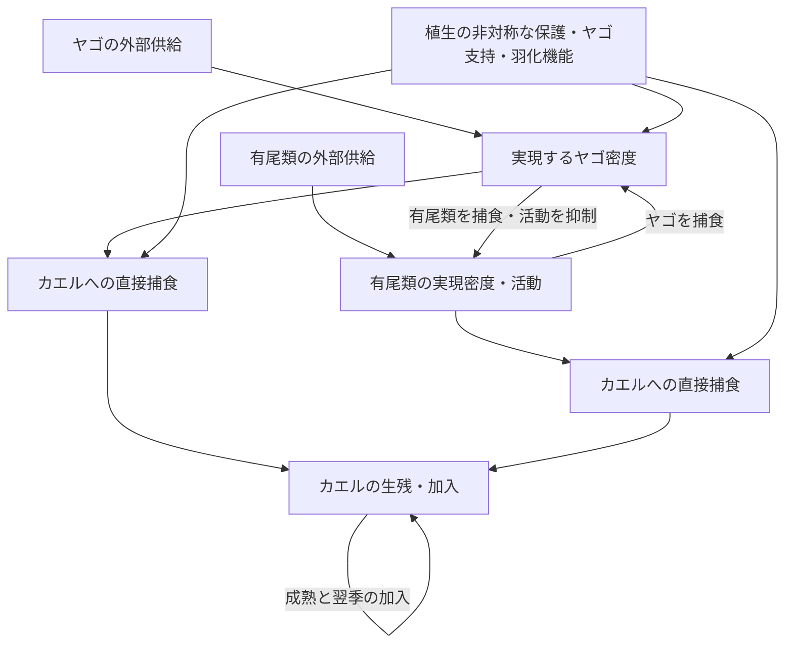

# 外部加入勾配で第三者・植生経路を検証した結果

## 結論

**事前に固定した全加入範囲の比較では、観測の「トンボ側の負の関係が有尾類側の高さで強まる」を再現しなかった。一方、保存した中間点を使った事後的な上側範囲の比較では、同方向の局所的パターンが生じた。この候補は捕食者間捕食と行動抑制に依存し、逆転捕食を除いても残った。**

これは自然系の原因の特定ではないが、「考えられる」という段階から、パターンを生成できる範囲と、それが消える経路操作を示す段階へ進んだ。ただし、局所範囲は探索後に選んだもので、主解析の成功に置き換えない。

## 設計

既存の複数年式に、群別・シナリオ別の外部供給源Iを追加した。

`B[g,t+1] = s[g]*B[g,t] + rho*b[g]*j[g]^(m[g]-1)*C[g,t+1-m[g]]/(1+C[g,t+1-m[g]]/K) + (1-rho)*(1-s[g])*I[g]`

Fの供給源は1に固定し、S（有尾類）とD（ヤゴ）のIをそれぞれ0.25/1/2に独立操作した。初期個体数、季節内の捕食式、局所加入率はその操作で変えない。Iは適合度や密度の実測値ではなく、外部から毎年与える量の規格化設定である。

主設定はrho=.5、80季節、最後20季節の平均。植生機能は全機能／無機能／各機能を一つずつ外す6設定、植生量0/1、カエルを有尾類／ヤゴから相対的に強く保護する2設定、カエル到着10/30/50日。通常／逆転捕食なし／行動抑制なし／捕食者間捕食なし／後二者なしの5経路設定を組み合わせ、3,240シナリオを実施した。

主比較はD供給0.25→2のカエル繁殖指数Bの割線傾きと、S供給0.25→2によるその変化。変態完了C、対数尺度も保存した。負の交互作用だけでなく、高SでのD傾き自体も負かを検査した。植生0などに等価な設定を含み、条件数は自然界での確率ではない。

## 1. 全範囲の主比較：負の交互作用だけでは再現ではない

通常モデルの72条件中22でSによるD傾きの変化が負になった。しかし、その22条件では低S・高SともD傾きは正であり、「ヤゴの正の利益が小さくなる」結果だった。「負の関係がさらに強まる」という同時条件を満たすものは0/72だった。

全機能・植生1・ヤゴから強く保護・到着30日の例では、D傾きは低Sで+0.1262、高Sで+0.0907、差−0.0355。交互作用の負符号だけをマクロ解析と結び付けると、効果の意味を逆に読んでしまう。

## 2. 上側範囲の探索：局所的に同方向のパターン

結果を見た後、保存済みD=1を使い、隣接する0.25→1と1→2の両区間を全条件で評価した。通常モデルのD=1→2では2/72条件で、低S・高SともD傾きが負で、高Sでより負になった。0.25→1では0/72。

2条件は、植生1・カエルを有尾類から強く保護・カエル到着50日で、全機能または「有尾類をヤゴから保護する機能」のみを外した設定だった。

全機能の代表例（任意に最大効果を選んだものではなく、全機能設定を説明例とした）：

| 有尾類の外部供給源 | D=1のF指数 | D=2のF指数 | Dの傾き |
|---|---:|---:|---:|
| 低S：0.25 | 1.1690 | 0.5451 | −0.6239 |
| 高S：2 | 1.4578 | 0.6330 | −0.8248 |

高S−低Sの傾きの差は−0.2009。高Sの方が同じDでのF指数は高いことにも注意する。これは「有尾類が多いほどカエルが減る」という主効果ではなく、**有尾類を含む系で得られる利益が、高D側で縮小する**という条件差である。

## 3. どの経路を外すと消えるか

同じ全機能・植生1・有尾類から強く保護・到着50日、D=1→2の比較。

| 経路操作 | SによるD傾きの変化 | 負のD効果の強まり |
|---|---:|---|
| 通常 | −0.2009 | あり |
| 逆転捕食を外す | −0.4526 | 残る |
| ヤゴによる有尾類の行動抑制を外す | +0.1154 | 消える |
| 捕食者間の捕食を外す | +0.0015 | 消える |
| 行動抑制と捕食者間捕食を外す | +0.0038 | 消える |

この条件で、行動抑制と捕食者間捕食の組合せが候補経路になる。一方、**逆転捕食はこのパターンの必要条件ではない**。逆転捕食を入れた方が負の修飾の絶対値は小さく、少なくともこの例を逆転捕食の証拠として使わない。

行動抑制を外す操作はS→FとS→Dの両捕食に作用する。また捕食者間捕食を外す操作はD→SとS→Dを同時に外す。したがって、ここでは個別の一本の矢印まで識別したわけではない。

生態学的な読み方は、ヤゴと有尾類の間の抑制・捕食が互いの実現密度と活動を変え、カエルに返る間接的な利益が外部供給量に対して非線形に変わる、というものになる。供給が高まったときにその利益がどこまで維持されるかが、単純な捕食者数より重要である。死亡数そのものはカエルの初期数にも依存するので、捕食圧の割合と同一視しない。



矢印は作用経路で、符号はラベルで読む。密度と活動をまとめた概念図であり、個々の矢印の野外観測を表すものではない。

## 4. 植生の役割を切り分ける

同じ局所候補条件での一機能ずつの除去：

| 植生設定 | SによるD傾きの変化 | 負のD効果の強まり |
|---|---:|---|
| 全機能 | −0.2009 | あり |
| カエルの隠れ場を外す | +0.0476 | 消える |
| ヤゴの遭遇・採餌支持を外す | +0.5797 | 消える |
| 有尾類をヤゴから保護する機能を外す | −0.2805 | 残る |
| 羽化関連機能を外す | +0.0701 | 消える |
| 植生量0 | +0.3672 | 消える |

したがって、このモデル設定では「植生が有尾類の隠れ場になる」ことが主要な必要条件とは言えない。カエルへの非対称な保護、ヤゴの採餌支持、羽化関連機能の組合せが局所的な符号に関わった。ただし羽化関連機能は羽化失敗の低下と変態後カエルとの接触増加を束ねた既存実装であり、それらを独立識別していない。各機能の除去は条件付きの比較で、全パラメータ域における必要性の証明ではない。

## 5. 数値・人口学的感度

全機能の540シナリオを対象として、時間刻み、期間、局所加入重み、加入換算、成熟遅延を変えた。選択した局所候補の修飾：

| 設定 | 修飾 | 同方向の局所パターン |
|---|---:|---|
| 基本 | −0.2009 | 残る |
| 時間刻み0.25→0.125 | −0.1965 | 残る |
| 80→160季節 | −0.2004 | 残る |
| 加入換算4→2 | −0.1053 | 残る |
| 加入換算4→8 | +2.4496 | 消える |
| 成熟遅延2/2/1→1/1/1 | +0.6789 | 消える |
| 成熟遅延2/2/1→3/3/2 | −0.2833 | 残る |
| rho=.25 | −0.1596 | 残る |
| rho=.75 | +0.0636 | 消える |

rhoは局所加入と外部供給を同時に変える混合重みで、独立した分散率ではない。全機能格子全体の平均F指数の最大差は、半刻み0.003778、期間延長0.000457。全範囲の負の修飾判定はどちらも不一致0。数値的な再現性と、人口学的仮定に対する普遍性は別である。

## 論文に使える結論

外部加入の独立操作は、第三者による効果修飾が勾配の範囲に依存することを示した。全範囲では観測と同方向のパターンは得られなかったが、高いヤゴ供給の局所範囲には、有尾類の高供給下でカエルへの負の傾きが強まる条件が存在した。この局所パターンは、捕食者間捕食と危険情報による行動抑制の組合せ、ならびに植生の複数機能に依存した。一方、逆転捕食は必要条件ではなかった。したがって発生段階の逆転は別の時間的フィードバックとして評価し、今回の負の関連の主因と断定しない。これらは野外の経路同定ではなく、次に測るべき生物間作用と環境条件を絞る、条件付きの機構予測である。

## 再現性

```
python -m unittest discover -s research/scripts -p test_source_gradient.py
python research/scripts/run_source_gradient.py
python research/scripts/assess_source_gradient.py
python research/scripts/verify_macro_snapshot.py
```

計画：`docs/superpowers/plans/2026-10-26-source-gradient.md`。
表・軌跡・図：`research/results/source_gradient_20261026/`。
旧864シナリオの年モデル要約を再計算し保存値と一致、凍結マクロ894ファイルを保護した。設定表に生じたboolean欠損は明示値へ修正し、旧・新のカーネル入力が一致することを検査した。既定値を変えた数値調整はしていない。
