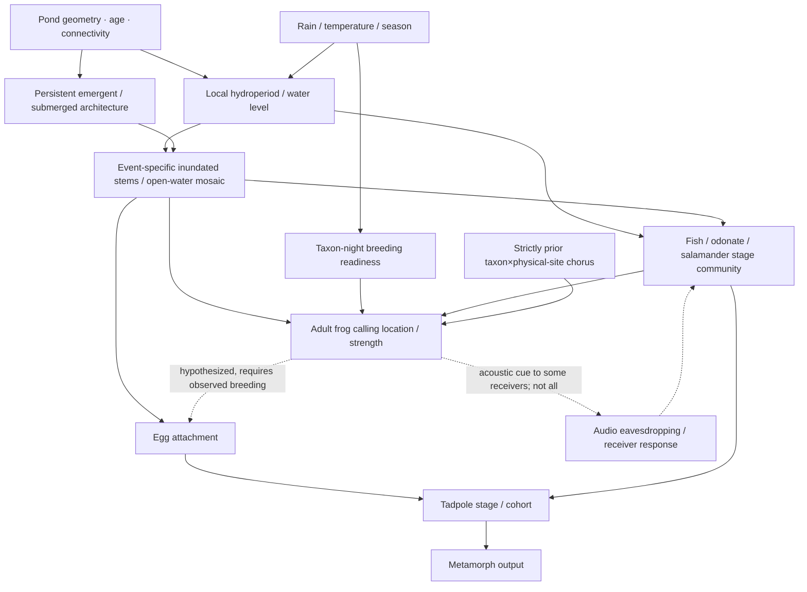

# 降雨・歴史的鳴き声地点・抽水植物・発生段階別食物網の階層モデル v0.1

Date: 2026-10-25 | Status: **prospective scientific program, not additional RC6 results**
Maintains RC6 science lock, submission candidate and WFTS stop decision; no changes to `main` or the JAE manuscript. Scientific inspiration and frozen numerical facts: [RC6 bridge](RC6_TO_VEGETATION_BIOTIC_BRIDGE_2026-10-25.json). Existing macro framework: [stage network and meth-eDNA](STAGE_MACRO_CHORUS_METHEDNA_PROGRAM_V0_1.md).

## 1. Core biological question

**Are recurrent taxon-specific frog chorus locations an emergent property of slowly changing wetland vegetation, local water states and stage-dependent biotic interactions, expressed by a fast rainfall-associated behavioural pulse?**

Keep **two different meanings of “memory”** apart:

1. **Ecological/structural memory at the site:** persistent hydroperiod, seasonal vegetation (emergent stems, submerged cover, open water), pond age, fish community, predator nursery, egg attachment substrate.
2. **Biological carry-over:** surviving adults, mate/conspecific attraction, historical breeding cohorts, predator abundance and stage structure. A repeat site × taxon CallingIndex does not identify the same individual or individual memory.

**NAAMP SiteID is a fixed wetland-associated listening location, not necessarily a single confirmed pond.** Do not write “same pond revisited” as an RC6 fact. Coordinate QC includes a positive U.S. longitude and multiple implausibly long routes; no unverified NWI/imagery linkage is permitted.

## 2. Why this extends, rather than rewrites, RC6

- Rain-associated 0 → CI2/3 transitions account for **87.1%** of the activation coefficient.
- Strict-prior SiteID strong CI2/3 predicts renewed wet CI2/3 within pair×species (β **0.1511**, 95% CI **0.1291–0.1731**); rain-favoured CI3 historical targeting β **0.02449**, 95% CI **0.0070–0.0420**.
- On **2,916** history-eligible wetter/drier comparisons, observed within-taxon multi-stop concentration is **1.6503**, principal comparator **1.3535**, conditional residual **0.2969** (Monte Carlo P **0.000999**).
- Added nonlinear weather removes **11.4%** of this residual *on the same 2,916-pair sample*. ERA5 antecedent rainfall amount removes **6.5%** on its own comparable 2,835-pair sample. Other-taxon stop-night hotness improves local stop-richness prediction (RMSE **0.775→0.581**) but target taxon's conditional residual remains on that comparator (0.318). **These are separate outcome/comparator families; the residuals must not be naively subtracted across samples.**
- Therefore **broad measured atmospheric drivers, observer effects and general other-taxa chorus hotness have not exhausted the pattern**. Local water level, hydroperiod and event-specific plant structure have *not* been measured, so it is false to say “environment does not explain this”.

## 3. Emergent vegetation is a multi-trophic infrastructure, not a single habitat-score covariate

Measure at least these *distinct* layers:

| Dimension | Ground-truth variable | Possible frog link | Possible other-taxon link |
|---|---|---|---|
| Above-water architecture | emergent stem density, height, diameter, spacing, plant taxon | calling perches, sound transmission, mate search, edge microclimate | dragonfly final molt/emergence substrate, spider/bird hunting substrate, attachment by other insects |
| Waterline/egg substrate | submerged stem extent, shallow vegetated margin, egg attachments | oviposition, egg retention, larval transition | fish/invertebrate egg predation, ambush in macrophyte patches |
| Below-water refuge | submerged vegetation structural complexity, litter, free water | tadpole shelter, feeding biofilms, movement | fish/odonate/salamander capture probability and pursuit |
| Aquatic architecture | open-water fraction, emergent × submerged mosaic, depth × vegetation | open-water calling species vs perch-dependent callers, oviposition trade-offs | predatory fish access, oxygen/temperature, predator co-concentration |
| Slow plant history | previous-season and previous-year emergent cover, re-growth/removal/succession | repeat site preference without identical returning individuals | repeated larval predator community, fish refuge, emergence cohort |
| Plant × hydroperiod | seasonal inundated stem area, recent flow arrival, drying speed | wetland availability and switch from silence into chorus | concurrent stage availability and predator recruitment |

**Do not treat emergent, submerged, floating, shoreline, canopy and leaf litter as interchangeable.** High vegetation can protect larvae *or* aggregate insect predators (see [evidence](EMERGENT_VEGETATION_HIERARCHY_EVIDENCE_2026-10-25.csv)). Do not impose a universally positive coefficient. Predeclare candidate **unimodal/threshold** response and **taxon-specific** variation. Measure sound attenuation/observer detection separately because dense reeds can change detectability without changing the true calling state.

## 4. Preliminary external mechanistic contrasts (not NAAMP estimates)

- **Hamer et al. (2021), 55 wetlands / 11 frog species:** negative fish association and positive `Gambusia × emergent vegetation` interactions for some species; `Lim. tasmaniensis` predicted occupancy 0.167→0.938 across 0–100% cover when fish present, but other taxa preferred open water. **This is published model prediction, not a newly measured frogcs coefficient**. DOI 10.1002/eap.2293; public raw Dryad 10.5061/dryad.b8gtht7b5.
- **Between-habitat tadpoles and predators (2020):** fish can shift *both* tadpoles and aquatic insect predators into complex emergent littoral vegetation. Thus “refuge” may instead increase local predator contact. DOI 10.1007/s10750-020-04190-5.
- **Egan & Paton (2004), 124 ponds:** frog and salamander egg masses associated with vegetation complexity and hydroperiod, reduced in fish-occupied ponds. DOI 10.1672/0277-5212(2004)024[0001:WPAOBW]2.0.CO;2.
- **Swartz et al. (2019), farm ponds:** older ponds more often had emergent vegetation and favourable breeding conditions. Pond history and vegetation may covary; DOI 10.1002/eap.1964.
- **Brinley Buckley et al. (2021):** timed photos, vegetation and inundation paired with frog audio; temporal hydropattern, vegetation and precipitation predict calling. DOI 10.1016/j.ecolind.2020.107171.
- **Hossie & Murray (2010):** structural leaf litter changes dragonfly→tadpole attack functional response II→III under sufficient cover, **not evidence that emergent reeds universally do so**. DOI 10.1007/s00442-010-1568-6.
- **Grof-Tisza et al. (2017):** riparian plant structural complexity protects emerging odonates against birds; DOI 10.1002/ece3.2705. Plants connect water-stage predator and air-stage vulnerable prey.
- **Davis et al. (2017):** rainfall impacts wetland amphibians differently when hydroperiod and fish predators interact; DOI 10.1002/eap.1442.
- **Frog acoustics:** other species' calling is an imperfect generic environmental proxy, not a fish, odonate, salamander or vegetation census. Airborne chorus being interpreted as a danger cue by *underwater* larvae is not demonstrated; test acoustic propagation/playback against co-varying rainfall, adult arrival, egg release and chemical cues.
 
## 5. Directed ecological causal graph and time

**Temporal guardrail:** pre-existing plant structure at year `t-1`, prior taxon×SiteID histories up to `< t`; weather and hydrology at `t`; adult chorus at `t`; eggs, larvae and emergence measured **after `t`** at species-specific degree-day lags. Cannot use `t+30` larvae or future vegetation as explanatory predictors of `t` chorus. Consider negative controls with future rainfall (already tested) and future/noncausal taxa; interpret carefully because stable habitat autocorrelation can survive such controls.

## 6. Competing, falsifiable model sequence (same sample and blocked holdout)

| Model | Added process | Direct falsifier |
|---|---|---|
| **E0** existing model | Rain/temperature/season + taxon rain response + strict prior species × SiteID history + dry persistence + matched total wet activation | Baseline spatial-concentration residual as in RC6 |
| **E1** direct local hydrology | water level, hydroperiod, recent inundation / wet-dry transition and water temp | No held-out gain or attenuation of concentration/dependence |
| **E2** physical vegetation | E1 + emergent/stem density, submerged refuge, open-water fraction, canopy, historical vegetation trajectories and taxon × architecture | No held-out gain or historical-site targeting attenuation beyond E1 |
| **E3** stage-structured biotic filtering | E2 + fish, odonate larva, salamander larva, egg/tadpole stages at **survey time**; `fish×emergent`, `odonate×submerged`, `stage×predator`, `hydroperiod×predator` | No incremental held-out gain or remaining multi-site concentration reduction vs E2 |
| **E4** joint taxon-night state × local filter | E3 + broad taxon-night latent readiness interacting with hydrology/architecture; selective rather than uniform activation | No held-out gain in **joint configuration**, or too much near/far dependence as in the already failed uniform scalar gate |
| **E5** independent signal test | controlled acoustic cue/receiver stage (not GloBI interaction associations) | No response to playback beyond local hydrology/chemical/visual cues |

**Executable screening implementation (new):** [compare_frog_vegetation_biotic.py](scripts/compare_frog_vegetation_biotic.py) fits out-of-route E0–E4 logistic models to *marginal CI2plus only* with strict time-of-measurement checks. Its E0 lacks the full original route-cross-fitted response/history/persistence/total-incidence conditional generator; its E4 uses observed cross-products, **not** a fitted spatially correlated latent taxon-night state. Therefore **do not equate script E0/E4 estimates with the full inferential E0/E4 above**. They are covariate-screening approximations that must be upgraded and evaluated against C before any mechanism conclusion. Synthetic QA assesses execution and leakage guards, not field support.

**Two distinct validation targets, never conflated:**
1. marginal site×taxon calling probability / CI2–3 using effort/detection controls, blocked CV by route/pond and time;
2. **conditional realized configuration** `C = Σ_taxa choose(k_taxon−1, 2)` (zero for k<3), controlling the same *first-order overall recruitment and spread* as the original study, with 1,000+ within-route simulations and route-block bootstrap. **Do not condition on exact k for every taxon when testing C**: doing so makes C mathematically fixed. Fixed k *is* appropriate for the separate exact-k historical-site targeting audit, not for the main concentration response. Test historical-site overlap and near/far route topology separately. Do not use unvalidated exact-coordinate distances.

Compute changes in `C`, bounded residual `rho_b`, strictly-prior SiteID targeting and log score/Brier. E2/E3 must outperform E1 out of block and produce an interpretable diminution of conditional spatial residual; high AUC alone will not resolve the biological question.

### The three decisive outcomes

1. **Only E1/E2 removes C excess:** the “memory” is mainly local hydrology/plant architecture; biotic mechanisms unnecessary. This **strengthens**, not weakens, a precise wetland ecology claim.
2. **E3 further reduces excess** with reproducible `fish×emergent` or `odonate×refuge` effects: plant architecture filters animal interactions and organizes recurrent choruses.
3. **E4 needed after E3**: species-specific route-night joint readiness or social/demographic carry-over may remain, without establishing any one mechanism. If none of the models predicts configuration after holdout, leave an unresolved mechanism.

## 7. Data strategy — authentic macroecology, not just literature re-analysis

1. **New harmonized worldwide wetland × species × year × season panel**: use independently sourced fixed-site acoustic and amphibian surveys with repeated site IDs; match independently measured or audited fish, odonate, salamander, frog egg/tadpole and hydrology. Keep dataset and evidence-level identifiers; do not treat GloBI feeding edges as demonstrated site-specific co-occurrence.
2. **U.S. FWS National Wetlands Inventory** (public wetland polygons and Cowardin emergent classes) as *stable wetland-type* proxy only. Needs validated SiteID→polygon geometry and source mapping-date QC; does **not** measure live emergent stems, true cover percentage, or event-level water depth.
3. **Site-level imagery** (orthophoto/NAIP where available, high-resolution repeat aerial imagery, drone or time-lapse) to estimate emergent cover and edge architecture independently; satellite 10–30 m pixels cannot reliably resolve tiny ponds or stem density. Collect open-water fraction and canopy separately. No silently inferred pond polygon from 0.8-km listening-stop spacing.
4. **Cross-study measured benchmark**: Hamer et al. Australian 55-wetland raw dataset (Dryad DOI 10.5061/dryad.b8gtht7b5: includes Kooragang_site_covariates.csv, 11 detection matrices and survey covariates) can test `emergent × fish` outside NAAMP. It does **not** contain NAAMP route-level rain-contrast/strict prior SiteID C; hence no direct frogcs cross-dataset replication claim. Swartz et al. farm-pond Figshare DOI 10.6084/m9.figshare.8258795.v1 can test wetland succession/emergent cover association, not acoustic multi-site concentration.
5. **Stage-directed GloBI** occurrence records (source + target stage and study citation) supply potential predator relations but cannot be joined without verified *wetland/time* co-occurrence and live stage census. See [previous measured API pilot](GLOBI_TROPHIC_DIRECTION_PILOT_2026-10-25.json).
6. **Future meth-eDNA** target distinguish egg/larval/juvenile and reproductive state after assay calibration per taxon. eDNA presence or methylation cannot on its own identify interspecific predation events or acoustic risk communication.

## 8. Minimum observation grain (data contract)

`wetland_id, route_id, physical_site_id, taxon_id, time_local, year, first_valid_prior_obs_utc, last_prior_history_utc, sound_detection_effort, chorusing_CI, rainfall_72h, days_since_rain, temp_air, water_level, water_temp, inundated_fraction, hydroperiod_class, emergent_cover_fraction, stem_density, emergent_tall_fraction, submerged_cover_fraction, open_water_fraction, canopy_cover_fraction, vegetation_map_date, fish_presence, odonate_larval_density, salamander_larval_density, breeding_stage_evidence, measured_egg_masses, larval_density_lagged, evidence_type, source_id`.

Prefer **within-wetland event-specific change** and vegetation changes across years to distinguish a static site intercept from plant-driven changes. If only static plant cover exists, it will be collinear with site fixed effects: a cross-sectional between-site association can be assessed, but the within-site plant-change mechanism remains unidentified. Maintain missingness and precision grades, and use spatial/time blocked CV. Never invent values to complete a panel.

## 9. Status and repository artifacts

- [Frozen empirical bridge extracted from the existing RC6 source JSON](RC6_TO_VEGETATION_BIOTIC_BRIDGE_2026-10-25.json).
- [External direct-mechanism evidence ledger](EMERGENT_VEGETATION_HIERARCHY_EVIDENCE_2026-10-25.csv).
- Existing [GloBI stage-resolved macro pilot](GLOBI_OCCURRENCE_STAGE_PILOT_2026-10-25.json).
- Next actual cross-data analysis requires a validated site-level plant/fish/hydrology dataset. Direct Hamer Dryad source is located; extraction remains unverified and no model refit result is claimed.
