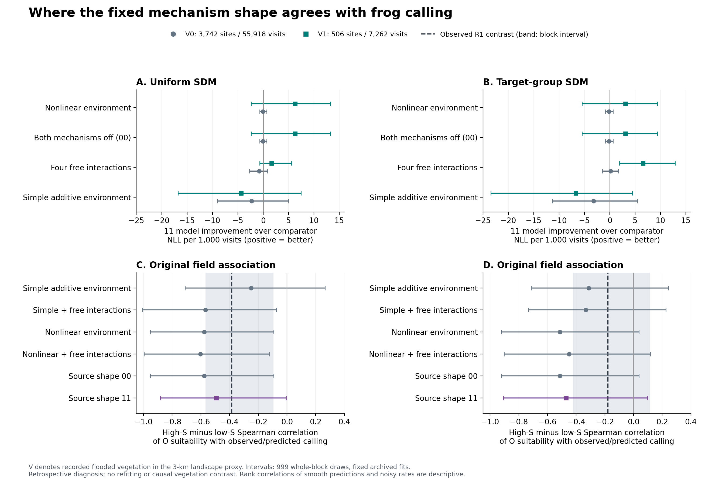

# 野外と機構の接続 G6：整合する条件を保存済み予測から特定

2026-11-06。**解析・独立再計算・全研究テスト完了。新しいモデル適合は0回。**

## 1. 今回の結論

元G5で見えた小さな予測改善の点推定は、**冠水植生が記録された506地点の側から生じていた**。植生の記録がない3,742地点では、機構11を加えた改善はほぼゼロか僅かに負だった。この方向は両SDM仕様で共通だった。

また、有尾類適合度の高低によるトンボ類適合度―強発声の相関差は、観測値でも機構11の予測値でも、植生ありの地点群で負の程度が弱まる方向だった。これにより、元の野外結果と機構由来の予測形状を、同じ条件付き相関統計量で照合できるようになった。

**到達点は、整合する文脈の位置を具体化したこと。** 植生群の改善区間と植生群間の差の区間はゼロを含む。単純な加法的環境モデルに対する予測優位性も得ていない。元G4の全8条件比較の未達、G5の両背景での頑健な予測改善の未達は保持する。

ここで機構11は、元モデルの「有尾類からカエルを保護する植生機能」と「ヤゴのカエル捕食を支援する植生機能」の両方を含む形状である。これらの機能を野外で測定したわけではない。

## 2. 植生条件ごとの予測改善

対象は元の4,248地点・63,180完了調査・36,554強発声記録・432ルート・56地理ブロック。G5の50,976地点×背景×候補の予測をそのまま使用し、モデル・係数・地域分割・三分位境界を変更していない。

主要比較は非線形共有環境モデル `flex_add` に対する `flex_prior_11` のNLL改善。値が正なら予測誤差が小さい。単位は1完了調査当たり。

| SDM仕様 | 植生なし：3,742地点・55,918調査 | 植生あり：506地点・7,262調査 |
|---|---:|---:|
| uniform | −0.0000239［−0.000664,+0.000700］ | **+0.0062684［−0.002351,+0.013237］** |
| target-group | −0.0001390［−0.000868,+0.000631］ | **+0.0030910［−0.005462,+0.009389］** |

全体の改善へ換算した植生あり群の寄与はuniform **+0.0007205**、target-group **+0.0003553**。植生なし群の僅かな負の寄与を合わせると、元G5の全体改善 **+0.0006994／+0.0002322** を再現する。各分割の寄与合計と元全体の差は最大8.7×10⁻¹⁹だった。

植生あり−なしの対応差はuniform **+0.006292［−0.002850,+0.013457］**、target-group **+0.003230［−0.005693,+0.009930］**。両区間はゼロを含む。

### 比較相手と有尾類条件による違い

- 両植生機能OFFの00形状との比較も、ほぼ同じ方向だった。
- 4つの自由交互作用を持つ `flex_all` との比較では、植生あり群の改善はuniform +0.001676［−0.000694,+0.005600］、target-group +0.006555［+0.001930,+0.012886］。後者の点別区間は正だが、多重比較調整を行わない事後診断であり、G5の主要判定を置き換えない。
- **単純な加法的環境モデル `env_add` との比較では植生あり・なしの両群で機構11のNLLが大きかった。** 植生あり群の改善差はuniform −0.004359、target-group −0.006683で、どちらも区間はゼロを含む。
- 植生ありを有尾類適合度の低・中・高に分けると、低・中群は両背景で改善方向だった。高群はuniform +0.001657、target-group −0.004738と方向が分かれ、両区間は広い。したがって、有尾類適合度が高い場所で特に機構が支持された、という結論にはしない。

全6候補、全4比較、両背景、全区分を[完全な集計表](results/g6_observation_context_20261106/G6_context_gains.csv)に保存した。

## 3. 元R1と同じ相関差を照合

各地点の観測強発声割合 `k/n` と、各候補の保存済み地域外予測確率に対し、同じ演算を行った。

> 有尾類適合度が高い三分位での Spearman(トンボ類適合度, 応答) − 低い三分位での同相関。

元の全域観測値はuniform **−0.384748716**、target-group **−0.178687937**を再現した。植生別の点推定は以下。

| SDM仕様・応答 | 植生なし | 植生あり |
|---|---:|---:|
| uniform・観測 | −0.5128 | **−0.1699** |
| uniform・機構11の予測 | −0.6839 | **−0.4328** |
| target-group・観測 | −0.2852 | **−0.0688** |
| target-group・機構11の予測 | −0.6911 | **−0.2876** |

**いずれも、植生ありで負の相関差が弱まる方向。** ただし植生あり群の観測区間はuniform［−0.3967,+0.2337］、target-group［−0.4242,+0.6533］と広い。また、単純な環境モデルも全地点の相関差を負方向に生成した（uniform −0.2494、target-group −0.3115）。したがって、このパターンだけで機構11を選別することはできない。

滑らかな予測確率と、訪問回数が有限の観測 `k/n` の順位相関は、同じ完全な予測分布を比較しているわけではない。ここでの照合は応答形の記述的な診断であり、相関差が最も近いモデルを採用する手続きではない。

元R1の区間はルート単位のbootstrap。G6の区間は保存済み予測に対応させた56地理ブロック単位のbootstrapであり、**元R1の区間や肯定結果を置き換えない**。[全42相関比較](results/g6_observation_context_20261106/G6_R1_observed_and_heldout_rank_contrasts.csv)

## 4. 比較の範囲と図



A–Bは観測された植生群ごとの予測改善、C–Dは全地点での元R1相関差の照合。誤差線は999回の対応する地理ブロック再標本化。Vは3 km景観で冠水植生が記録されたかを示し、池内の隠れ場機能そのものではない。

主要V区分と副次V×Sの全群は事前の支持数基準を満たした。全18セルを残す付録V×S×O集計では、両背景合計36セル中5セルが支持不足だった。支持不足セルは点推定と分母を残し、区間を示さない。主要V比較および相関診断の未定義bootstrap反復は0。細かい付録区分の未定義反復は各表に記録した。

G6はG5全体結果を確認した後に設計した**事後的な固定予測診断**。区間は各比較に対するもので、多重比較、モデル再適合、SDMや生物学的パラメータの不確実性を含まない。V0でも機構11と00の予測が異なり得るのは、G5で観測係数と環境係数を別々に推定しているためである。V群間の性能差は植生介入の効果ではない。

## 5. 検証・再現・原稿への接続

### 完了した検証

- 元G4・G5の入力と野外入力をSHA256で照合。
- 新規20テストは未実装時の失敗を確認してから実装し、20/20成功。
- 研究スクリプト全体のテストは**177/177成功**。初回は既存3モジュールの`rasterio`不足で読み込みエラーとなり、元の依存バージョンrasterio 1.4.4・shapely 2.1.2を導入後に全体を再実行した。
- 元G5の全12スコアを独立に再加算。NLL最大差2.2×10⁻¹⁶、Brier最大差1.1×10⁻¹⁶。
- 別実装による独立確認でも、24損失差、24寄与、全42相関差が数値精度内で一致。主要比較の区間12端点も最大8.5×10⁻¹⁷以内で一致。
- 図を生成し、ラベル・誤差線・凡例・単位を目視確認。
- 同梱した元G4/G5ファイルだけを使って別ディレクトリに再集計し、全8集計・監査表が完全一致することを確認。

[再現receipt](results/g6_observation_context_20261106/G6_source_and_replay_receipt.json)／[コード](scripts/run_g6_observation_context_diagnostic.py)／[診断仕様](G6_OBSERVATION_CONTEXT_DIAGNOSTIC_PROTOCOL_2026-11-06.md)

### 再現コマンド

原G4/G5の必要ファイルを`source/`へ原本のまま保存したため、Actions artifactの保存期限に依存せず再集計できる。

```bash
python research/scripts/run_g6_observation_context_diagnostic.py \
  --sites research/results/naamp_remote_vegetation_20261026/primary_site_landscape_context.csv.gz \
  --g4-dir research/results/g6_observation_context_20261106/source \
  --g5-dir research/results/g6_observation_context_20261106/source \
  --out /tmp/frogcs_g6_replay

python research/scripts/plot_g6_observation_context_diagnostic.py \
  --results /tmp/frogcs_g6_replay
```

依存：numpy、pandas、matplotlib。新規テストではscipyも使用。元G5の学習コードや80年生物シミュレーションを再実行する必要はない。

### 原稿へ組み込む結果文

> A retrospective decomposition of the frozen out-of-block predictions localized the positive point improvements to the 506 locations with recorded landscape flooded vegetation. Relative to the nonlinear environmental baseline, NLL gains per visit were 0.00627 and 0.00309 under the uniform and target-group specifications, compared with −0.000024 and −0.000139 at the remaining 3,742 locations. Both vegetation-specific intervals and the between-context differences overlapped zero. Observed and source-constrained predicted third-guild correlation contrasts also became less negative in vegetated contexts, although environmental alternatives generated the pooled conditional pattern and the simple additive baseline retained lower prediction error. This diagnostic locates directional agreement in a relevant habitat context without selecting a natural predator pathway.

組込先はP1を含む[PR165の原稿](https://github.com/zuizui0223/frogcs/blob/ac53197127bb1196589b09f1d49038fad66f8dc5/editorial/MAIN_TEXT_R1_R4_SUBMISSION_CANDIDATE_2026-11-05.md)。今回の出発点PR166に含まれる同名原稿はP1節・第4図を含まない前の版を基にG4/G5を追記しているため、今後の統合では**PR165のP1本文を保持してG4/G5/G6を追加する**。この診断では既存原稿や生物カーネルを上書きしていない。

## 状態

G6の解析・原本再現・図・結果文まで完了。診断はG4/G5の保存済み予測に条件付けられた事後解析であり、独立した新規野外検証ではない。機構を有意化するための再適合や、未取得の野外段階データを埋める解析は行っていない。
