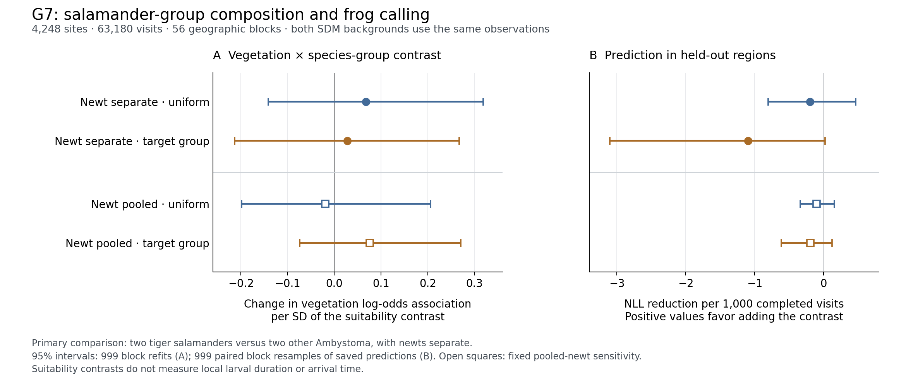

# G7 完了：種群と植生の関連は正方向だが、区間と地域外予測では支持されなかった

**2026年11月6日。** 予定した追加比較を実行し、本文・補足Methods S3e・補足表S3f・補足図S2へ統合した。解析後の群分け、種の除外、罰則や説明変数の変更は行っていない。[統合原稿](../editorial/MAIN_TEXT_R1_R4_SUBMISSION_CANDIDATE_2026-11-05.md) と [Supplement](../editorial/SUPPLEMENTARY_METHODS_AND_EVIDENCE_R1_R4_2026-11-05.md) を更新済み。投稿は未実施。

## 1. 結果を見る前に修正した生物学的前提

文献上、トラフサンショウウオ類を一律に「幼生期間が長い群」、他の3種を「短い群」とする順序は成立しない。通常の期間は重なり、*A. maculatum* にも幼生越冬がある。*Notophthalmus viridescens* は水生の成体を持ち、亜種・水文条件によって発育経路も異なる。原典と公的種別解説の役割は [固定した5種の根拠表](g7_trait_evidence_20261106.csv) と [文献表](../editorial/REFERENCES_R1_R4_P1_G6_2026-11-06.md) に区別して記録した。

主解析は、トラフ類2種（*A. mavortium*, *A. tigrinum*）と他の *Ambystoma* 2種（*A. maculatum*, *A. laterale*）を比べ、イモリは独立の説明変数にした。提案されたトラフ類2種対その他3種も、固定した補助比較として実行した。どちらも**生活史を手掛かりにした種群比較**であり、地点ごとの幼生期間や加入順序の測定ではない。

[仕様](G7_TRAIT_INFORMED_COMPOSITION_PROTOCOL_2026-11-06.md) は新しい係数を見る前のローカルコミット `21fda6b3f8155a0eb8583fd0f70ef43a36874c0e`、コードとテストは実解析前の `be77b4c4` に固定した。同じNAAMPコホートの既知の結果から動機付けられた追加比較であり、研究全体の外部事前登録や独立な野外再現とは呼ばない。

## 2. 固定した比較と全結果

元の種別SDMを再学習せず、全4,248地点・63,180完了調査・56地理ブロックを保持した。5種×2背景×4,248地点の **42,480予測**は欠損なくそろい、元の5種平均を再現した。主比較の8支持セルはすべて基準を満たし、最小でも95地点だった。説明変数の線形従属による推定不能も認められなかった。

主係数thetaは、総 *Ambystoma* 適合度、イモリ適合度、トンボ、環境・地理・調査条件を調整したうえで、**トラフ類に相対的に適した環境ほど、植生と強いコーラスの関連が正に変わるか**を表す。正負を制約せずに推定した。単位は、種群適合度差が1 SD増えたときの植生の対数オッズ関連の変化。

| 固定比較 | 背景 | theta［95%区間］ | 地域外NLL改善／調査［95%区間］ |
|---|---|---:|---:|
| 主解析：イモリを別扱い | uniform | +0.067231［−0.141540, +0.319074］ | −0.000196［−0.000808, +0.000462］ |
| 主解析：イモリを別扱い | target-group | +0.027857［−0.213863, +0.267340］ | −0.001100［−0.003103, +0.000018］ |
| 補助：イモリをその他群へ | uniform | −0.019090［−0.198648, +0.206300］ | −0.000100［−0.000338, +0.000155］ |
| 補助：イモリをその他群へ | target-group | +0.076141［−0.074078, +0.270673］ | −0.000195［−0.000612, +0.000122］ |

係数区間は999回の地理ブロック再抽出と**再推定**による。4比較で同じ再抽出を使い、全 **3,996回の再推定**が収束した。NLLは「当該交互作用を除いたモデルの損失−加えたモデルの損失」で、正が予測改善。元の5分割で学習と評価を分け、保存した地域外予測を56ブロックで999回再抽出した区間である。全40学習モデルが収束した。二つの背景は同じ音声記録を使う感度分析であり、独立な標本ではない。

主解析の点推定は両背景で正だったが、区間は広くゼロを含んだ。地域外NLLの点推定は両方とも改善せず、補助比較も判定を変えなかった。**固定した正の関連の基準、予測改善の基準はともに未達。** 元の単純な環境モデルも、新しい主解析モデルより低いNLLを維持した。



[係数原表](results/g7_trait_composition_20261106/G7_coefficient_summary.csv)・[予測差原表](results/g7_trait_composition_20261106/G7_heldout_paired_gains.csv)・[全予測スコア](results/g7_trait_composition_20261106/G7_heldout_scores.csv)。図Bだけは読みやすさのためNLLを1,000調査当たりへ換算した。

## 3. 論文で言えることと停止判断

G7は種群の違いで野外との接続を具体化したが、提案された正の植生関連を確立する結果にはならなかった。種群差の86.7%／91.8%は地理ブロック間の変動であり、適合度は実際の幼生期間・個体数・加入順序と同じではない。したがってP1の「早い加入と長い水中期間がそろうと反転する」という操作実験の直接検証でも、反証でもない。

既存の肯定結果は維持する。同一256構造で植生の二つの働きが四符号の成立を3.52%から14.06%へ増やしたこと、発育条件で個体数への効果が反転したこと、符号の成立・個体数・長期占有が一致しないことが主線である。G4〜G6の方向的な対応と未達の判定も変更しない。**予定した追加比較は完了し、結果に応じて群分けや検定を増やさない。**

Abstractの難解な語句は次に変更した：

> Adding a fixed model-derived pattern slightly improved predictions at sites with flooded vegetation, but gains were uncertain and a simpler environmental model predicted calls more accurately.

改訂本文は4,981語、Abstractは133語。主要4図を維持し、G7は補足図S2とした。これらは語数の実測であり、共著者承認や実際の投稿完了を意味しない。

## 4. 再現と検証

[実行記録](results/g7_trait_composition_20261106/G7_execution_receipt.json) と [独立検証](results/g7_trait_composition_20261106/G7_independent_validation.json) に詳細を記録した。元の16出力と3入力のハッシュは一致し、4係数区間、8予測スコア、4予測差を独立に再計算した。別の最適化法による主係数の再推定誤差は最大4.4×10⁻¹²。研究コード全体は192テストが成功した。

```bash
OPENBLAS_NUM_THREADS=1 OMP_NUM_THREADS=1 python -u research/scripts/g7_trait_composition_bridge.py \
  --protocol research/G7_TRAIT_INFORMED_COMPOSITION_PROTOCOL_2026-11-06.md \
  --out /tmp/frogcs_g7_replay
python research/scripts/plot_g7_trait_composition_bridge.py --results /tmp/frogcs_g7_replay
```

予測表の`candidate`列には文字列`null`があるため、Pythonで読む場合は `pd.read_csv(path, keep_default_na=False)` とする。元の保存値と計算は正しく、読み込み時の欠損値変換に注意が必要。過去の結果を上書きせず、別の出力先で再現する。
