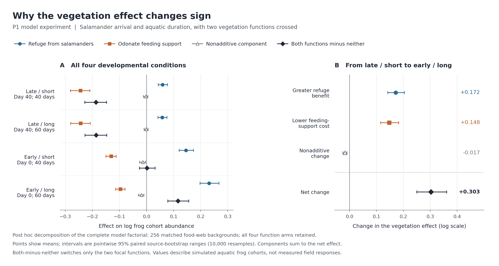

# 植生がカエルに有利になる条件：加入時期・水中期間と二つの機能

**2026-11-06｜P1の全256食物網・全4発育条件・全4植生処理を使った追加集計。**

## 1. 主結果と、今回新しく分かった内訳

**このモデル群では、有尾類が早く加入して長く水中に残ると、カエルを保護する利益が大きくなり、ヤゴの捕食を支援する不利益が小さくなる。その二つが重なり、植生二機能の純効果が負から正へ反転する。**

P1の純粋な加入×水中期間実験は既に完了していた。今回新しく行ったのは、その全出力の**事後的な要因分解と、背景ごとの符号遷移の集計**である。新たな生物学的シミュレーションや独立野外検証を実行したとは扱わない。G7の不支持判定は変更していない。

全4,096シナリオを保持した分解結果は次のとおり。各値は平均log水中カエルコホート量への効果で、カエル保護だけ・ヤゴ捕食支援だけ・非加法成分の和が、二機能を両方ONにした純効果と厳密に一致する。

| 有尾類の加入・水中期間 | カエル保護だけの効果 | ヤゴ捕食支援だけの効果 | 非加法成分 | 二機能の純効果 |
|---|---:|---:|---:|---:|
| 遅い・短い LS | +0.0593 | −0.2435 | −0.0023 | **−0.1864** |
| 遅い・長い LL | +0.0580 | −0.2431 | −0.0009 | **−0.1860** |
| 早い・短い ES | +0.1458 | −0.1303 | −0.0135 | **+0.0021** |
| 早い・長い EL | +0.2312 | −0.0959 | −0.0190 | **+0.1163** |

元P1の純効果の95%区間は、LS **[−0.2266, −0.1464]**、LL **[−0.2271, −0.1463]**、ES **[−0.0264, +0.0317]**、EL **[+0.0787, +0.1560]**。早い加入だけでは平均効果がほぼゼロになる段階で、長い水中期間が加わる条件で平均の利益が明確になる。[元P1の全結果](P1_PURE_ARRIVAL_DURATION_TRUE80_VERIFIED_RESULT_2026-11-05.md)と区間はそのまま保持した。

遅い・短い条件から早い・長い条件への純効果の変化 **+0.3028** は、次の三成分に分かれる。

| 反転への寄与 | 効果 | 今回の対応する背景再抽出95%区間 |
|---|---:|---:|
| カエル保護の利益が増える | **+0.1719** | **+0.1422 ～ +0.2042** |
| ヤゴ捕食支援の不利益が小さくなる | **+0.1476** | **+0.1157 ～ +0.1829** |
| 非加法成分の変化 | −0.0167 | −0.0248 ～ −0.0093 |
| **合計** | **+0.3028** | **+0.2500 ～ +0.3612** |

非加法成分は反転を少し弱める側に働く。保護利益の増大と捕食支援コストの縮小が、正の変化の中心である。ここでいう成分は、人口学的フィードバックを含む各機能の操作差で、野外の直接捕食死亡を分配した割合ではない。



## 2. 平均だけでなく、124構造で実際に不利益から利益へ反転した

| 発育条件 | 純効果が正 | 純効果が負 | ゼロ |
|---|---:|---:|---:|
| LS：遅い・短い | 59/256 | 197/256 | 0 |
| LL：遅い・長い | 59/256 | 197/256 | 0 |
| ES：早い・短い | 124/256 | 132/256 | 0 |
| EL：早い・長い | **183/256** | 73/256 | 0 |

LSからELへ変えると、**124/256構造（48.4%）が負から正へ反転し、正から負へ反転した構造は0**だった。59構造は両条件で正、73構造は両条件で負だった。効果が正方向へ動いた構造は246/256（96.1%）だが、この数は正負反転した構造数とは異なる。

したがって、平均の反転は少数の極端な構造だけによるものではない。一方、ELでも73構造は負であり、全ての食物網で利益になるとはいえない。これらの割合は調べた合成モデル群内の記述値で、現実の池における頻度ではない。[背景別の全符号遷移](results/p1_vegetation_benefit_20261106/p1_background_sign_transitions.csv)を保存した。

## 3. 既存の肯定結果とつながる

**野外の条件付き相関（R1）：** 4,248地点・63,180調査で、有尾類適合度が高い場所と低い場所の「トンボ適合度―強い発声」の相関差は、uniform **−0.385 [−0.509, −0.240]**、target-group **−0.179 [−0.328, −0.029]**。これは広域の相関の肯定結果であり、自然の捕食機構を同定した結果ではない。[元結果](results/naamp_odonata_caudata_associations_20261026/high_low_contrasts.csv)。

**植生二機能の組合せ（R2）：** 同一256構造×3発育条件で、4符号成立率は両OFF **27/768（3.52%）**から両ON **108/768（14.06%）**へ増加した。対応差は **+10.55ポイント [7.68, 13.67]**、非加法効果は **+4.04ポイント [0.91, 7.29]**。この符号生成への非加法効果と、上記の個体群量への非加法成分は別の応答量である。[元の全比較](results/submission_frozen_sources_20261106/R3/paired_2x2_source_background_95MC.csv)。

**長期人口学（R4）：** 早い加入・長い水中期間に対応する元context2では、次の条件付き利益が既に成立していた。これは今回新しく選んだ条件設定ではなく、事前指定された発育条件×q×移動の全比較の一部である。

| context2の条件 | 年80の占有パッチ数差［95%区間］ | 最後20年の平均個体数差［95%区間］ |
|---|---:|---:|
| q3・移動OFF | **+0.197 [0.047, 0.344]** | **+2.12 [0.59, 3.63]** |
| q3・移動ON | **+0.195 [0.037, 0.354]** | **+1.91 [0.36, 3.46]** |
| q12・移動OFF | 0.000 [−0.035, 0.037] | +6.34 [−0.69, 13.21] |
| q12・移動ON | **+0.031 [0.004, 0.061]** | **+8.96 [2.03, 15.71]** |

占有・個体数は人工8パッチ全体のモデル値で、qは仮定した個体数換算尺度。q12では占有が飽和に近い。発育条件を平均した植生効果は占有では不確実、個体数では負だったことも保持する。R4の元発育条件は複数の時期・期間を同時に変えるため、加入と水中期間の独立寄与を占有で分離した実験ではない。[全発育条件・全q・全移動の元結果](results/submission_frozen_sources_20261106/R4/R4_full_256_model_2x2_occupancy_and_events.csv)／[事前仕様](NEWSEED_2X2_FINITE_N_R4_PREDECLARED_PROTOCOL_2026-11-02.md)。

## 4. 解析の範囲・再現

今回の応答は、80年間の最後20年で平均した水中カエルコホート量について、植生×有尾類供給×ヤゴ供給の8格子にわたり等重みで平均した自然対数である。植生なしの4格子では介入差がゼロ。**00は二つの焦点機能OFFであり、植生なしという意味ではない。** 対数量の差を現実のカエル個体数の増加率へ置き換えない。

率は元のattack=0.5・局所加入割合=0.75を保持した。この率領域は過去の探索で選ばれた条件である。背景再抽出10,000回・seed20261126の同じインデックスを、全条件・全成分・全調節効果に適用した。32対比の全平均・点ごとの95%区間を保存しており、新たな確認的p値や野外信頼区間とは扱わない。

全32,768頂点から4,096シナリオの応答を再構築し、分解の恒等式・植生なしの対照・元P1の平均との一致を確認した。全背景を保持し、結果を理由とする除外は0件。元のP1区間を保存した別表と、今回の共通再抽出による新区間を区別している。

```bash
python -m unittest discover -s research/scripts -p test_p1_vegetation_benefit_decomposition.py
python research/scripts/p1_vegetation_benefit_decomposition.py
python research/scripts/plot_p1_vegetation_benefit_decomposition.py
```

- [解析計画・事後解析としての位置付け](P1_VEGETATION_BENEFIT_DECOMPOSITION_PLAN_2026-11-06.md)
- [再現スクリプト](scripts/p1_vegetation_benefit_decomposition.py)
- [全32対比](results/p1_vegetation_benefit_20261106/p1_decomposition_summary.csv)／[全1,024背景×条件の分解](results/p1_vegetation_benefit_20261106/p1_all_256_background_decompositions.csv)
- [入力ハッシュ・実行記録](results/p1_vegetation_benefit_20261106/p1_decomposition_receipt.json)／[独立再計算](results/p1_vegetation_benefit_20261106/p1_independent_validation.json)
- [肯定機構を中心に改訂した本文](../editorial/MAIN_TEXT_R1_R4_SUBMISSION_CANDIDATE_2026-11-05.md)／[補足Methods S8b](../editorial/SUPPLEMENTARY_METHODS_AND_EVIDENCE_R1_R4_2026-11-05.md)
