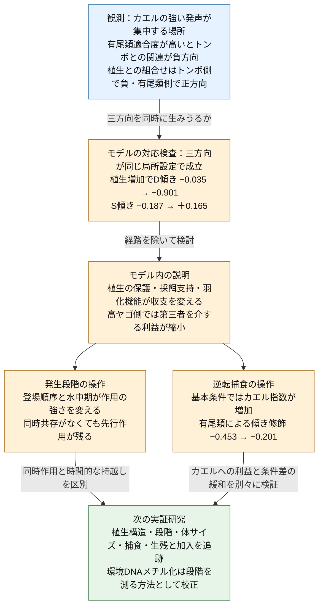

# 論文のストーリー・考察・結論

2026年10月27日改稿。固定済みマクロ解析と保存済みモデル結果を統合。新しい解析結果を追加した改稿ではない。

## 論文を貫く流れ

1. **発見する：** カエルの強い発声の集中を起点に、有尾類と植生によってトンボ類との関連が変わる三方向を記述する。
2. **解釈する：** 同じモデル設定で三方向を生成できるかを先に問い、成立した局所条件の経路除去から、植生と第三者が利益と害を変える仕組みを検討する。
3. **予測する：** 発生段階と逆転捕食を操作し、段階の同時重複、先行作用の持越し、後年への利益を区別する。次の実証研究で測る構造利用・段階・捕食・生残・加入を導く。

論文の中心命題：**繁殖活動の集中を理解するには、植生が誰を保護し、誰の利用を支え、第三者を介する利益をいつ変えるかを考える必要がある。**

## 統合考察

本研究をつなぐ結果は、マクロ解析で見られた三方向、すなわち有尾類条件に伴うトンボ関連の負方向への変化と、植生に伴うトンボ側の負方向・有尾類側の正方向への変化が、モデルの同じ局所設定で生じたことである。植生0から1への対応比較では、D傾きが−0.035から−0.901、S傾きが−0.187から+0.165へ変わった。これにより、植生が誰を保護し、誰の利用機会を支えるかという仮定を、三つの結果を同時に生む説明として検討できる。以下では、その説明を捕食者間の利益と害、植生の複数機能、相互作用の時間配置の順に考察する。

### 繁殖活動の集中を、第三者を含む生物的環境から理解する

本研究では、カエルの強い発声の頻度とトンボ類の生息適合度との関連が、池性有尾類と植生の条件によって異なった。これは、繁殖活動の集中を特徴づける生物的環境が、カエルと一種類の捕食者との関係だけでは要約できないことを示す。特に、有尾類適合度が高い地点でトンボ類との負の関連が強まった結果は、第三者が直接作用と間接作用の収支を変えるという観点から解釈できる。

有尾類はカエル幼生の捕食者となる一方、ヤゴへの捕食を通じてカエルに間接的な利益を与えうる。逆に、ヤゴが有尾類の活動を抑えることでもカエルへの利益が生じうる。後者には、ヤゴの危険情報がサンショウウオ幼生の活動と捕食形態を抑制し、オタマジャクシの死亡を減らした実験的先例がある（Kishida et al. 2009）。したがって、有尾類が多いこともヤゴが多いことも、それぞれ一方向の捕食圧に置き換えることはできない。

本研究の複数年モデルでは、高いヤゴ供給側の探索的な範囲に、観測と同方向の関係を生む条件が存在した。全植生機能を含む例では、有尾類供給の増加に伴うカエル繁殖指数の差が、ヤゴ供給1では約+0.289、供給2では約+0.088となった。すなわち、カエルにとっての利益が高ヤゴ側で縮小することで、有尾類の多い系ほどヤゴ勾配に沿った減少が急になった。この関係は捕食者間捕食または行動抑制を除くと消えた。観測された負の条件差の説明候補として、捕食者の害が単純に加算される仕組みに加え、捕食者間作用から生じる利益が維持されなくなる仕組みを考える必要がある。

### 植生は、捕食者ごとに異なる接触と避難の条件を作る

マクロ解析では、トンボ類×植生が負、有尾類×植生が正方向という非対称な関連が見られた。この結果を理解するうえで重要なのは、植生をカエルに一律の安全性を与える環境として扱わず、誰と誰の遭遇を変える構造なのかを問うことである。

先行実験は、避難場所の利用が捕食者によって異なる結果をもたらすことを示している。Davenport and Chalcraft（2013）では、ヤゴの危険情報に応じてオタマジャクシが落葉下を利用し、成体イモリの採餌効率が低下した。この実験は落葉量を変えていないが、共通の構造内での場所利用が、別の捕食者との接触を変える機構を示している。一方、Hossie and Murray（2010）は、落葉量の操作によってヤゴのオタマジャクシに対する機能的反応がII型からIII型へ変わることを示した。構造の作用は、捕食を一様に増減させるのではなく、餌密度に対して捕食がどう変化するかにも及ぶ。

植生は捕食者にも利用される。水生無脊椎動物の実験では、人工植生の追加により、植物上で採餌する捕食者の浮遊性の餌への捕食圧が増す一方、底生の餌の死亡は減少した（Klečka & Boukal 2014）。これは、構造の効果が捕食者と餌の微小生息場所の組合せに依存することを示す。本研究の負のトンボ類×植生の関連も、植生がカエルへの保護とトンボ側の利用機会を同時に変える可能性として解釈できる。ここで想定するのは、植生が常にヤゴの捕食率を高めるという一般則ではなく、保護と捕食機会の相対的な変化である。

### 植生は第三者を介する利益の大きさも変える

植生構造の効果は、カエルとヤゴの接触だけで完結しない。Anderson and Semlitsch（2016）は、二種のサンショウウオ幼生に対する上位捕食者と垂直構造の操作から、構造の主効果が小さくても、捕食者の組合せと中間捕食者の生残を含む関係が、もう一方の幼生の生残に関わることを示した。この先例は、植生の役割を植生量の主効果だけで評価できないことを示している。

今回のモデルでも、植生機能を個別に除去すると、同じヤゴ・有尾類供給条件の帰結が変わった。観測と同方向の局所パターンは、カエルの隠れ場、ヤゴの採餌支持、羽化関連機能のいずれかを外すと消えた一方、有尾類をヤゴから保護する機能を外しても残った。したがって、この条件を「植生が有尾類を保護したため」と説明するよりも、カエルへの非対称な保護とトンボ側を支える機能が組み合わさり、第三者を介する利益と直接的な害の釣り合いを変えたと解釈する方が、結果に即している。

この解釈では、正の有尾類×植生係数を、そのまま有尾類によるカエルへの利益と読む必要はない。観測の非対称な係数は、捕食者ごとに異なる構造利用を検討する根拠となり、モデルの機能除去は、そのような非対称性から関係が変わりうることを示す。景観の冠水植生被覆と池内の隠れ場構造の対応は、今後の局所観測で確かめる対象となる。

### 羽化を支える植生が、水中での作用を後の段階へつなぐ

植生の役割は、水中での捕食回避や採餌にとどまらない。Grof-Tisza et al.（2017）は、植物構造がトンボの羽化場所としての利用に関わることを示した。羽化場所選択と捕食回避は区別する必要があり、固定した餌を用いた鳥による除去実験では、植物の機械的防御の効果が認められた一方、構造複雑性の効果は認められなかった。この結果は、植物のどの形質がどの過程を支えるかを分ける必要を示す。

本研究のモデルでは、羽化・変態完了を後年の加入につなぐことで、植生の作用が当季の生残だけでなく、後の捕食者との関係にも及びうることを示した。羽化関連機能を外すと局所パターンが消えた結果は、植生を隠れ場だけとして捉える説明では不十分であることを示唆する。ただし、実装した羽化関連機能は羽化失敗の低下と変態後カエルとの接触増加を含む複合操作である。先行文献が実測した羽化場所利用から、当該池の翌季のヤゴ加入までを実証済みの連鎖として扱わず、今回のモデルが検討した接続として位置付ける。

### 発生段階は作用の時間配置を変え、逆転捕食は利益の返り方を変える

時期とサイズ依存性の操作は、局所パターンの符号が発生段階のずれに固有ではないことを示した。一方、その強さは段階の出現と終了の配置で変化した。有尾類が水中から去った後にカエルが現れる設定でも、有尾類が先にヤゴへ及ぼした作用を通して関係が残った。繁殖活動の集中を理解する際には、現在同時に存在する生物だけでなく、先行する相互作用が残す条件にも注目する必要がある。

逆転捕食も、この時間的な接続の一部である。基本の局所条件では、変態後カエルによる羽化中トンボの捕食がカエル繁殖指数を増加させ、有尾類の低供給・高供給間の傾きの差を縮めた。これはカエルへの利益と第三者による修飾の変化を示すが、ヤゴ勾配の負の傾き自体が一律に緩和されたことを意味しない。逆転捕食はその局所パターンの必要条件ではなく、発生時期によって利益の大きさと群間の差を変える作用として理解できる。

### 広域の関連から機構の成立条件へ

二つの解析は、異なる側面から同じ生態学的な問いを扱う。マクロ解析は、繁殖活動の集中が第三者と植生の文脈に応じてどう異なるかを示した。モデルは、その文脈依存性を生みうる機構と成立条件を具体化した。供給の全範囲では三方向の同時一致は得られず、同時一致は高ヤゴ供給側の探索的な区間で現れたため、広域パターン全体の再現ではなく、機構的な可能性の検証として位置付ける。

発声は成体の繁殖活動、適合度は環境ニッチへの近さ、景観植生は周辺の被覆を表す。幼生期の作用が発声集中へつながるには、生残・加入を経て繁殖集団へ返る経路、または成体の場所利用へつながる経路が必要となる。本研究はこの接続を動機として、植生と第三者が利益と害を組み替える仕組みを提示した。個々の係数を特定の捕食経路へ直結させず、観測された関連と経路操作の結果を対応させることで、生態学的な考察を検証可能な説明へ進めている。

### 次の実証研究では、構造利用と段階の時間配置を測る

この説明から、次に測るべき対象は三群の存在だけでなく、植生内での接触、各段階が現れる順序、その後の生残と加入となる。第一に、強い発声地点と環境の似た弱い発声・無発声地点で、発声、産卵、幼生加入を時系列で記録する。鳴き声の集中が、その後の幼生段階の集中や生残につながるかを確かめ、成体の場所利用と幼生期の作用を区別する。過去の利用、水位・水域持続期間も併せて測る。

第二に、水中の隠れ場と羽化を支える水面上の構造を分け、三群の体サイズ・発生段階・活動とともに調べる。モデルからは、カエルを有尾類から保護しつつヤゴの利用も支える条件で、二つの捕食者群との関連が異なる方向へ動くという予測が得られる。有尾類とカエルが同時にいなくても、先行する有尾類がヤゴ密度や活動を変えていれば後のカエルに影響しうる。同時共存と先行作用を分けた投入時期の操作は、単なる種の共存記録より直接的な検証になる。

第三に、変態後カエルと羽化中トンボの重なり、実際の捕食、羽化生残、翌季のヤゴ加入を追う。基本の局所モデルは逆転捕食によるカエル指数の増加と有尾類条件間の傾き差の縮小を予測するが、時期を揃えた条件では修飾がわずかに強まる場合もある。したがって、カエルの生残・加入が増えるかと、有尾類による条件差が緩むかを別々の応答として検証する必要がある。

環境DNAメチル化は、この段階の時間配置を水から捉えるための方法開発に位置付ける。形態で判定した段階と飼育水を対応づけ、独立水槽・家系で検証した後、既知の段階混合物と野外試料へ進む。日齢、体サイズ、発生段階を別に記録し、水中DNAの混合比を個体の段階比と同一視しない。三群の混合池水から段階組成を推定する方法は本研究では検証していないため、まず測定法を校正し、卵塊・幼生・羽化殻や生残の直接観測と併用する。これにより、マクロで見つけた関連を、いつ誰が誰に作用するかという実証可能な問いへ進められる。

## 結論

カエルの繁殖活動の集中は、トンボ類との関連が池性有尾類と植生の文脈によって変わることで特徴づけられた。段階構造モデルでは、その三方向が同じ局所設定で生じ、植生による非対称な保護と採餌・羽化機能が、捕食者間作用を通じた利益と直接的な害の収支を変えるという解釈が得られた。有尾類による負の修飾は、高ヤゴ側で第三者を介する利益が縮むことでも生じた。

発生段階の時間配置はこの作用の強さを変え、先行する相互作用の影響を後のカエルへ持ち越した。逆転捕食は基本の局所条件でカエルに利益を返し、有尾類条件間の傾き差を縮めた。したがって、本研究が提示するのは、観測された関係を生みうる仕組みと、その帰結を変える生活史上の条件である。次の実証研究では、植生の機能別利用、三群の段階構成、羽化・変態から加入への接続を測り、繁殖シグナルの集中と相互作用の収支を結ぶ経路を検証する。

## 図構成と本文への配置

図中の矢印は研究の推論順序を示す。青は観測された関連、橙はモデル内の結果・解釈、緑は未実施の実証課題である。モデルの数値は規格化供給量に対する傾きで、観測の回帰係数とは異なる。三方向一致は高ヤゴ供給側の局所比較であり、全範囲やマクロの三者回帰項までの一致ではない。逆転捕食の緩和は有尾類条件間の傾き差に関する結果である。

図1は発声頻度とトンボ類適合度の関連を有尾類条件別に示す。図2は植生を含む条件付き関連と区間を示す。図3はモデルの経路図と、同じ設定から得た三方向の対応比較を示す。図4は経路除去、段階の時間配置、逆転捕食によるカエル指数と傾き修飾の変化を示す。全供給範囲、全設定と感度、利用履歴、水面、INBOの補助解析は補助図表にまとめる。

## 執筆用の出典対応

本文の二部構成は最新の研究方向に沿う原稿案であり、投稿形式・引用文献一覧を完成させた稿ではない。文献に基づく個々の捕食・植生経路の引用は、既存の一次文献監査から方法・序論へ配置する。

| 内容 | 保存済み根拠 |
|---|---|
| 背景と新規性、近接する先行研究 | CALLING_HIERARCHY_NOVELTY_2026-10-26.md、NOVELTY_MECHANISM_PRIMARY_AUDIT_2026-10-26.md |
| 符号付き因果経路とモデル・文献の区別 | CAUDATE_VEGETATION_MECHANISTIC_DISCUSSION_2026-10-26.md、CAUDATE_VEGETATION_PATH_AUDIT_2026-10-26.md |
| マクロ解析の解釈と一次文献 | THREE_GUILD_VEGETATION_DISCUSSION_V1_2026-10-26.md、VEGETATION_THREE_GUILD_PRIMARY_EVIDENCE_2026-10-26.md |
| 適合度の層別相関 | ../results/naamp_odonata_caudata_associations_20261026/stratified_correlations.csv |
| 植生の交互作用 | ../results/naamp_remote_vegetation_20261026/network_rank_coefficients.csv |
| 幼生と後年の発声 | PRIOR_LARVAE_CHORUS_RESULTS_2026-10-26.md |
| 三方向の同時一致と全範囲の比較 | JOINT_VEGETATION_PATTERN_CHECK_2026-10-27.md、../results/joint_vegetation_20261027/ |
| 外部供給勾配と経路除去 | SOURCE_GRADIENT_RESULTS_2026-10-26.md |
| 時間配置・逆転捕食の操作 | STAGE_TIMING_AND_EDNAM_RESEARCH_2026-10-26.md |
| 次の実証研究とメチル化の測定上の課題 | EDNA_METHYLATION_STAGE_FEASIBILITY_2026-10-26.md |
| 季節内モデル | STAGE_VEGETATION_SIMULATION_REPORT_2026-10-26.md |
| 複数年モデルと感度 | MULTIYEAR_STAGE_NETWORK_RESULTS_2026-10-26.md、../results/multiyear_stage_network_20261026/ |

方法の完全な設定、全結果、再現手順は各解析文書を参照する。元のマクロ解析の固定結果は変更していない。

## 引用文献（統合考察）

- Anderson, T. L. & Semlitsch, R. D. (2016). Top predators and habitat complexity alter an intraguild predation module in pond communities. *Journal of Animal Ecology*, 85, 548–558. https://doi.org/10.1111/1365-2656.12462
- Davenport, J. M. & Chalcraft, D. R. (2013). Nonconsumptive effects in a multiple predator system reduce the foraging efficiency of a keystone predator. *Ecology and Evolution*, 3, 3063–3072. https://doi.org/10.1002/ece3.691
- Grof-Tisza, P., LoPresti, E., Heath, S. K. & Karban, R. (2017). Plant structural complexity and mechanical defenses mediate predator–prey interactions in an odonate–bird system. *Ecology and Evolution*, 7, 1650–1659. https://doi.org/10.1002/ece3.2705
- Hossie, T. J. & Murray, D. L. (2010). You can't run but you can hide: refuge use in frog tadpoles elicits density-dependent predation by dragonfly larvae. *Oecologia*, 163, 395–404. https://doi.org/10.1007/s00442-010-1568-6
- Kishida, O., Trussell, G. C. & Nishimura, K. (2009). Top-down effects on antagonistic inducible defense and offense. *Ecology*, 90, 1217–1226. https://doi.org/10.1890/08-0238.1
- Klečka, J. & Boukal, D. S. (2014). The effect of habitat structure on prey mortality depends on predator and prey microhabitat use. *Oecologia*, 176, 183–191. https://doi.org/10.1007/s00442-014-3007-6
