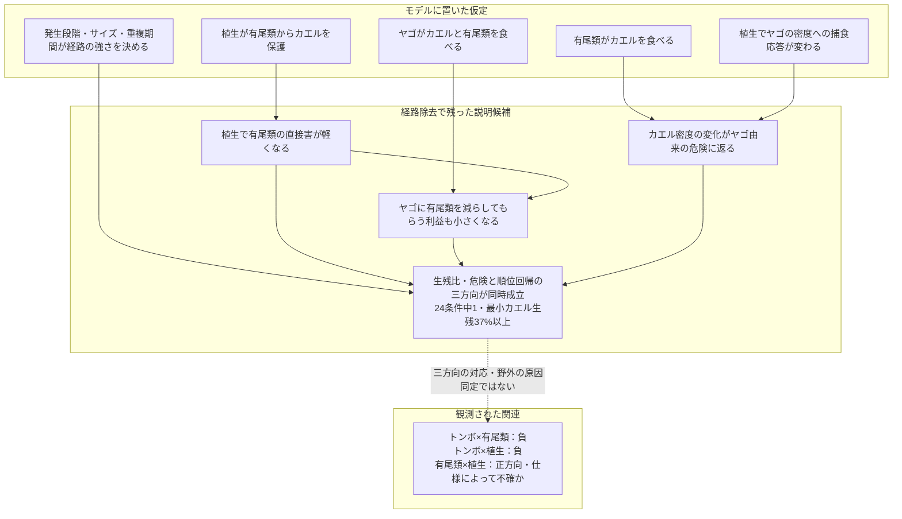

# 論文のストーリー・考察・結論

2026-10-27最終機構比較に基づく改稿。以前の救済経路中心の説明を固定せず、条件付き再現とマクロ形式の再現を区別する。

## ストーリー

カエルの発声集中を出発点に、トンボ類と有尾類の適合度・景観植生の三方向の関連を記述した。3,600構成の機構探索後、20候補を共通24条件で比較した。暫定的な第一検証候補は相手別保護・ヤゴによる有尾類捕食・植生に応じた密度依存的捕食の組合せである。有尾類の対ヤゴ捕食を除いても成立し、救済の消失を必要機構とする説明は採用しない。ただし成立範囲は狭く、野外の原因は特定していない。

## 考察

### 有尾類の意味を、利益と害の符号から読み違えない

マクロの有尾類×植生が正方向であることは、有尾類がカエルに利益を与えることを意味しない。今回の候補では、有尾類供給を増やすとカエル指数は下がり、植生はその害を軽くした。したがって解釈の中心は「有尾類の利益が増える」ではなく、「植生によって有尾類から受ける害が変わる」である。

ヤゴはカエル幼生を食べる一方、有尾類を食べることで別の捕食者による害を減らす。有尾類がカエル密度を変えると、ヤゴの密度依存的な一個体当たり捕食危険も変わる。この直接害、別の捕食者の除去による間接利益、残った餌密度を介した応答を合成したとき、三方向の条件付き関連が生じた。有尾類がヤゴを抑える救済が必須ではない点が、旧解釈との重要な違いである。

### 植生は捕食者の除去利益と、密度に対する捕食応答を変える

有尾類供給1でヤゴ供給を0.25から2へ増やしたとき、植生が少ない条件では有尾類由来の危険が0.10265減り、ヤゴ由来が0.12905増え、総危険は0.02640増えた。植生が多いと有尾類由来の軽減は0.07994に縮み、ヤゴ由来は0.13971増え、総危険は0.05977増えた。植生が有尾類からカエルを守ると、ヤゴに有尾類を減らしてもらう利益が小さくなる。

加えて、植生構造はヤゴの捕食の密度応答を変える。落葉構造の少ない場合のII型から、十分ある場合のIII型への変化には実験的根拠がある（Hossie and Murray 2010）。しかし、本モデルの倍率2/(1+F)と2F/(1+F²)、密度尺度、他の捕食者との合成は未校正である。植生が常に捕食を促進するという結果ではない。成功例では植生によってヤゴと有尾類の指数は変わらず、植生が捕食者を増やすことも必要ではなかった。

Davenport and Chalcraft（2013）の落葉利用とイモリ採餌の結果は相手別保護を考える根拠だが、景観植生から一定の保護倍率を決める根拠ではない。有尾類卵の葉包み、魚からのトンボ幼生保護、羽化時の鳥からの保護は、段階と捕食者を区別して扱う。これらを採餌する幼生の一般的な保護へ移すことはできない。羽化支持を含む構成も比較したが、今回の主要候補を改善する必須要素にはならなかった。

### 発生段階の役割と識別の限界

発生段階・サイズ・水中期間は、捕食経路が作用できる期間と強さを決める。今回の成功例はヤゴ先行だったが、有尾類→ヤゴを除いて成立するため、時間とともに相互の捕食方向が逆転することを必要条件とはしない。24条件での成立範囲は狭く、各生活史要因の独立した原因効果を推定したものでもない。

次の優先課題は、植生内外でカエル密度と捕食率の関係を測り、有尾類由来とヤゴ由来の死亡を分け、有尾類がヤゴに食べられる段階・サイズを記録することである。環境DNAメチル化は段階組成を測る将来の方法候補で、まず形態・体サイズ・日齢と飼育水の対応を校正する必要がある。本研究では混合池水からの段階推定を検証していない。

## 結論

発声集中に伴う三方向の関連は、植生による相手別保護、捕食者が別の捕食者を除く間接作用、密度に対する捕食応答の組合せから生成しうる。有尾類によるヤゴ抑制や発生段階に伴う逆転捕食は、この候補の必要条件ではなかった。

最も有望な検証候補としてこの機構群を残すが、成立は共通24条件の1条件に限られ、マクロの三者項の方向や効果量全体も再現していない。したがって結論は、野外の原因の確定ではなく、発声の広域的関連から具体的な捕食経路と密度応答を検証する課題を絞ったことである。

## 統合図

有尾類→ヤゴを除いても成立した。三者交互作用の正方向は再現していない。モデルの指数・供給量・構造機能は、発声・SDM適合度・景観植生の直接測定とは異なる。

## 出典と再現資料

最新の選定と全結果はFINAL_MECHANISM_COMPARISON_2026-10-27.md、一次根拠の段階別評価はVEGETATION_FUNCTION_EVIDENCE_2026-10-27.md。以前の応答尺度・段階・植生比較は各監査資料に履歴として残す。新しい候補選定はそれらの条件付き再現と区別する。マクロの固定データ894ファイルと第1部の本文は変更していない。

## 主な引用文献

- Sugai et al. (2021). https://doi.org/10.1111/1365-2656.13399
- de Herder et al. (2023). https://doi.org/10.1643/h2022014
- Hopkins, Gall & Brodie (2011). https://doi.org/10.1111/j.1439-0310.2011.01963.x
- Anderson & Semlitsch (2016). https://doi.org/10.1111/1365-2656.12462
- Davenport & Chalcraft (2013). https://doi.org/10.1002/ece3.691
- Hossie & Murray (2010). https://doi.org/10.1007/s00442-010-1568-6

- Orizaola & Braña (2003). Oviposition behaviour and vulnerability of eggs to predation in four newt species (genus Triturus). Herpetological Journal 13:121–124. https://www.thebhs.org/publications/the-herpetological-journal/volume-13-number-3-july-2003/1720-03-oviposition-behaviour-and-vulnerability-of-eggs-to-predation-in-four-newt-species-genus-triturus/file
- Elkin & Baker (2000). https://doi.org/10.1006/anbe.2000.1513
- Grof-Tisza et al. (2017). https://doi.org/10.1002/ece3.2705
- Bried et al. (2018). https://doi.org/10.1080/13887890.2018.1520652
