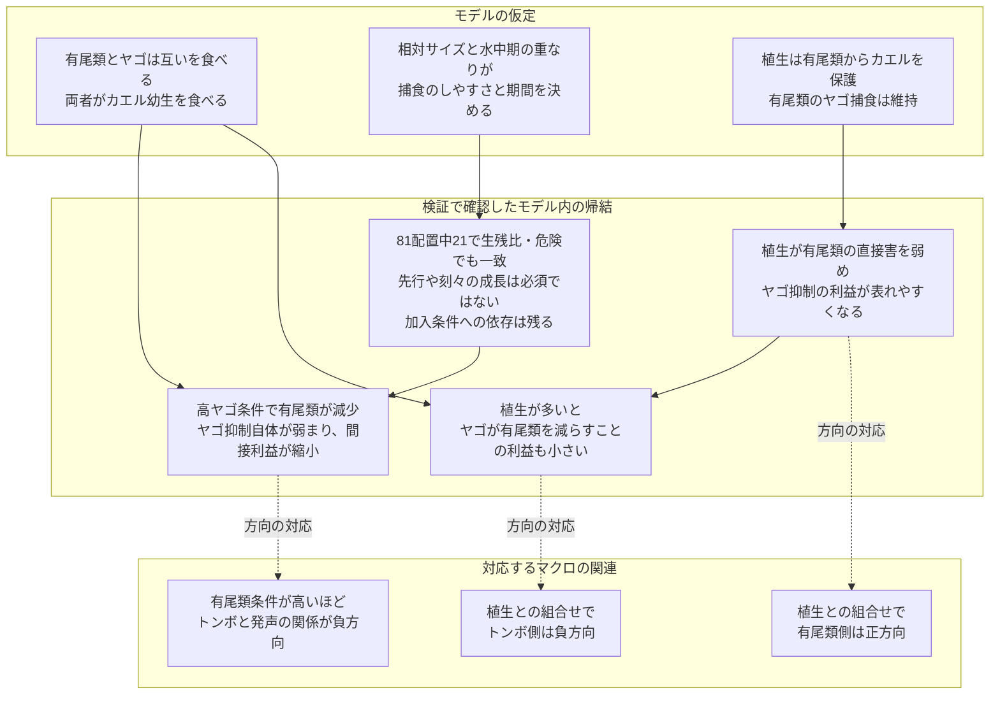

# 論文のストーリー・考察・結論

2026年10月27日改稿。主機構の解釈は生残尺度監査と発生段階・サイズ監査に基づく。

## 論文を貫く流れ

1. **発見する：** カエルの強い発声の集中を起点に、有尾類と植生によってトンボ類との関連が変わる三方向を記述する。
2. **説明を識別する：** 絶対生残差の圧縮と、第三者による捕食制御の低下を、生残比・累積捕食危険と経路除去で区別する。
3. **機構を示す：** 双方向捕食が有尾類の間接利益を変え、植生による相手別の保護が直接害との収支を変える条件を示す。
4. **成立条件を絞る：** 登場時期・水中期間・サイズ関係を独立に変え、刻々の成長や先行自体を必要条件とせず、作用の重複と人口学的な接続を検証する。

中心命題：**植生が第三者の直接害を弱めると、その第三者による間接利益だけでなく、別の捕食者が第三者を減らすことの意味も変わる。この収支は段階・サイズ・重複期間に依存する。**

主要な結果：尺度依存の最小構成は生残比・危険では不成立。相互捕食を含む候補は基準条件で成立し、動的サイズの81配置中21配置でも成立。21配置は半刻み・160季節で維持。ただし低加入条件での不成立は残る。

## 統合考察

### 発声集中から第三者による捕食制御へ

カエルの強い発声とトンボ類に適した環境との関連は、池性有尾類と植生の条件によって異なった。この結果は、繁殖活動の集中を、一種類の捕食者への適合度だけで理解することの限界を示す。モデルは、第三者が加わることで捕食者の害が単純に増えるのではなく、その第三者自身が直接害と間接利益を持つという解釈を具体化した。

有尾類はカエル幼生を食べる一方、ヤゴを抑えてカエルに間接利益を与える。主候補では、高ヤゴ条件でヤゴが有尾類を減らし、有尾類によるヤゴ抑制自体を弱めた。これにより、有尾類の供給が多い側で得られる間接利益が低ヤゴ側ほど大きく、高ヤゴ側では縮小し、有尾類条件によるヤゴ勾配の負方向への変化が生じた。有尾類がヤゴの攻撃性を直接高める仕組みではない。

ヤゴを捕食する有尾類と、ヤゴに捕食される有尾類の役割は、種・段階・サイズに依存する。Hopkins et al.（2011）は有尾類によるヤゴ捕食とヤゴのサイズ別被食回避を、Anderson and Semlitsch（2016）は上位捕食者と構造が関わるギルド内捕食系を示した。ただし、異なる実験系の経路を結んだ本モデル全体が、一つの池で実証されているわけではない。野外で問うべきなのは「有尾類がいるか」だけでなく、「ヤゴを抑える有尾類が、ヤゴによってどの程度減るか」である。

### 床効果を含む説明と、捕食制御の変化を分ける

生残率が低いと、相対的な救済が維持されても絶対生残差は小さくなる。本研究の最小構成110110はこの区別を示す対照となった。絶対尺度の三方向一致だけでは、有尾類の制御が弱まったとはいえず、同モデルの対数生残では有尾類による修飾の方向が逆になった。したがって、救済の絶対量の縮小を第三者の捕食制御の低下と読み替える説明は採用しない。

主候補111110では、生残比・累積捕食危険でも三方向が一致し、経路別の危険も有尾類のヤゴ抑制の低下を示した。これが床効果だけによる説明と区別する根拠である。ただし、生残比と負の累積危険は本モデルでは数学的に結び付いており、独立な二重の支持ではない。また、加入式や移入を含む翌季指数の対数は対数生残と同じ応答ではない。尺度の変更はマクロの相関を否定するためではなく、そこにどの機構的意味を与えられるかを検査するために用いた。

### 植生は有尾類の直接害を弱め、ヤゴが持つ間接利益も変える

主候補での植生の役割は、有尾類からカエルを保護することである。有尾類のヤゴ捕食は保たれるため、有尾類の直接害が弱まり、ヤゴ抑制の間接利益が表れやすくなる。これは植生と有尾類の組合せがカエル側で正方向となる仕組みに対応する。

同じ作用が、植生とヤゴの負方向の関係も説明する。植生が少ないとき、ヤゴが有尾類を減らすことには、有尾類からカエルへの直接害も減らすという間接利益が伴う。植生がすでにその直接害を弱めていれば、ヤゴが有尾類を減らすことで得られる利益は小さくなる。したがって、植生がヤゴの採餌を促進しなくても、ヤゴの直接害を相殺する利益が減り、ヤゴ勾配はより負になりうる。植生が多いほどカエルが必ず不利になるという意味でもない。

この説明の面白さは、同じ保護作用が、有尾類の意味をより有利にし、同時にヤゴが第三者を減らすことの利益を小さくする点にある。植生の機能を単独の正負の効果で要約せず、誰から誰を守り、それが他の捕食者の間接効果をどう変えるかとして捉える必要がある。

Davenport and Chalcraft（2013）は、ヤゴに応じたオタマジャクシの落葉利用がイモリの採餌を減らすことを示した。ただし落葉量は操作しておらず、本モデルの植生被覆に対する一定の保護倍率を実証したわけではない。Hossie and Murray（2010）はヤゴ側の機能的反応も構造で変わることを示しており、相手別の保護が常に本モデルと同じとは限らない。今回の主候補は植生の羽化支持を必要としなかったが、羽化場所としての機能を否定した結果でもない。景観植生被覆と池内の避難構造の対応は、次の検証対象である。

### 発生段階とサイズは、先行そのものではなく作用可能な経路を決める

登場順・水中期間・相対サイズは、ヤゴと有尾類が互いを食べる期間と強さ、さらに両者がカエル幼生に作用する期間を同時に変える。動的サイズ条件では成功がヤゴ先行に限られたが、ヤゴ優位の固定感受性では同時登場でも成立した。相手別の時間平均感受性を保ってサイズ変化を止めても成功配置は変わらなかった。したがって、「早く登場した側が勝つ」「成長に伴って捕食方向が逆転する」とだけ結論することはできない。

モデルが支持するのは、有尾類がヤゴを抑える余地と、ヤゴがその有尾類を減らす余地が、カエル幼生期と関連する時間配置でともに存在するという条件付きの説明である。同じ先行でも水中期間によって成立が変わり、同じサイズ方向でも配置によっては不成立だった。将来の実証では、登場順、体サイズ、発生段階、水中滞在期間を別々に記録し、各捕食方向に沿って評価する必要がある。

### 広域パターンとの接続と次の実証

マクロ解析は発声集中の条件付き関連を示し、モデルはその方向を生みうる捕食経路と生活史条件を示した。発声頻度は成体の繁殖活動、適合度は環境ニッチへの近さ、景観植生は周辺被覆である。モデルの生残、供給量、保護倍率と直接同じ測定ではない。幼生期の作用が発声集中へ結び付くには、生残・成熟・加入を介して繁殖集団に返る経路や、成体の場所利用を変える経路が必要となる。

主候補は探索後に得たものであり、マクロへの尤度に基づく最適モデルではない。低局所加入率・低加入換算では生残比の一致が崩れたことも、局所の捕食だけでなく人口学的な接続を検証する必要を示す。マクロの有尾類×植生や三者交互作用は仕様により不確かで、今回の三方向検査もマクロの全回帰項を再現したものではない。

次の実証では、強い発声地点と環境の似た弱い発声・無発声地点で、三群の段階・サイズ・出現時期、植生内外のカエル生残、有尾類のヤゴ捕食、ヤゴによる有尾類死亡を測る。絶対生残差と生残比を併記し、高ヤゴ条件で制御自体が落ちるかを確認する。植生操作では有尾類からの保護とヤゴからの保護を分け、直接害と間接利益を別々に測定する。過去の利用歴や水域持続性は、段階が重なる時間を説明する候補として併せて扱う。

環境DNAメチル化は発生段階を測る将来の方法候補に位置付ける。形態判定した段階、体サイズ、日齢と飼育水を対応づけ、混合試料と独立個体群で校正する必要がある。本研究は混合池水から三群の段階組成を推定する方法を検証していない。まず直接観察で機構を測り、その後に段階測定を広げる手段として検討する。

## 結論

カエルの発声集中とトンボ類適合度との関連は、有尾類と植生の文脈によって異なった。モデル比較は、絶対生残差の圧縮だけでも類似の関連が生じることを示すとともに、それとは区別される捕食制御の変化を説明候補として絞った。

その候補では、有尾類がヤゴを抑えてカエルを間接的に保護する一方、高ヤゴ条件ではヤゴによる有尾類捕食がその制御を弱める。植生は有尾類の直接害を弱め、間接利益を表しやすくすると同時に、ヤゴが有尾類を減らすことによる利益を小さくする。この収支の変化により、生残比・捕食危険でも三方向が成立した。

成立を決めるのは、発生段階に伴う捕食方向の強さと、水中期の重複の組合せである。ヤゴ先行や成長に伴う逆転は普遍的な必要条件ではなく、加入条件にも依存する。本研究は野外の原因を同定するものではないが、繁殖活動の広域的な関連から、相手別の植生保護、双方向の捕食、段階とサイズの時間配置を測る実証課題へつなぐ枠組みを示した。

## 図構成と本文への配置

図は仮定、モデル内で検証した帰結、観測の関連を分ける。点線は方向の対応であり、野外の因果同定ではない。有尾類×植生の正方向は背景仕様により区間にゼロを含む。図1はマクロの条件付き関連と区間、図2は捕食経路と絶対／比／危険の尺度比較、図3は経路除去と危険の分解、図4は登場・期間・サイズの成功と失敗を示す。加入感度、羽化支持、カエルによる羽化トンボ捕食などの代替機構は補助資料に置く。

## 執筆用の出典対応

| 主張・検査 | 保存済み根拠 |
|---|---|
| マクロの固定結果 | ../results/naamp_remote_vegetation_20261026/network_rank_coefficients.csv、../results/naamp_odonata_caudata_associations_20261026/stratified_correlations.csv |
| 経路の一次根拠と外挿の境界 | EVIDENCE_CONSTRAINED_MECHANISMS_2026-10-27.md |
| 床効果・尺度依存と主候補の選定 | RESPONSE_SCALE_MECHANISM_AUDIT_2026-10-27.md、../results/response_scale_audit_20261027/ |
| 発生段階・サイズ・経路除去・数値検証 | STAGE_HAZARD_MECHANISM_AUDIT_2026-10-27.md、../results/stage_hazard_audit_20261027/ |
| 前段階の探索と全結果 | EVIDENCE_CONSTRAINED_RESULTS_2026-10-27.md、PATHWAY_CAUSAL_AUDIT_2026-10-27.md |
| 年次接続と補助的逆転捕食 | MULTIYEAR_STAGE_NETWORK_RESULTS_2026-10-26.md、STAGE_TIMING_AND_EDNAM_RESEARCH_2026-10-26.md |
| 次の段階測定法の課題 | EDNA_METHYLATION_STAGE_FEASIBILITY_2026-10-26.md |

原稿内の主候補の解釈は応答尺度監査と段階・サイズ監査に従う。初期探索資料は当時の設定内での結果を記録したものである。マクロの固定結果は変更していない。本稿は投稿形式・引用一覧の最終整形前の原稿案である。

## 主な引用文献

- Sugai et al. (2021). https://doi.org/10.1111/1365-2656.13399
- de Herder et al. (2023). https://doi.org/10.1643/h2022014
- Hopkins, Gall & Brodie (2011). https://doi.org/10.1111/j.1439-0310.2011.01963.x
- Anderson & Semlitsch (2016). https://doi.org/10.1111/1365-2656.12462
- Davenport & Chalcraft (2013). https://doi.org/10.1002/ece3.691
- Hossie & Murray (2010). https://doi.org/10.1007/s00442-010-1568-6
