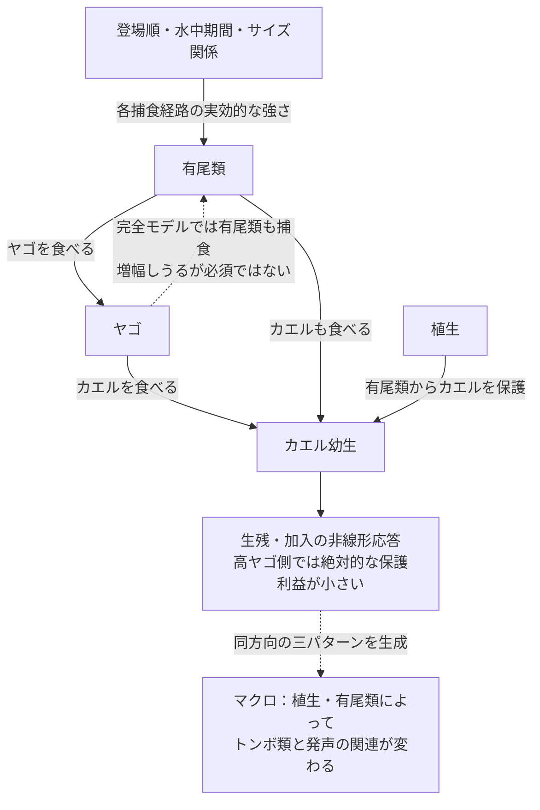

# 未検証の採餌抑制を除いた機構比較と候補選定

## 最終結論：説明の核として選ぶ機構

**有尾類がカエルとヤゴの両方を食べ、植生が有尾類からカエルを保護する。その結果、有尾類によるヤゴ抑制の利益が表れやすくなる。ただし高ヤゴ供給では残存ヤゴによるカエル死亡が大きく、保護・ヤゴ抑制による絶対的な利益が小さくなる。**

この組合せを第一候補の説明の核とする。未検証の対ヤゴ採餌抑制、植生によるヤゴ採餌・羽化生残の増強、逆転捕食を使わず、全供給範囲で三方向を生成し、数値・人口学の六対照でも一致が維持された。

ヤゴによる有尾類捕食は完全モデルでこの変化を増幅したが、最も安定した代表の除去比較では必須ではなかった。したがって、「有尾類の個体数が減ることだけが原因」とは結論しない。最終の64組合せ検査では、より単純な食物連鎖＋ヤゴからのカエル保護でも同方向を生成できた。マクロの三方向だけでは保護対象を一意に決められず、第一候補は文献に知られる有尾類の対カエル捕食も残し、検査した人口学条件への安定性が高い説明として選んだ。

## 検証の問い

カエルの発声を起点とする三方向、すなわち（1）植生に伴うトンボ側の負方向への変化、（2）有尾類側の正方向への変化、（3）有尾類が高い文脈でのトンボ側の負の関係の強まりを、未検証の「ヤゴが有尾類の対ヤゴ採餌を抑える」機構なしで同時に生成できるかを調べた。

**この文書は前回のPATHWAY_CAUSAL_AUDITの結論を一般化しないための再検証である。前回の採餌抑制の必要性は、固定した一設定内の必要性にすぎず、他の発生段階・機構で同じパターンが生じないことを意味しなかった。**

## 文献制約

全設定で対ヤゴ採餌抑制を0とした。植生によるヤゴの対カエル・対有尾類捕食の一律増強、有尾類自身の隠れ場、内因的羽化失敗の低下、羽化時のカエルとの接触増加も外した。

残した・追加した機構は以下。一次文献の実測範囲は `EVIDENCE_CONSTRAINED_MECHANISMS_2026-10-27.md` に記録した。

| 機構 | 一次根拠 | モデルで未校正の部分 |
|---|---|---|
| 有尾類によるヤゴ捕食とサイズ依存の逃避 | [Hopkins et al. 2011](https://doi.org/10.1111/j.1439-0310.2011.01963.x) | 攻撃率・成長率・シグモイド関数。密度と発生段階を自動的に結び付けない |
| ヤゴによる有尾類捕食 | [Anderson & Semlitsch 2016](https://doi.org/10.1111/1365-2656.12462) | 対象三群の合成、サイズ関数、年間加入 |
| ヤゴの危険情報による有尾類の対カエル作用の低下 | [Kishida et al. 2009](https://doi.org/10.1890/08-0238.1) | 抑制式・強度。対ヤゴ捕食には転用しない |
| カエルの構造利用による有尾類捕食の低下 | [Davenport & Chalcraft 2013](https://doi.org/10.1002/ece3.691) | 植生量への応答、保護の非対称性の大きさ。原著の落葉量は一定 |
| 構造によるヤゴの機能的反応のII型からIII型への変化 | [Hossie & Murray 2010](https://doi.org/10.1007/s00442-010-1568-6) | 密度尺度・係数。原著のデータへ再適合していない |
| 高植生で羽化開始が遅れる | [Bried et al. 2018](https://doi.org/10.1080/13887890.2018.1520652) | 5日をシナリオ値として使用。水域一般の係数ではない |

「文献制約」は、機構の方向に根拠があるという意味であり、すべての式・係数が実測されたという意味ではない。NAAMPの適合度→実際の供給量、繁殖指数→鳴き声の変換も検証していない。各論文の種・段階を合成していること自体が外挿である。

## 解析の範囲を先に固定した比較

### 機構5系統の比較

全5系統で8種類の時期・期間配置、保護順序3水準、攻撃尺度3水準、対カエル採餌抑制の有無、逆転捕食の有無を交差した。植生0/1、S・D供給それぞれ0.25/1/2を全て計算し、25,920シナリオを保存した。

1. `refuge_only`：植生をカエルへの非対称な保護として表現。
2. `litter_response`：ヤゴの捕食を低植生II型・高植生III型の機能的反応へ変更。ヤゴからの単純な保護倍率を重ねない。
3. `risk_refuge`：ヤゴに応じたカエルの避難が有尾類捕食を抑える。関数形は仮定。
4. `timing_shift`：羽化生残を増やさず、高植生でヤゴ水中期を5日延長。
5. `combined`：機能的反応・危険に応じた避難・羽化時期を組み合わせる。

主比較はD・Sとも0.25→2。従来の局所比較D=1→2、S=0.25→2を別に示し、全9組合せの供給区間も保存した。各系統288文脈。

| 系統 | 主比較の三方向一致 | 従来の局所比較の一致 |
|---|---:|---:|
| 非対称な保護 | 0/288 | 5/288 |
| 機能的反応II→III | 0/288 | 7/288 |
| 危険に応じた避難 | 0/288 | 0/288 |
| 羽化時期変化 | 0/288 | 6/288 |
| 三機能の組合せ | 0/288 | 0/288 |

機能を多く入れるほど説明できるわけではなかった。時期変化の一致には、羽化がF・Sの水中期終了後へずれるだけでカエルの帰結が同一となる例を含む。件数は自然界での出現確率・独立な反復数ではない。

### 発生段階の独立格子

有尾類・ヤゴの登場時期を各0/20/40日、カエル登場を20日に固定。F水中期間45/60/75日、S期間40/60/80日、D期間40/60/70日を独立に交差し、243配置を作った。保護系統は攻撃尺度3、機能的反応系統は1.5という事前に選んだ代表値を維持した。**この二系統の件数は攻撃尺度が異なるため、優劣の統計量として比較しない。** 両系統とも採餌抑制を全て0、逆転捕食なし、保護順序S、局所加入0.5とした。

時間変化するサイズ関数と、全捕食方向を同じ0.25/0.5/0.75に固定する対照を比較し、34,992シナリオを追加した。

| 系統・サイズ表現 | 全供給範囲の一致 | 従来の局所区間の一致 |
|---|---:|---:|
| 保護・時間変化するサイズ関数 | 59/243 | 85/243 |
| 保護・共通固定値0.25/0.5/0.75 | 各0/243 | 各0/243 |
| 機能的反応・時間変化するサイズ関数 | 3/243 | 27/243 |
| 機能的反応・共通固定値0.25 | 6/243 | 6/243 |
| 機能的反応・共通固定値0.5/0.75 | 各0/243 | 各0/243 |

共通固定値への置換は平均捕食強度まで変えるため、この結果だけで成長に伴う時間変化が必須とはしない。そこで、各捕食方向について水中期の重複中のサイズ関数の平均を保った固定値に置換する8,748シナリオを追加した。この対照でも、保護系統63/243、機能的反応系統3/243が全範囲で一致した。

**必要なのは「発生段階がずれて逆転すること」とは限らない。登場順・水中期・サイズ関係が作る捕食方向ごとの強さの違いが重要であり、毎時点の成長変化まで必須とはいえない。** 平均合わせは個体密度で重み付けしない時間平均であり、累積捕食ハザードそのものを同一に保った対照ではない。

## 経路操作で分かった別の仕組み

最初の局所一致例を、効果量最大ではなく、規定したキー順で選び、各経路を除いた。保護系統では三者の登場・終了を揃えた設定、全採餌抑制なし・逆転捕食なしでも一致した。

高S供給でD供給1→2にしたとき、有尾類開始密度は3.317→1.300、有尾類のヤゴによる死亡割合は20.9%→92.0%、ヤゴの有尾類による死亡割合は98.8%→51.3%となった。カエル指数は1.0795→0.6228へ下がった。

ここでは、**ヤゴが有尾類を捕食して、有尾類によるヤゴ抑制が弱まる**。前モデルのように有尾類の密度を保ったまま採餌活動を抑える機構ではない。D→SまたはS→Dの片方を除くと三方向一致が消えた。有尾類からカエルを守る植生機能を除いても消えた。

### 植生はヤゴを増強しなくても、負の関連を強めうる

この保護モデルでは、植生によるヤゴ採餌支持・羽化生残増加を外しており、逆転捕食もない。したがって、同じ供給条件なら植生0/1でヤゴと有尾類の密度は同じである。植生はカエルを保護するだけだが、中ヤゴ側での保護利益が大きく、高ヤゴ側では小さくなることで、トンボに沿う負の傾きが急になった。

例としてS供給1のカエル指数は、植生なしでD=1の0.5478からD=2の0.5069、植生ありで1.2552から0.5262へ変わる。**植生がカエルを減らした結果ではない。左側を大きく持ち上げ、右側を少しだけ持ち上げた結果である。**

この違いを「植生がトンボの害を増した」と一律に表現しない。前モデルの採餌・羽化支持による説明は一候補だったが、今回の比較ではそれらがなくても同方向のパターンを生成できた。

## 候補選定と限界

候補は、（1）三方向と負のD傾きの同時一致、（2）全供給範囲での成立、（3）経路除去による説明可能性、（4）数値・人口学的安定性、（5）一次文献の機構的根拠と追加仮定の少なさ、で比較する。観測データへの尤度・予測適合で選んだモデルではない。

主候補となる機構の核は、**段階・サイズ条件に依存した捕食者間捕食と、植生によるカエルへの保護**である。機能的反応の変化は、同じ核を含む代替的な表現として残す。厳密な機能形まで自然系の最適モデルとして選べたとはしない。

人口学の代表例と全段階格子での頑健性比較、最終代表の経路除去と数値検証は、同じ結果ディレクトリの`fullrange_*`、`robust_stage_*`、`robust_selected_*`で追跡する。最終選定表と数値は本書末尾に追記する。

## 再現手順

```text
python -m unittest discover -s research/scripts -p test_evidence_mechanisms.py
python research/scripts/run_evidence_constrained.py
python research/scripts/run_evidence_constrained.py --sensitivity
python research/scripts/audit_evidence_candidate.py
python research/scripts/audit_evidence_candidate.py --profile litter_response
python research/scripts/check_evidence_robustness.py
python research/scripts/run_evidence_stage_grid.py
python research/scripts/run_evidence_mean_gate.py
python research/scripts/validate_evidence_stage_candidates.py
python research/scripts/scan_evidence_demography.py
python research/scripts/validate_evidence_stage_candidates.py --robust
```

出力：`research/results/evidence_constrained_20261027/`。探索範囲、関数形、選択規則は各実行前のdesign JSONに保存した。平均合わせの対照と人口学の全格子検証は、先行結果を受けて追加した探索であり、独立な検証データとは扱わない。既存のマクロ解析894ファイルは変更していない。

## 最終選定結果

第一候補は、**発生段階・サイズ条件に依存する捕食者間捕食＋植生によるカエルの非対称な保護**とした。単純な保護系統では、243配置中27配置で基準＋4人口学設定の全てにわたり全供給範囲の三方向一致が残った。機能的反応系統では全5設定一致の配置はなく、代表候補は3/5設定で一致した。ただし攻撃尺度の違いを含むため、件数の差をモデルの確率的な優劣とは扱わない。追加仮定の少なさ、条件内の安定性、経路除去の説明可能性から主候補を選び、機能的反応の代替表現も残す。

最終代表は、まず基準全範囲で一致する配置の中で人口学検証の一致数が最大のものを取り、同点は登場時刻・期間の数値順で選んだ。効果量最大の選択ではないが、探索後選択であり独立な実証ではない。

| profile | s_arrival | d_arrival | F_duration | S_duration | D_duration | passed | tested |
| --- | --- | --- | --- | --- | --- | --- | --- |
| litter_response | 40 | 20 | 75 | 40 | 70 | 3 | 5 |
| refuge_only | 40 | 20 | 45 | 40 | 40 | 5 | 5 |

カエル登場は20日。選択した保護系統ではヤゴが20日先行し、有尾類と重なるのは40〜60日。採餌抑制は全て0、逆転捕食なし、植生の採餌・羽化増強も0。

### 経路除去と数値確認

| profile | check | intervention | DV | SV | SD | all_three |
| --- | --- | --- | --- | --- | --- | --- |
| litter_response | interventions | full | -0.040605 | 0.010287 | -0.091841 | True |
| litter_response | interventions | no_DF_refuge | -0.040605 | 0.010287 | -0.091841 | True |
| litter_response | interventions | no_D_eats_F | -0.014223 | 0.009654 | 0.004161 | False |
| litter_response | interventions | no_D_eats_S | 0.112872 | 0.014323 | -0.074827 | False |
| litter_response | interventions | no_SF_refuge | -0.023713 | 0.007164 | -0.071273 | True |
| litter_response | interventions | no_S_eats_D | -0.128040 | -0.000726 | 0.003412 | False |
| litter_response | interventions | no_S_eats_F | 0.011079 | 0.011079 | -0.100738 | False |
| litter_response | half_step | full | -0.041352 | 0.010264 | -0.091652 | True |
| litter_response | horizon160 | full | -0.040536 | 0.010287 | -0.091787 | True |
| refuge_only | interventions | full | -0.155068 | 0.010032 | -0.100528 | True |
| refuge_only | interventions | no_DF_refuge | -0.032431 | 0.002663 | -0.119645 | True |
| refuge_only | interventions | no_D_eats_F | -0.022552 | 0.013303 | 0.006979 | False |
| refuge_only | interventions | no_D_eats_S | -0.159449 | 0.021023 | -0.056783 | True |
| refuge_only | interventions | no_SF_refuge | -0.118145 | 0.004226 | -0.064912 | True |
| refuge_only | interventions | no_S_eats_D | -0.148235 | 0.000871 | 0.009775 | False |
| refuge_only | interventions | no_S_eats_F | -0.124136 | 0.008688 | -0.114846 | True |
| refuge_only | half_step | full | -0.154975 | 0.009969 | -0.100502 | True |
| refuge_only | horizon160 | full | -0.155068 | 0.010032 | -0.100442 | True |

### 第一候補のコホート収支

割合は季節開始コホートに対する平均であり、実際の動物の頭数・野外死亡率ではない。

| vegetation | S_source | D_source | F_B | S_B | D_B | F_fraction | F_killed_by_S_fraction | F_killed_by_D_fraction | S_killed_by_D_fraction | D_killed_by_S_fraction |
| --- | --- | --- | --- | --- | --- | --- | --- | --- | --- | --- |
| 1.000000 | 2.000000 | 0.250000 | 1.601893 | 2.879116 | 0.567057 | 0.439597 | 0.020561 | 0.539842 | 0.505883 | 0.175012 |
| 1.000000 | 2.000000 | 1.000000 | 0.752662 | 1.695965 | 1.371332 | 0.139060 | 0.004132 | 0.856809 | 0.836118 | 0.071842 |
| 1.000000 | 2.000000 | 2.000000 | 0.570810 | 1.214343 | 2.101364 | 0.047788 | 0.001281 | 0.950931 | 0.940881 | 0.038403 |

### 時間平均を保ったサイズ関数対照

| profile | DV | SV | SD | all_three |
| --- | --- | --- | --- | --- |
| litter_response | -0.042639 | 0.009266 | -0.087347 | True |
| refuge_only | -0.152897 | 0.009281 | -0.099280 | True |

時間平均対照の結果は、サイズ関数の刻々の変化と、経路ごとの平均的な捕食しやすさを区別する材料である。文献で支持されたサイズ依存性の存在を、今回の成長率・期間の実測根拠と同一視しない。

### 完了した検証の範囲

定義した格子・感度・再計算を含め107,388シナリオ評価を保存した。これは独立な107,388実証でも、自然界の全機構の網羅でもない。基準結果の再現・コホート収支・選定代表の数値安定性を検査し、失敗した設定も全て残した。マクロ解析の原因を同定した結論ではなく、既存の結果を説明できる機構の候補を絞った結論である。

## 最小経路の組合せ：因果主張を絞る最終検査

頑健性で選んだ保護系統の同一設定で、4本の捕食経路と2本の保護経路の全64組合せ（1,152シナリオ）を検査した。新しい機構や係数は追加せず、既存経路を除去した。10組合せで三方向が一致し、それ以上経路を除くと一致しない最小部分集合は二つだった。

| 識別子 | 残る捕食 | 残る植生機能 | 解釈 |
|---|---|---|---|
| 010101 | 有尾類→ヤゴ、ヤゴ→カエル | ヤゴからカエルを保護 | 食物連鎖と保護だけでも同じ符号を作れる |
| **110110** | **有尾類→ヤゴ、有尾類→カエル、ヤゴ→カエル** | **有尾類からカエルを保護** | **直接害を弱め、ヤゴ抑制の利益を表しやすくする説明の核** |

ここで矢印は捕食者→被食者。有尾類自身の被食や逆転捕食が自然に存在しないという主張ではない。既知の経路を削除した反実仮想は、どの経路がこのパターンに必須かを検査するためのもの。

基準に加え、半刻み・160季節・局所加入0.25/0.75・加入換算2/8を同じ代表設定で比較した。110110は全てで三方向が維持され、010101は加入換算2で植生×Dの方向が失われた。数値安定性は両方で確認された。

| mask | check | DV | SV | SD | all_three |
| --- | --- | --- | --- | --- | --- |
| 010101 | half_step | -0.086087 | 0.015582 | -0.066025 | True |
| 110110 | half_step | -0.071213 | 0.009270 | -0.082400 | True |
| 010101 | horizon160 | -0.086066 | 0.015563 | -0.066006 | True |
| 110110 | horizon160 | -0.071416 | 0.009285 | -0.082328 | True |
| 010101 | rho25 | -0.013426 | 0.002989 | -0.009222 | True |
| 110110 | rho25 | -0.017595 | 0.006440 | -0.009371 | True |
| 010101 | rho75 | -0.295811 | 0.034920 | -0.140382 | True |
| 110110 | rho75 | -0.122978 | 0.008032 | -0.136027 | True |
| 010101 | conversion2 | 0.000296 | 0.001188 | -0.003419 | False |
| 110110 | conversion2 | -0.014600 | 0.006303 | -0.003286 | True |
| 010101 | conversion8 | -0.298200 | 0.024752 | -0.293916 | True |
| 110110 | conversion8 | -0.054027 | 0.005171 | -0.106632 | True |

### 選んだ核でも「利益が失われる」の意味を限定する

110110では有尾類はヤゴに食べられず、対ヤゴ採餌も抑制されない。それでも植生1で、有尾類供給が多い側のF指数の優位は、D供給0.25で1.5589−1.4059=+0.1530、D供給2で0.5492−0.5403=+0.0089へ縮む。高Dでは両方のF生残が低く、絶対的な生残・加入の差が圧縮される。有尾類のヤゴ抑制そのものがなくなったわけではない。

有尾類供給によるF生残割合の増加は、低Dの約5.65ポイントから高Dの約0.58ポイントへ縮む。一方、相対生残比は約1.15から1.21へ増える。**負の傾きの強まりを、相互作用の生理的・行動的強度が必ず弱まった証拠とはしない。生残と加入の非線形性を含む応答尺度の結果である。**

したがって説明の核は「有尾類によるヤゴ抑制＋カエルへの保護＋生残・加入への非線形な変換」であり、相互捕食による有尾類減少は、完全モデルでそれを増幅しうる経路として分ける。



図はモデル内で検証した説明候補。野外の因果経路を同定した図ではない。形態・段階、捕食方向、植生内での相手別生残を測ることで、二つの最小構成や増幅経路を区別する必要がある。

追加の再現：`python research/scripts/minimize_evidence_candidate.py`、`python research/scripts/check_minimal_evidence.py`。続けて `python research/scripts/summarize_evidence_selection.py` で最終検証JSONと集計を再生成する。最小構成の全結果も同ディレクトリに保存した。
