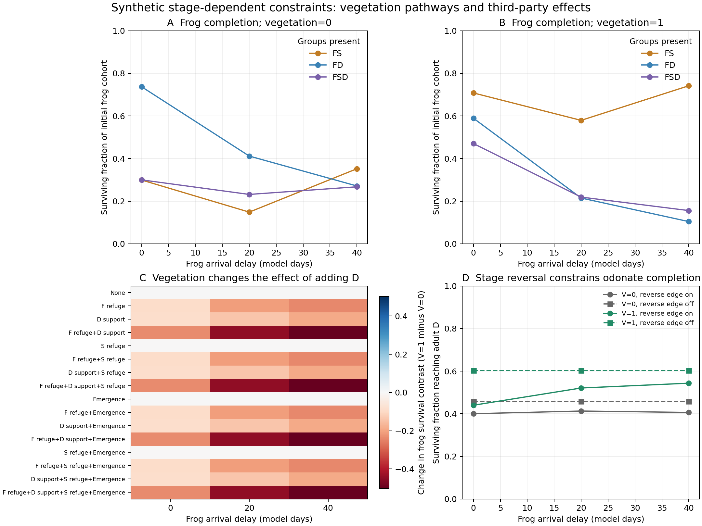

# 植生機能と発生段階を分けた三群モデル：方法・結果・論文への接続

2026-10-26。**合成シナリオであり、観測データへの適合・原因の同定ではない。**
旧 `three_guild_delay_toy.py` と結果を保持し、新しいコホートモデルを追加した。

## 改善内容

カエルだけでなく有尾類・ヤゴの被食と生残を追跡し、植生をFの退避、Dの水中接触支援、
Sの退避、Dの羽化支援という四経路に分けた。F変態後→D羽化期の経路も追加した。
三群それぞれの到着時期・段階移行、死亡原因と閉じたコホート収支を保持する。
長期共存モデルの代替ではなく、一季の段階別制約を説明するモデルである。

## 再実行

リポジトリルートから、固定済みPython環境で実行する。新モデルは決定論的で乱数なし。

```console
python -m unittest discover -s research/scripts -p test_stage_vegetation_network.py
python research/scripts/stage_vegetation_network.py --out work/stage-vegetation-replay
python research/scripts/plot_stage_vegetation_network.py --results work/stage-vegetation-replay
python research/scripts/verify_macro_snapshot.py
```

保存先をwork/にすればコミット済み結果を上書きしない。元の3,510条件モデルと今回の18,432条件は別。

## Methods text

We constructed a deterministic, one-season cohort model to separate vegetation pathways and stage-dependent
constraints. We followed normalized frog larvae/postmetamorphs (F), urodele larvae/postmetamorphs (S),
and odonate nymphs/emerging individuals/adults (D). Each present group began with one normalized cohort.
There was no reproduction, immigration, prey-to-predator conversion, food-dependent growth or calling state.
Aquatic durations were 45, 70 and 60 model days for F, S and D; emergence lasted five further days.
Births and transitions occurred on integration boundaries, with maturation preceding drying at an equal
boundary. Size proxies were 0.15+0.020 age for F, 0.15+0.014 age for S and 0.15+0.015 age for D.
These are arbitrary scenario assumptions, not species-specific measurements.

Let L(x)=1/(1+exp(-x)), k be an attack multiplier, v a synthetic structure index, and R, A, Q, E the
four independently enabled vegetation roles. Per-capita hazards were:

```text
h(S->F) = .035 k S L[8(sizeS-sizeF)] exp(-rS R v) / (1+qD)
h(D->F) = .025 k D L[3(sizeD-.5 sizeF)] exp(-rD R v + .8 A v)
h(D->S) = .025 k D L[8(sizeD-sizeS)] exp(-.8 Q v + .8 A v)
h(S->D) = .020 k S L[8(sizeS-sizeD)] / (1+qD)
h(Fpost->Demerging) = .060 k Fpost exp(.4 E v)
h(emergence failure) = .100 exp(-.8 E v)
```

rS/rD were 1.25/0.25, 0.75/0.75 or 0.25/1.25. Thus greater refuge from urodeles was not the only
ordering explored. A is an assumed encounter-support pathway, not a measured plant effect on capture.
E reduces transition failure while increasing access by postmetamorphic frogs. Failure is a generic
competing hazard, not measured bird predation. All hazards use start-of-step states; exact exponential
survival over each step prevents negative states, and competing deaths are allocated in proportion to
their hazards. Every group's surviving and dead fractions sum to its initial cohort.

S->D is an optional, hypothetical size-dependent edge, not a verified link for every modeled species.
The S-refuge pathway changes D-induced mortality only: vegetation does not reduce the cue suppression
term. Thus release of S foraging behavior through reduced risk perception is discussed as a separate
hypothesis but is not simulated. Adult-newt evidence does not calibrate the larval S state.

The full grid crossed 16 role combinations, three refuge orderings, F arrivals at 10/30/50, S arrivals
at 0/20, D arrivals at 10/35, attack multipliers 0.5/1.5, cue strengths 0/3, structure 0/1, and communities
F/FS/FD/FSD: 18,432 trajectories and 4,608 paired community contexts. Water persisted for 120 days.
Complete-grid sensitivities removed Fpost->D, removed S->D, removed both S-D consumption and cue effects,
or shortened water to 60 days. Satellite detection frequency was not converted to these durations.

For frog completion C, D-addition effects were C(FSD)-C(FS) and C(FD)-C(F). Their raw difference was
retained, but not used as an interaction diagnostic because independent hazards combine multiplicatively.
The independent-hazard contrast was J=log C(FSD)+log C(F)-log C(FS)-log C(FD). J=0 under independent
hazards; J>0 indicates antagonism relative to that null. Contrasts were compared between v=0 and v=1.
Absolute contrasts <=0.002 were labeled near-zero, not statistically nonsignificant. Grid counts are
not natural probabilities and include duplicates when a factor has no effect under a disabled pathway.

## 結果

全条件で収支が成立。0.25日→0.125日の刻み半減で三群完了率の最大差は **0.0005594**。
独立捕食者条件のJの最大絶対値は **2.55×10^-15** だった。

| F完了率への追加効果 | 負 (<−0.002) | ほぼ0 | 正 (>0.002) | 条件数 |
|---|---:|---:|---:|---:|
| SなしでDを追加 | 4,608 | 0 | 0 | 4,608 |
| SありでDを追加 | 3,496 | 68 | 1,044 | 4,608 |
| DありでSを追加 | 4,234 | 88 | 286 | 4,608 |

直接の捕食と、他の捕食者を減らす／抑制する間接経路の釣り合いによって正味の方向が変わる。
数字は任意格子内の件数であり、自然界での割合ではない。

2,304の植生比較で、D追加効果（Sあり）の植生による変化は−0.5482～+0.3533、
S追加効果（Dあり）の変化は−0.3127～+0.3850だった。D側が負方向、S側が正方向に変わる
組合せは1,158条件。ただし生残に対する追加・除去対比であり、適合度と鳴き声の回帰係数を
再現した数ではない。両者は異なる推定対象である。

図示の固定例（全経路、有尾類への退避が強い設定、S到着0、D到着35、k=1.5、q=3）では、
F到着10日で植生0→1によるF完了率は **0.3000→0.4704**、F到着50日では **0.2675→0.1560**。
同じ植生機能でも、捕食可能段階との重なりで正味の方向が変わった。

F変態後→D羽化期の経路を除くとD完了率は最大 **0.3670** 変わったが、F・Sの変化は全条件で0。
Dはすでに水中捕食段階を終え、翌年加入のフィードバックもないためである。羽化支援のみでも
当年F幼生の生残は変わらない。段階逆転を当年のカエル繁殖活動への利益と同一視できない。

S→D除去ではF完了率最大0.2393、S最大0.1856、D最大0.5626の変化があった。
未測定の相互捕食辺の採否が結果に影響することを残す。水期間60日の感度では、期限までに
変態しないコホートの完了率が0になる。これは仮定した発生期限の結果で、実測水面頻度の説明ではない。

## 構造上の限界と論文での位置付け

本モデルでSとDは互いを減らすか抑えるだけで、摂食による成長促進や被食者の追い出しはない。
FSDの各捕食ハザードは単独捕食者系以下なので、J>=0が構造的に保証される。
全4,608条件のJ>0は、普遍的な緩和を発見した結果ではない。
実測の負のO×S項を再現したモデルではなく、拮抗経路があってもDの正味効果が負に残り得ること、
植生・時期による変化、段階逆転の作用先を具体化するモデルである。
相乗的制約には別途根拠のある促進経路が必要で、実測の符号に合わせるためだけには追加しない。

## Results paragraph for insertion

The synthetic model produced both detrimental and beneficial net effects of odonate addition when
urodeles were present, whereas odonate addition was detrimental without urodeles. Vegetation modification
changed direction across functions and stage overlap. In a fixed illustration, structure raised frog
completion from 0.300 to 0.470 for early arrival but lowered it from 0.268 to 0.156 for late arrival.
Removing postmetamorphic frog predation during odonate emergence changed odonate completion by up to
0.367, without changing frog or urodele completion. This reflects the separation between aquatic predation
and later terrestrial vulnerability. All departures from independent mortality were antagonistic,
as implied by the exclusively suppressive predator-predator pathways. The model illustrates conditional
antagonism and stage-specific constraints, not a fitted explanation of the empirical associations.

## Figure caption

**Synthetic vegetation pathways and stage-dependent constraints.** F=frog, S=urodele, D=odonate.
A–B: frog completion across arrival delays and community combinations at structure 0/1, with all four
vegetation roles. C: vegetation change in the D-addition effect with S for all 16 role combinations;
negative means more detrimental or less beneficial. D: odonate completion with/without F-postmetamorph
predation during emergence. Other settings are specified above; all conditions are saved separately.
These are deterministic hypothetical scenarios, without statistical confidence intervals or empirical fit.



## 資料

[考察原稿](THREE_GUILD_VEGETATION_DISCUSSION_V1_2026-10-26.md)・
[一次文献](VEGETATION_THREE_GUILD_PRIMARY_EVIDENCE_2026-10-26.md)・
[仕様](STAGE_VEGETATION_MODEL_DESIGN_2026-10-26.md)。
全出力は `research/results/stage_vegetation_network_20261026/`。
