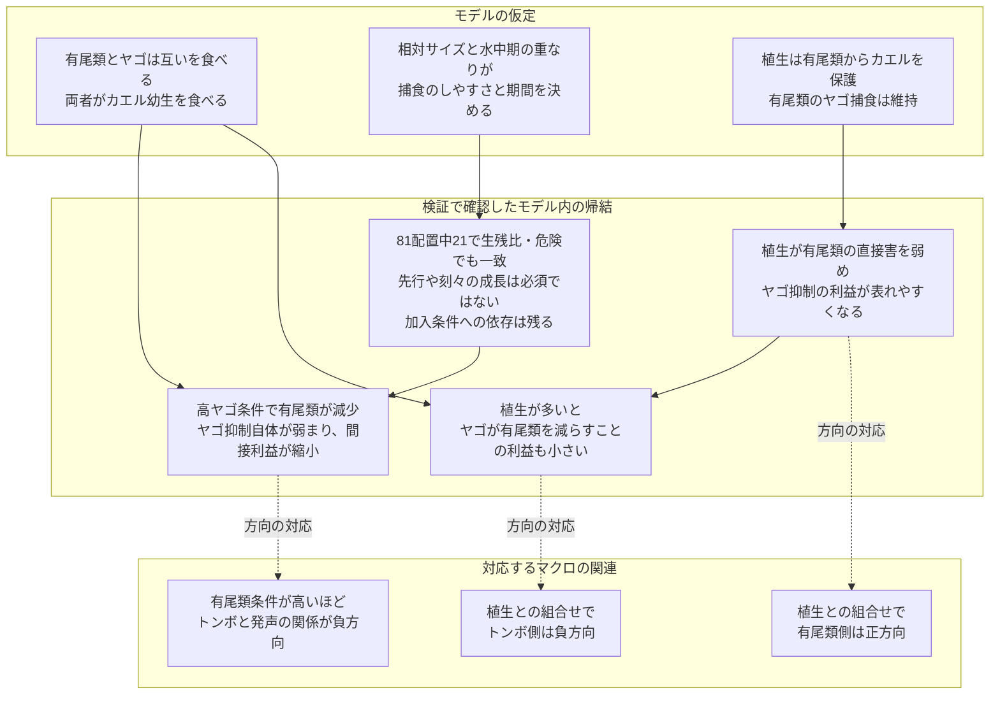

# カエルの発声集中を特徴づける第三者と植生の文脈

## 広域解析と発生段階を組み込んだ三者モデル

英語仮題：Third-party and vegetation context of concentrated frog calling: macroecological associations and a stage-structured three-guild model

## 要旨案

カエルの繁殖活動が集中する場所は、幼生を捕食する生物群と植生の組合せによって特徴づけられる可能性がある。本研究は北米4,248音響調査地点の広域解析と、カエル・トンボ類・有尾類の段階構造モデルを組み合わせた。強い発声とトンボ類適合度との関連は、池性有尾類適合度が高い文脈でより負方向となり、植生との交互作用はトンボ類側で負、有尾類側で正方向を示した。ただし後者の不確実性は背景データの仕様に依存した。モデルでは三方向の同時再現を調べ、絶対生残差の圧縮と捕食制御の変化を区別するため、生残比と累積捕食危険でも検証した。有尾類によるヤゴ抑制とカエル保護だけを持つ最小構成は、比・危険尺度では同時再現しなかった。一方、ヤゴによる有尾類捕食を加え、植生が有尾類からカエルを保護する構成では、同じ三方向がこれらの尺度でも成立した。この構成では、高ヤゴ条件で有尾類のヤゴ制御自体が弱まり、植生は有尾類の直接害と間接利益の収支を変えた。登場時期・水中期間の81条件中21条件で全尺度の一致が得られ、経路別の平均サイズ感受性を固定しても同じ配置で維持された。別のサイズ条件では同時登場でも成立したため、先行や成長に伴う捕食方向の逆転を必須条件とはできない。植生機能24構成の追加比較では、有尾類をヤゴから守るだけでも6/81配置で一致した。カエル保護だけが基準係数で最も広く成立したが、保護対象は一意に選べなかった。成立は加入条件にも依存した。以上は、発声集中に伴う関連を、相互捕食・植生による相手別の保護・段階の重複から説明できる条件を示すものであり、野外の因果経路の同定ではない。

## 序論

繁殖期の発声は、カエルの存在だけでなく、繁殖活動がどこで繰り返し高まるかを広域に捉える手がかりとなる。発声群集と局所・景観構造との関係はすでに研究されている（[Sugai et al. 2021](https://doi.org/10.1111/1365-2656.13399)）。本研究は強い発声が集中する地点を起点に、異なる水生生物群と植生が、その地点をどのように特徴づけるかを問う。発声は雄成体の繁殖活動の指標であり、幼生個体数や繁殖成功の直接測定ではない。発声場所と産卵場所の応答も一致するとは限らない（[de Herder et al. 2023](https://doi.org/10.1643/h2022014)）。

カエル幼生に対するヤゴの作用を理解するには、有尾類という第三者を含める必要がある。有尾類はカエル幼生の捕食者であると同時に、サイズ条件によってヤゴを食べ、カエルに間接利益を与えうる。大型サンショウウオ幼生によるヤゴ捕食と、ヤゴの段階による被食回避には実験的根拠がある（[Hopkins et al. 2011](https://doi.org/10.1111/j.1439-0310.2011.01963.x)）。逆向きの捕食や捕食者・構造の組合せも池の相互作用を変える（[Anderson & Semlitsch 2016](https://doi.org/10.1111/1365-2656.12462)）。したがって、第三者は単に捕食圧を加える存在ではなく、別の捕食者による害を減らす存在にもなりうる。

植生や水中構造は、誰から誰を保護するかによって、その収支を変える候補である。ヤゴに反応したオタマジャクシの落葉利用がイモリの捕食を減らす実験（[Davenport & Chalcraft 2013](https://doi.org/10.1002/ece3.691)）や、落葉量によりヤゴの機能的反応が変わる実験（[Hossie & Murray 2010](https://doi.org/10.1007/s00442-010-1568-6)）は、構造の作用が捕食者と被食者の利用の仕方に依存することを示す。ただし、これらの知見は景観植生被覆から池内の保護機能を直接推定できることを意味しない。

また、相互作用の符号を生残差から読む際には注意が必要である。全体の生残が低いと、捕食危険の軽減が続いていても、救われる割合の絶対差は小さくなる。本研究ではこの尺度依存性を明示的に検査し、絶対差の圧縮による説明と、第三者による捕食制御自体が変わる説明を分離する。

研究は二部からなる。第1部は、発声集中とトンボ類適合度の関連が有尾類と植生によってどう変わるかを記述する。第2部は、三方向の関連を同一設定で生成できる機構を比較し、生残比・捕食危険による尺度検査、経路除去、登場時期・水中期間・サイズ関係の操作を通して成立条件を絞る。特色は、発声集中を出発点に、二者の関連を第三者と生息場所の機能へ展開し、機構の説明が応答尺度と生活史条件を越えてどこまで成立するかを検査する点にある。統計的な交互作用を、野外の高次相互作用の実証と同一視しない。

## 第1部 マクロ解析による繁殖利用の特徴づけ

### 1.1 データと解析の焦点

NAAMPの反復音響調査から、6回以上・3年以上の調査を持つ4,248地点を対象とした。応答は、各地点の調査回のうち、監視対象のいずれかのカエルでcall indexが2以上だった回の割合とした。「強い発声」はこの調査指標上の区分であり、録音から測った音圧ではない。解析単位は音響調査地点であり、すべてが独立した一つの池に対応するとは仮定しない。

GBIFの出現記録とGloBIの相互作用情報を種候補の整理に用い、分布モデル由来の群別環境適合度を各地点へ投影した。適合度は環境ニッチへの近さを表す相対指標であり、その地点のヤゴや有尾類の実際の密度ではない。GloBIの関係も、音響調査地点で相互作用が観察されたことを意味しない。

トンボ類との関連を基準に、有尾類全体と池性有尾類の区分を比較し、池性有尾類を主要な生態学的文脈として示した。SDMのuniform背景とtarget-group背景を感度解析として比較した。両者は同一観測に対する別仕様であり、独立な追試ではない。

植生にはEarthEnvの冠水植生被覆を用いた。主要な指標は1 km画素を調査地点の半径3 kmで集約した周辺景観の被覆で、半径1 kmの感度解析も比較した。これは池内の茎密度や隠れ場構造の直接測定ではない。発声、適合度、植生の順位を標準化したモデルに、主効果、全二者交互作用、三者交互作用を含め、全域とルート内の関連を区別した。

### 1.2 トンボ類との負の関連は有尾類の文脈で変わる

トンボ類適合度と強い発声の頻度には、全域で弱い負の相関があった。池性有尾類適合度の低い層と高い層を比較すると、その相関はuniform背景で0.101から−0.284、target-group背景で−0.004から−0.183へ変わった。全域の順位モデルでもトンボ類×池性有尾類の係数は負だった。

この結果は、トンボ類に適した環境との関連が、有尾類にも適した環境で異なることを示す。一方、同じルート内の解析では仕様によって関連の明瞭さが異なるため、局所的な捕食効果と地理的な環境構造を区別する必要がある。

### 1.3 植生との関係は二つの群で非対称だった

主要な全域・半径3 km・池性有尾類モデルの交互作用は以下だった。区間は保存済みbootstrapの95%区間。

| 項 | uniform背景 | target-group背景 |
|---|---|---|
| トンボ類×有尾類 | −0.166［−0.229,−0.108］ | −0.086［−0.151,−0.023］ |
| トンボ類×植生 | −0.087［−0.124,−0.048］ | −0.064［−0.115,−0.014］ |
| 有尾類×植生 | +0.058［+0.015,+0.101］ | +0.046［−0.022,+0.109］ |
| トンボ類×有尾類×植生 | +0.037［+0.008,+0.068］ | +0.027［−0.024,+0.073］ |

植生が多い文脈でトンボ類との負の関連が強まる成分は両仕様に見られた。有尾類×植生の点推定は正だったが、target-group背景では区間に0を含んだ。これらは他の変数を条件としたモデル係数であり、各群の全地点での正負の効果を直接表すものではない。

三者交互作用の正の推定は、植生によってトンボ類×有尾類の負の成分が緩和される可能性に対応する。ただし背景仕様・空間尺度・ルート内解析に対して一貫して明確ではない。したがって、「三者相互作用を実証した」よりも、「第三者と植生を含む条件付き関連が、機構を検討する動機となった」と位置付ける。

### 1.4 利用履歴と時間的な持続性

同時期・環境条件を揃えた強い発声側と無発声側の4,040対では、強い発声側に過去の強い発声履歴が多かった。前年の周辺水面検出頻度には約−1.48ポイントの差があったが、水面の検出頻度を実際の水域持続日数や新しい池への進出と同一視しない。これらは繁殖利用の履歴と水域条件を示す補助結果であり、植生の交互作用モデルですべてを同時調整したわけではない。

独立したベルギーINBO資料では、同種幼生の確認と3年後の発声に正の関連があった（76/82対38/54地点年、差+22.3ポイント、95%区間+7.2〜+38.1）。ただし幼生有無が切り替わった13地点の地点内比較は不確かだった（−3.8ポイント、−34.6〜+26.9）。有尾類幼生との関連も方向が一定しなかった。この補助解析は時間的な利用の連続性を検討する材料であり、幼生からの加入による効果と、継続的に利用されやすい地点条件を分離してはいない。

## 第2部 シミュレーションによる三者関係の機構検討

### 2.1 モデルの構造と観測への対応

カエル幼生、有尾類の水生段階、ヤゴを含む季節内の捕食モデルを、変態・羽化後の生残、成熟遅延、密度依存的な局所加入と外部移入によって次季へ接続した。発声を直接予測するモデルではなく、季節開始時の規格化したカエル指数と幼生期生残を応答とする。80季節の最後20季節を主に集計した。供給量はSDM適合度の換算値ではない。

主たる候補は、両捕食者によるカエル捕食、有尾類→ヤゴ捕食、ヤゴ→有尾類捕食、および有尾類からカエルを保護する植生作用を含む構成である。保存ファイルでは111110と識別する。植生がヤゴの採餌や羽化生残を増やす経路、未検証の有尾類の対ヤゴ採餌抑制、カエルによる羽化トンボ捕食はこの構成では使わない。捕食の存在や構造利用は一次研究に基づくが、種をまたいだ経路の合成、攻撃係数、成長式、植生による保護率、加入式は合成設定である。

サイズは登場後の時間から増加させ、捕食者と被食者の相対サイズを経路別の捕食感受性へ変換した。これは実測体長のモデル化ではない。水中にいる期間が重ならない場合、その時点の水中捕食は起こらない。

### 2.2 三方向の判定と尺度検査

各設定で植生0/1、有尾類・ヤゴの供給0.25/1/2を組み合わせた18セルを比較した。主要な供給範囲は0.25→2。植生によるヤゴ勾配の変化（DV、他群供給1）、植生による有尾類勾配の変化（SV、他群供給1）、有尾類高低によるヤゴ勾配の差（SD、植生1）を求めた。DV<−1e−6、SV>1e−6、SD<−1e−6、かつ高有尾類側のヤゴ勾配が負であることを同時一致の条件とした。マクロの回帰係数を推定・再現した検査ではなく、指定した条件付き方向の対応検査である。

カエル指数とその対数、絶対生残率とその対数、累積捕食危険を比較した。対数生残の差は生残率の比に対応する。乾燥死を伴わない主条件では、季節ごとにlog生残=−累積捕食危険となることを確認した。したがって両者を独立な支持としては数えない。対数変換に擬似カウントは用いない。平均生残の対数と平均累積危険をともに保存し、年次変動を含めても判定を照合した。

### 2.3 絶対差の圧縮と捕食制御の低下を区別する

固定した代表段階配置で、4捕食経路と2保護経路の全64組合せを比較した。有尾類→ヤゴ、有尾類→カエル、ヤゴ→カエルと有尾類からのカエル保護だけを持つ最小構成110110は、絶対生残と翌季指数では三方向を生成した。しかし対数生残ではDVはゼロ、SDは+0.0248で、目標方向との同時一致は失われた。SVは+0.0276だった。この構成ではヤゴ抑制は続いており、高ヤゴ条件で救済の絶対量が小さくなることを、制御自体の低下とは解釈できない。対数翌季指数では一致が残るため、季節生残と人口学的な変換後の応答も区別した。

対照的に、ヤゴ→有尾類捕食を加えた111110は、同じ比較格子の64構成中唯一、絶対・対数生残と絶対・対数翌季指数の全てで一致した。対数生残／負の累積危険でDV=−0.0296、SV=+0.0178、SD=−0.0788だった。全64構成・全パラメータ空間を通じた唯一の自然機構を意味する結果ではない。

この代表設定では、有尾類供給が高い側の季節開始指数は、ヤゴ供給0.25→2で2.879→1.214へ低下し、有尾類がヤゴへ与える累積捕食危険も0.192→0.039へ低下した。有尾類供給を少から多へ増やすことによる、カエルへのヤゴ由来危険の軽減は、低ヤゴ条件の0.246から高ヤゴ条件の0.092へ縮小した。ここでは絶対生残差だけでなく、捕食制御そのものが弱まった。

### 2.4 発生段階・サイズによる成立条件

カエル登場20日・水中期間45日を固定し、有尾類とヤゴの登場0/20/40日、有尾類水中期間40/60/80日、ヤゴ水中期間40/60/70日を組み合わせた81条件を比較した。動的サイズでは21/81条件で、翌季指数・その対数・対数生残・負の累積危険の全てが三方向に一致した。成功はすべてヤゴ先行の配置だった。

経路別に水中重複期間の平均サイズ感受性を計算し、時間変化を止めても同じ21条件が成立した。この平均は無重みであり、密度重み付き捕食危険を固定したものではない。さらに、カエルへの両捕食感受性を経路別平均に保ち、ヤゴ→有尾類／有尾類→ヤゴの感受性を0.2/0.8、0.5/0.5、0.8/0.2へ変更した。前二者は0/81、ヤゴ優位条件は21/81で一致し、そのうち9条件は同時登場だった。よってヤゴ先行や刻々の成長は普遍的な必要条件とはいえない。

同じ先行でも期間が異なると判定は変わった。有尾類が20日、ヤゴが0日に登場し、有尾類水中期間40日の配置では、ヤゴ水中期間40日でSD=+0.1379、60日でSD=−0.0334となった（負の累積危険尺度）。一方、両者40日登場・両期間40日では、動的サイズのSD=+0.7082に対し、ヤゴ優位の固定感受性ではSD=−0.1375となり、他の二方向も成立した。登場順だけでなく、捕食方向の強弱と水中期の重複の組合せが成立条件だった。

### 2.5 経路除去、数値安定性と人口学的な制約

両捕食者の水中期間40日を固定した9登場配置で、ヤゴ→有尾類または有尾類→ヤゴを除くと、全尺度一致はいずれも0/9となった。これは比較した配置における双方向の作用を支持するが、他の全機構への必要性を証明するものではない。

動的サイズで成功した21配置は、時間刻みを0.25日から0.125日へ、また80季節から160季節へ変更した両検査で21/21の一致を維持した。各季節の累積危険と対数生残の整合性も確認した。一方、代表設定の六つの感度検査では、生残比・危険尺度で一致したのは四条件だった。局所加入率0.25、加入換算2ではSDが正となり一致しなかった。時期・サイズの成立条件と、人口学条件への依存は別々に報告する。

### 2.6 植生が守る対象と羽化支持の比較

カエル保護だけを既定の答えとせず、カエル保護、有尾類保護、ヤゴ保護の有無と、羽化機能なし／羽化段階損失低下／羽化時期変更の24構成を、同じ81配置で比較した。カエル保護のみは21/81、有尾類保護のみは6/81、両保護は9/81で全尺度一致を示した。ヤゴ保護をカエル保護に加えるだけでは0/81だったが、さらに羽化生残支持を加えると4/81で成立した。カエル保護＋羽化時期変更は13/81だった。

有尾類保護のみの成功例では、植生によって有尾類が残り、カエルへの直接捕食も増えたが、それ以上にヤゴ由来の危険が減った。カエルを直接保護せずに間接利益を生む代替説明である。成功した9機能構成から一つずつ選んだ代表は、半刻み・160季節の18検査全てで一致を維持した。二つの共通段階配置で保護強度、加入率、加入換算も比較し、低加入条件での失敗を保存した。

係数は原著推定値でなく、F保護1.25とS/D保護0.8は同じ強度でもない。成功数をモデルの尤度とせず、基準係数における成立範囲と解釈する。植生の生残支持と時期変更は同時には加えていない。有尾類の卵保護の直接根拠を、採餌する水生段階の保護倍率の検証に転用しない。方法・全結果・一次根拠は植生機能比較と文献監査に示す。

### 2.7 補助モデルの位置付け

羽化場所、植生によるヤゴ採餌支持、変態後カエルによる羽化中トンボ捕食、行動抑制を含む探索は、代替経路と次の実証課題を扱う補助解析とする。それらの初期設定内での必要性を、本論文の主機構の必要条件へ移さない。特に「ヤゴが有尾類の対ヤゴ採餌を抑える」という未検証経路と、「ヤゴが有尾類を捕食する」経路を混同しない。発生段階依存の相互捕食を含むことも、時間とともに捕食方向が逆転したことの実証とは異なる。

## 統合考察

### 発声集中から第三者による捕食制御へ

カエルの強い発声とトンボ類に適した環境との関連は、池性有尾類と植生の条件によって異なった。この結果は、繁殖活動の集中を、一種類の捕食者への適合度だけで理解することの限界を示す。モデルは、第三者が加わることで捕食者の害が単純に増えるのではなく、その第三者自身が直接害と間接利益を持つという解釈を具体化した。

有尾類はカエル幼生を食べる一方、ヤゴを抑えてカエルに間接利益を与える。主候補では、高ヤゴ条件でヤゴが有尾類を減らし、有尾類によるヤゴ抑制自体を弱めた。これにより、有尾類の供給が多い側で得られる間接利益が低ヤゴ側ほど大きく、高ヤゴ側では縮小し、有尾類条件によるヤゴ勾配の負方向への変化が生じた。有尾類がヤゴの攻撃性を直接高める仕組みではない。

ヤゴを捕食する有尾類と、ヤゴに捕食される有尾類の役割は、種・段階・サイズに依存する。Hopkins et al.（2011）は有尾類によるヤゴ捕食とヤゴのサイズ別被食回避を、Anderson and Semlitsch（2016）は上位捕食者と構造が関わるギルド内捕食系を示した。ただし、異なる実験系の経路を結んだ本モデル全体が、一つの池で実証されているわけではない。野外で問うべきなのは「有尾類がいるか」だけでなく、「ヤゴを抑える有尾類が、ヤゴによってどの程度減るか」である。

### 床効果を含む説明と、捕食制御の変化を分ける

生残率が低いと、相対的な救済が維持されても絶対生残差は小さくなる。本研究の最小構成110110はこの区別を示す対照となった。絶対尺度の三方向一致だけでは、有尾類の制御が弱まったとはいえず、同モデルの対数生残では有尾類による修飾の方向が逆になった。したがって、救済の絶対量の縮小を第三者の捕食制御の低下と読み替える説明は採用しない。

主候補111110では、生残比・累積捕食危険でも三方向が一致し、経路別の危険も有尾類のヤゴ抑制の低下を示した。これが床効果だけによる説明と区別する根拠である。ただし、生残比と負の累積危険は本モデルでは数学的に結び付いており、独立な二重の支持ではない。また、加入式や移入を含む翌季指数の対数は対数生残と同じ応答ではない。尺度の変更はマクロの相関を否定するためではなく、そこにどの機構的意味を与えられるかを検査するために用いた。

### 植生は有尾類の直接害を弱め、ヤゴが持つ間接利益も変える

主候補での植生の役割は、有尾類からカエルを保護することである。有尾類のヤゴ捕食は保たれるため、有尾類の直接害が弱まり、ヤゴ抑制の間接利益が表れやすくなる。これは植生と有尾類の組合せがカエル側で正方向となる仕組みに対応する。

同じ作用が、植生とヤゴの負方向の関係も説明する。植生が少ないとき、ヤゴが有尾類を減らすことには、有尾類からカエルへの直接害も減らすという間接利益が伴う。植生がすでにその直接害を弱めていれば、ヤゴが有尾類を減らすことで得られる利益は小さくなる。したがって、植生がヤゴの採餌を促進しなくても、ヤゴの直接害を相殺する利益が減り、ヤゴ勾配はより負になりうる。植生が多いほどカエルが必ず不利になるという意味でもない。

この説明の面白さは、同じ保護作用が、有尾類の意味をより有利にし、同時にヤゴが第三者を減らすことの利益を小さくする点にある。植生の機能を単独の正負の効果で要約せず、誰から誰を守り、それが他の捕食者の間接効果をどう変えるかとして捉える必要がある。

Davenport and Chalcraft（2013）は、ヤゴに応じたオタマジャクシの落葉利用がイモリの採餌を減らすことを示した。ただし落葉量は操作しておらず、本モデルの植生被覆に対する一定の保護倍率を実証したわけではない。Hossie and Murray（2010）はヤゴ側の機能的反応も構造で変わることを示しており、相手別の保護が常に本モデルと同じとは限らない。今回の主候補は植生の羽化支持を必要としなかったが、羽化場所としての機能を否定した結果でもない。景観植生被覆と池内の避難構造の対応は、次の検証対象である。

### 植生は誰を守るのか：代替機能を含めた解釈

カエル保護だけの説明は簡潔で、今回の係数と格子では最も広く成立した。しかし、有尾類をヤゴから守るだけでも三方向が生じた。植生が有尾類を残すことで、カエルへの直接害とヤゴ抑制の間接利益を両方増やし、後者が上回る配置がある。この代替は、植生がカエルの隠れ場でなければ観測を説明できないという主張を退ける。一方、ヤゴ保護や羽化支持は、加入と危険の勾配を変えるため、機能を追加すれば一致が改善するわけではなかった。

根拠は段階別に評価する。Orizaola and Braña（2003）は、イモリ卵を葉で包むことがヤゴによる捕食を防ぐことを示したが、これは採餌する幼生の隠れ場とは異なる。Elkin and Baker（2000）のトンボ目幼生の植生保護は魚を捕食者とする実験で、有尾類からの保護への適用は類推である。Grof-Tisza et al.（2017）の羽化場所選好と鳥からの保護は、内因的な脱皮失敗や局所加入の増加の直接証拠ではない。Bried et al.（2018）は疎な植生で羽化開始が5日早まることを示した一方、総羽化成功の処理差は有意ではなかった。

したがって、モデル比較から残る問いは、植生の利益があるかどうかだけでなく、卵・遊泳幼生・羽化段階のどこで、どの捕食者から守るのかである。現在の景観植生と三方向の関連だけでは、その保護対象を一意に選べない。次の実証では、カエルへの保護と有尾類への保護を並列に検証し、葉への産卵、幼生の避難場所利用、羽化場所と生残を別々に測る必要がある。

### 発生段階とサイズは、先行そのものではなく作用可能な経路を決める

登場順・水中期間・相対サイズは、ヤゴと有尾類が互いを食べる期間と強さ、さらに両者がカエル幼生に作用する期間を同時に変える。動的サイズ条件では成功がヤゴ先行に限られたが、ヤゴ優位の固定感受性では同時登場でも成立した。相手別の時間平均感受性を保ってサイズ変化を止めても成功配置は変わらなかった。したがって、「早く登場した側が勝つ」「成長に伴って捕食方向が逆転する」とだけ結論することはできない。

モデルが支持するのは、有尾類がヤゴを抑える余地と、ヤゴがその有尾類を減らす余地が、カエル幼生期と関連する時間配置でともに存在するという条件付きの説明である。同じ先行でも水中期間によって成立が変わり、同じサイズ方向でも配置によっては不成立だった。将来の実証では、登場順、体サイズ、発生段階、水中滞在期間を別々に記録し、各捕食方向に沿って評価する必要がある。

### 広域パターンとの接続と次の実証

マクロ解析は発声集中の条件付き関連を示し、モデルはその方向を生みうる捕食経路と生活史条件を示した。発声頻度は成体の繁殖活動、適合度は環境ニッチへの近さ、景観植生は周辺被覆である。モデルの生残、供給量、保護倍率と直接同じ測定ではない。幼生期の作用が発声集中へ結び付くには、生残・成熟・加入を介して繁殖集団に返る経路や、成体の場所利用を変える経路が必要となる。

主候補は探索後に得たものであり、マクロへの尤度に基づく最適モデルではない。低局所加入率・低加入換算では生残比の一致が崩れたことも、局所の捕食だけでなく人口学的な接続を検証する必要を示す。マクロの有尾類×植生や三者交互作用は仕様により不確かで、今回の三方向検査もマクロの全回帰項を再現したものではない。

次の実証では、強い発声地点と環境の似た弱い発声・無発声地点で、三群の段階・サイズ・出現時期、植生内外のカエル生残、有尾類のヤゴ捕食、ヤゴによる有尾類死亡を測る。絶対生残差と生残比を併記し、高ヤゴ条件で制御自体が落ちるかを確認する。植生操作では有尾類からの保護とヤゴからの保護を分け、直接害と間接利益を別々に測定する。過去の利用歴や水域持続性は、段階が重なる時間を説明する候補として併せて扱う。

環境DNAメチル化は発生段階を測る将来の方法候補に位置付ける。形態判定した段階、体サイズ、日齢と飼育水を対応づけ、混合試料と独立個体群で校正する必要がある。本研究は混合池水から三群の段階組成を推定する方法を検証していない。まず直接観察で機構を測り、その後に段階測定を広げる手段として検討する。

## 結論

カエルの発声集中とトンボ類適合度との関連は、有尾類と植生の文脈によって異なった。モデル比較は、絶対生残差の圧縮だけでも類似の関連が生じることを示すとともに、それとは区別される捕食制御の変化を説明候補として絞った。

その候補では、有尾類がヤゴを抑えてカエルを間接的に保護する一方、高ヤゴ条件ではヤゴによる有尾類捕食がその制御を弱める。植生は有尾類の直接害を弱め、間接利益を表しやすくすると同時に、ヤゴが有尾類を減らすことによる利益を小さくする。この収支の変化により、生残比・捕食危険でも三方向が成立した。ただし有尾類を保護する別の構成でも成立し、植生の保護対象は一意に特定できなかった。

成立を決めるのは、発生段階に伴う捕食方向の強さと、水中期の重複の組合せである。ヤゴ先行や成長に伴う逆転は普遍的な必要条件ではなく、加入条件にも依存する。本研究は野外の原因を同定するものではないが、繁殖活動の広域的な関連から、相手別の植生保護、双方向の捕食、段階とサイズの時間配置を測る実証課題へつなぐ枠組みを示した。

## 図構成と本文への配置

図は仮定、モデル内で検証した帰結、観測の関連を分ける。点線は方向の対応であり、野外の因果同定ではない。有尾類×植生の正方向は背景仕様により区間にゼロを含む。図1はマクロの条件付き関連と区間、図2は捕食経路と絶対／比／危険の尺度比較、図3は経路除去と危険の分解、図4は登場・期間・サイズの成功と失敗を示す。加入感度、羽化支持、カエルによる羽化トンボ捕食などの代替機構は補助資料に置く。

## 執筆用の出典対応

| 主張・検査 | 保存済み根拠 |
|---|---|
| マクロの固定結果 | ../results/naamp_remote_vegetation_20261026/network_rank_coefficients.csv、../results/naamp_odonata_caudata_associations_20261026/stratified_correlations.csv |
| 経路の一次根拠と外挿の境界 | EVIDENCE_CONSTRAINED_MECHANISMS_2026-10-27.md |
| 床効果・尺度依存と主候補の選定 | RESPONSE_SCALE_MECHANISM_AUDIT_2026-10-27.md、../results/response_scale_audit_20261027/ |
| 発生段階・サイズ・経路除去・数値検証 | STAGE_HAZARD_MECHANISM_AUDIT_2026-10-27.md、../results/stage_hazard_audit_20261027/ |
| 植生機能24構成と一次根拠 | VEGETATION_FUNCTION_COMPARISON_2026-10-27.md、VEGETATION_FUNCTION_EVIDENCE_2026-10-27.md |
| 前段階の探索と全結果 | EVIDENCE_CONSTRAINED_RESULTS_2026-10-27.md、PATHWAY_CAUSAL_AUDIT_2026-10-27.md |
| 年次接続と補助的逆転捕食 | MULTIYEAR_STAGE_NETWORK_RESULTS_2026-10-26.md、STAGE_TIMING_AND_EDNAM_RESEARCH_2026-10-26.md |
| 次の段階測定法の課題 | EDNA_METHYLATION_STAGE_FEASIBILITY_2026-10-26.md |

原稿内の主候補の解釈は応答尺度監査と段階・サイズ監査に従う。初期探索資料は当時の設定内での結果を記録したものである。マクロの固定結果は変更していない。本稿は投稿形式・引用一覧の最終整形前の原稿案である。

## 主な引用文献

- Sugai et al. (2021). https://doi.org/10.1111/1365-2656.13399
- de Herder et al. (2023). https://doi.org/10.1643/h2022014
- Hopkins, Gall & Brodie (2011). https://doi.org/10.1111/j.1439-0310.2011.01963.x
- Anderson & Semlitsch (2016). https://doi.org/10.1111/1365-2656.12462
- Davenport & Chalcraft (2013). https://doi.org/10.1002/ece3.691
- Hossie & Murray (2010). https://doi.org/10.1007/s00442-010-1568-6

- Orizaola & Braña (2003). Oviposition behaviour and vulnerability of eggs to predation in four newt species (genus Triturus). Herpetological Journal 13:121–124. https://www.thebhs.org/publications/the-herpetological-journal/volume-13-number-3-july-2003/1720-03-oviposition-behaviour-and-vulnerability-of-eggs-to-predation-in-four-newt-species-genus-triturus/file
- Elkin & Baker (2000). https://doi.org/10.1006/anbe.2000.1513
- Grof-Tisza et al. (2017). https://doi.org/10.1002/ece3.2705
- Bried et al. (2018). https://doi.org/10.1080/13887890.2018.1520652
