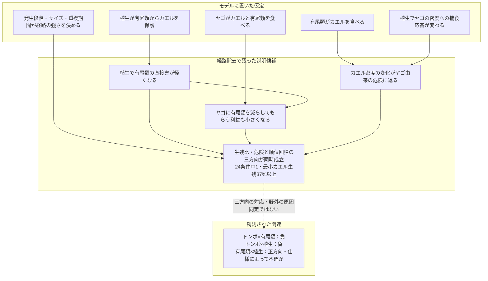

# カエルの発声集中を特徴づける第三者と植生の文脈

## 広域解析と発生段階を組み込んだ三者モデル

英語仮題：Third-party and vegetation context of concentrated frog calling: macroecological associations and a stage-structured three-guild model

## 要旨案

カエルの繁殖活動が集中する環境を、有尾類・トンボ類・植生の組合せから特徴づけた。北米4,248音響調査地点の広域解析では、トンボ類×池性有尾類とトンボ類×植生の関連は負方向、有尾類×植生は正方向だった。ただし後者の不確実性は背景仕様に依存した。段階構造を持つ季節内捕食と年次加入を接続し、既存の経路仮定を組み合わせた3,600構成を比較した。候補20構成を共通の24条件で再評価し、指定条件付きの生残比・捕食危険と、広域解析に対応する順位回帰の三方向を同時に検査した。植生による有尾類からのカエル保護、ヤゴによる有尾類捕食、植生に応じたヤゴの密度依存的捕食を持つ構成が、低生残条件に頼らず一致した。有尾類によるヤゴ捕食を除いても成立したため、救済経路の消失や双方向捕食の逆転は必要条件ではなかった。ただし成立は24条件中1条件に限られ、マクロの三者交互作用の正方向は再現しなかった。本研究は発声集中に伴う関連から、相手別の保護と密度依存的な捕食の収支を検証候補として抽出したものであり、野外の原因を一意に同定したものではない。

## 序論

繁殖期の発声は、カエルの存在だけでなく、繁殖活動がどこで繰り返し高まるかを広域に捉える手がかりとなる。発声群集と局所・景観構造との関係はすでに研究されている（[Sugai et al. 2021](https://doi.org/10.1111/1365-2656.13399)）。本研究は強い発声が集中する地点を起点に、異なる水生生物群と植生が、その地点をどのように特徴づけるかを問う。発声は雄成体の繁殖活動の指標であり、幼生個体数や繁殖成功の直接測定ではない。発声場所と産卵場所の応答も一致するとは限らない（[de Herder et al. 2023](https://doi.org/10.1643/h2022014)）。

カエル幼生に対するヤゴの作用を理解するには、有尾類という第三者を含める必要がある。有尾類はカエル幼生の捕食者であると同時に、サイズ条件によってヤゴを食べ、カエルに間接利益を与えうる。大型サンショウウオ幼生によるヤゴ捕食と、ヤゴの段階による被食回避には実験的根拠がある（[Hopkins et al. 2011](https://doi.org/10.1111/j.1439-0310.2011.01963.x)）。逆向きの捕食や捕食者・構造の組合せも池の相互作用を変える（[Anderson & Semlitsch 2016](https://doi.org/10.1111/1365-2656.12462)）。したがって、第三者は単に捕食圧を加える存在ではなく、別の捕食者による害を減らす存在にもなりうる。

植生や水中構造は、誰から誰を保護するかによって、その収支を変える候補である。ヤゴに反応したオタマジャクシの落葉利用がイモリの捕食を減らす実験（[Davenport & Chalcraft 2013](https://doi.org/10.1002/ece3.691)）や、落葉量によりヤゴの機能的反応が変わる実験（[Hossie & Murray 2010](https://doi.org/10.1007/s00442-010-1568-6)）は、構造の作用が捕食者と被食者の利用の仕方に依存することを示す。ただし、これらの知見は景観植生被覆から池内の保護機能を直接推定できることを意味しない。

また、相互作用の符号を生残差から読む際には注意が必要である。全体の生残が低いと、捕食危険の軽減が続いていても、救われる割合の絶対差は小さくなる。本研究ではこの尺度依存性を明示的に検査し、絶対差の圧縮による説明と、第三者による捕食制御自体が変わる説明を分離する。

研究は二部からなる。第1部は、発声集中とトンボ類適合度の関連が有尾類と植生によってどう変わるかを記述する。第2部は、三方向の関連を同一設定で生成できる機構を比較し、生残比・捕食危険による尺度検査、経路除去、登場時期・水中期間・サイズ関係の操作を通して成立条件を絞る。特色は、発声集中を出発点に、二者の関連を第三者と生息場所の機能へ展開し、機構の説明が応答尺度と生活史条件を越えてどこまで成立するかを検査する点にある。統計的な交互作用を、野外の高次相互作用の実証と同一視しない。

## 第1部 マクロ解析による繁殖利用の特徴づけ

### 1.1 データと解析の焦点

NAAMPの反復音響調査から、6回以上・3年以上の調査を持つ4,248地点を対象とした。応答は、各地点の調査回のうち、監視対象のいずれかのカエルでcall indexが2以上だった回の割合とした。「強い発声」はこの調査指標上の区分であり、録音から測った音圧ではない。解析単位は音響調査地点であり、すべてが独立した一つの池に対応するとは仮定しない。

GBIFの出現記録とGloBIの相互作用情報を種候補の整理に用い、分布モデル由来の群別環境適合度を各地点へ投影した。適合度は環境ニッチへの近さを表す相対指標であり、その地点のヤゴや有尾類の実際の密度ではない。GloBIの関係も、音響調査地点で相互作用が観察されたことを意味しない。

トンボ類との関連を基準に、有尾類全体と池性有尾類の区分を比較し、池性有尾類を主要な生態学的文脈として示した。SDMのuniform背景とtarget-group背景を感度解析として比較した。両者は同一観測に対する別仕様であり、独立な追試ではない。

植生にはEarthEnvの冠水植生被覆を用いた。主要な指標は1 km画素を調査地点の半径3 kmで集約した周辺景観の被覆で、半径1 kmの感度解析も比較した。これは池内の茎密度や隠れ場構造の直接測定ではない。発声、適合度、植生の順位を標準化したモデルに、主効果、全二者交互作用、三者交互作用を含め、全域とルート内の関連を区別した。

### 1.2 トンボ類との負の関連は有尾類の文脈で変わる

トンボ類適合度と強い発声の頻度には、全域で弱い負の相関があった。池性有尾類適合度の低い層と高い層を比較すると、その相関はuniform背景で0.101から−0.284、target-group背景で−0.004から−0.183へ変わった。全域の順位モデルでもトンボ類×池性有尾類の係数は負だった。

この結果は、トンボ類に適した環境との関連が、有尾類にも適した環境で異なることを示す。一方、同じルート内の解析では仕様によって関連の明瞭さが異なるため、局所的な捕食効果と地理的な環境構造を区別する必要がある。

### 1.3 植生との関係は二つの群で非対称だった

主要な全域・半径3 km・池性有尾類モデルの交互作用は以下だった。区間は保存済みbootstrapの95%区間。

| 項 | uniform背景 | target-group背景 |
|---|---|---|
| トンボ類×有尾類 | −0.166［−0.229,−0.108］ | −0.086［−0.151,−0.023］ |
| トンボ類×植生 | −0.087［−0.124,−0.048］ | −0.064［−0.115,−0.014］ |
| 有尾類×植生 | +0.058［+0.015,+0.101］ | +0.046［−0.022,+0.109］ |
| トンボ類×有尾類×植生 | +0.037［+0.008,+0.068］ | +0.027［−0.024,+0.073］ |

植生が多い文脈でトンボ類との負の関連が強まる成分は両仕様に見られた。有尾類×植生の点推定は正だったが、target-group背景では区間に0を含んだ。これらは他の変数を条件としたモデル係数であり、各群の全地点での正負の効果を直接表すものではない。

三者交互作用の正の推定は、植生によってトンボ類×有尾類の負の成分が緩和される可能性に対応する。ただし背景仕様・空間尺度・ルート内解析に対して一貫して明確ではない。したがって、「三者相互作用を実証した」よりも、「第三者と植生を含む条件付き関連が、機構を検討する動機となった」と位置付ける。

### 1.4 利用履歴と時間的な持続性

同時期・環境条件を揃えた強い発声側と無発声側の4,040対では、強い発声側に過去の強い発声履歴が多かった。前年の周辺水面検出頻度には約−1.48ポイントの差があったが、水面の検出頻度を実際の水域持続日数や新しい池への進出と同一視しない。これらは繁殖利用の履歴と水域条件を示す補助結果であり、植生の交互作用モデルですべてを同時調整したわけではない。

独立したベルギーINBO資料では、同種幼生の確認と3年後の発声に正の関連があった（76/82対38/54地点年、差+22.3ポイント、95%区間+7.2〜+38.1）。ただし幼生有無が切り替わった13地点の地点内比較は不確かだった（−3.8ポイント、−34.6〜+26.9）。有尾類幼生との関連も方向が一定しなかった。この補助解析は時間的な利用の連続性を検討する材料であり、幼生からの加入による効果と、継続的に利用されやすい地点条件を分離してはいない。

## 第2部 シミュレーションによる機構比較

### 2.1 仮説集合と観測への対応

カエル幼生、有尾類の水生段階、ヤゴを含む季節内捕食を、変態・羽化後の生残、成熟遅延、密度依存的な加入、外部移入によって次季へ接続した。登場からの合成成長式が捕食感受性を決め、水中期間が重ならなければ水中捕食は起こらない。実測体サイズの再現ではない。季節開始時のカエル指数を用いるが、発声を直接生成するモデルではない。供給量は環境適合度を密度へ換算した値ではない。

カエルへの捕食二経路を残し、有尾類とヤゴの相互捕食、相手別の植生保護、羽化生残・時期、採餌支持、変態後カエルによる羽化トンボ捕食、行動応答、密度依存的な機能的反応を組み合わせた。12,288論理組合せから機構的に同じものを整理して3,600構成とした。未検証の対ヤゴ採餌抑制を主要候補に使わなかった。卵の保護、毒性、成体の生息場所選択、非生物的交絡、観測過程は比較範囲外である。

### 2.2 固定した比較と成立基準

植生0/1、有尾類・ヤゴ供給0.25/1/2の18セルを3段階配置で比較し、194,400シナリオを計算した。40季節・0.5日刻みの一次比較後、必須参照11構成を含む20候補を、共通の24条件と一次比較3配置で80季節・0.25日刻みにより検証した。24条件は登場、期間、捕食強度、加入、植生保護、サイズ感受性を変える合成感度条件であり、独立した実証データではない。

従来の条件付き勾配DV<0、SV>0、SD<0をカエル指数・対数指数・対数生残・負の捕食危険で確認する判定に加え、18セルへマクロと同じ順位標準化の主効果・全二者交互作用・三者交互作用を当て、DS<0、DV<0、SV>0を検査した。どちらも満たすものを同時一致とした。対数生残と危険は独立な証拠ではない。全セルでカエル・有尾類の最小生残が5%以上かを低生残依存の診断とした。

### 2.3 最終比較で残った条件付き候補

一次比較の10,800構成配置のうち、従来の尺度条件を満たしたものは51、順位回帰も一致したものは4だった。後者は精密再評価で一致を維持しなかった。20候補×24条件では、落葉型機能的反応を持つ候補1479だけが条件13で両方を満たした。最小カエル生残0.3772、有尾類0.6118で、ほぼゼロのカエル生残による絶対差の圧縮ではなかった。

条件13ではヤゴが0日、有尾類とカエルが20日に登場し、水中期間はそれぞれ40、80、45日、捕食強度0.5、局所加入率0.75、加入換算4だった。植生による有尾類からのカエル保護係数は0.25である。ヤゴの捕食には植生に応じてII型からIII型へ変わる機能的反応を仮定した。密度尺度と係数は合成設定である。

この条件の負の累積危険の対比はDV=−0.019070、SV=+0.020437、SD=−0.000677だった。順位回帰はDS=−0.0482、DV=−0.0918、SV=+0.0262で三方向に合った。供給格子を21段階にするとDS=−0.0104、DV=−0.0863、SV=+0.0359となり、方向は維持したがDSは弱まった。三者項は−0.0104で、マクロの正方向と一致しなかった。合成と野外の応答・説明変数分布が異なるため、係数距離を実証的なモデル適合度とはしない。

### 2.4 必要な経路と不要だった救済経路

候補1479の4要素（有尾類→ヤゴ、ヤゴ→有尾類、有尾類からのカエル保護、落葉型機能的反応）を全16組合せで比較すると、後三者を残した二構成のみが一致した。有尾類→ヤゴを除いた縮約構成1455でも、最小生残はカエル0.3738、有尾類0.5990で成立した。両構成とも半刻み・160季節で一致を維持した。縮約構成を同じ24条件へ戻しても成功は条件13のみだった。これは事後の同条件再評価で、独立な検証ではない。

この結果から、有尾類がヤゴを食べてカエルを救う経路を必要な機構とはしない。ヤゴ→有尾類、植生保護、密度依存的捕食のいずれかを除くと不成立だった。ただし必要性はこのモデルと条件に限る。羽化支持、植生による有尾類・ヤゴ保護、変態後カエルから羽化トンボへの逆転捕食はこの成功候補には含まれない。

### 2.5 従来の条件付き再現との関係

以前のカエル保護＋相互捕食構成1478は、代表配置で生残比・危険の条件付き三方向を生成する。81配置中21の成立など、保存済み結果自体は変わらない。しかしその検査はマクロと同じ順位回帰を再現したものではなかった。今回の3段階格子では順位交互作用がほぼゼロ、21段階では三方向が復活するが弱かった。順位化の解像度による不合格を、生態機構の不可能性とは解釈しない。

最終比較は、従来の「救済が失われる」という一つの物語への収束を支持しない。捕食危険での条件付き再現、順位回帰の再現、効果量、広い条件での安定性を区別する。全成功・失敗と追加診断はFINAL_MECHANISM_COMPARISON_2026-10-27.mdおよび対応する結果ディレクトリに保存した。

## 考察

### 有尾類の意味を、利益と害の符号から読み違えない

マクロの有尾類×植生が正方向であることは、有尾類がカエルに利益を与えることを意味しない。今回の候補では、有尾類供給を増やすとカエル指数は下がり、植生はその害を軽くした。したがって解釈の中心は「有尾類の利益が増える」ではなく、「植生によって有尾類から受ける害が変わる」である。

ヤゴはカエル幼生を食べる一方、有尾類を食べることで別の捕食者による害を減らす。有尾類がカエル密度を変えると、ヤゴの密度依存的な一個体当たり捕食危険も変わる。この直接害、別の捕食者の除去による間接利益、残った餌密度を介した応答を合成したとき、三方向の条件付き関連が生じた。有尾類がヤゴを抑える救済が必須ではない点が、旧解釈との重要な違いである。

### 植生は捕食者の除去利益と、密度に対する捕食応答を変える

有尾類供給1でヤゴ供給を0.25から2へ増やしたとき、植生が少ない条件では有尾類由来の危険が0.10265減り、ヤゴ由来が0.12905増え、総危険は0.02640増えた。植生が多いと有尾類由来の軽減は0.07994に縮み、ヤゴ由来は0.13971増え、総危険は0.05977増えた。植生が有尾類からカエルを守ると、ヤゴに有尾類を減らしてもらう利益が小さくなる。

加えて、植生構造はヤゴの捕食の密度応答を変える。落葉構造の少ない場合のII型から、十分ある場合のIII型への変化には実験的根拠がある（Hossie and Murray 2010）。しかし、本モデルの倍率2/(1+F)と2F/(1+F²)、密度尺度、他の捕食者との合成は未校正である。植生が常に捕食を促進するという結果ではない。成功例では植生によってヤゴと有尾類の指数は変わらず、植生が捕食者を増やすことも必要ではなかった。

Davenport and Chalcraft（2013）の落葉利用とイモリ採餌の結果は相手別保護を考える根拠だが、景観植生から一定の保護倍率を決める根拠ではない。有尾類卵の葉包み、魚からのトンボ幼生保護、羽化時の鳥からの保護は、段階と捕食者を区別して扱う。これらを採餌する幼生の一般的な保護へ移すことはできない。羽化支持を含む構成も比較したが、今回の主要候補を改善する必須要素にはならなかった。

### 発生段階の役割と識別の限界

発生段階・サイズ・水中期間は、捕食経路が作用できる期間と強さを決める。今回の成功例はヤゴ先行だったが、有尾類→ヤゴを除いて成立するため、時間とともに相互の捕食方向が逆転することを必要条件とはしない。24条件での成立範囲は狭く、各生活史要因の独立した原因効果を推定したものでもない。

次の優先課題は、植生内外でカエル密度と捕食率の関係を測り、有尾類由来とヤゴ由来の死亡を分け、有尾類がヤゴに食べられる段階・サイズを記録することである。環境DNAメチル化は段階組成を測る将来の方法候補で、まず形態・体サイズ・日齢と飼育水の対応を校正する必要がある。本研究では混合池水からの段階推定を検証していない。

## 結論

発声集中に伴う三方向の関連は、植生による相手別保護、捕食者が別の捕食者を除く間接作用、密度に対する捕食応答の組合せから生成しうる。有尾類によるヤゴ抑制や発生段階に伴う逆転捕食は、この候補の必要条件ではなかった。

最も有望な検証候補としてこの機構群を残すが、成立は共通24条件の1条件に限られ、マクロの三者項の方向や効果量全体も再現していない。したがって結論は、野外の原因の確定ではなく、発声の広域的関連から具体的な捕食経路と密度応答を検証する課題を絞ったことである。

## 統合図

有尾類→ヤゴを除いても成立した。三者交互作用の正方向は再現していない。モデルの指数・供給量・構造機能は、発声・SDM適合度・景観植生の直接測定とは異なる。

## 出典と再現資料

最新の選定と全結果はFINAL_MECHANISM_COMPARISON_2026-10-27.md、一次根拠の段階別評価はVEGETATION_FUNCTION_EVIDENCE_2026-10-27.md。以前の応答尺度・段階・植生比較は各監査資料に履歴として残す。新しい候補選定はそれらの条件付き再現と区別する。マクロの固定データ894ファイルと第1部の本文は変更していない。

## 主な引用文献

- Sugai et al. (2021). https://doi.org/10.1111/1365-2656.13399
- de Herder et al. (2023). https://doi.org/10.1643/h2022014
- Hopkins, Gall & Brodie (2011). https://doi.org/10.1111/j.1439-0310.2011.01963.x
- Anderson & Semlitsch (2016). https://doi.org/10.1111/1365-2656.12462
- Davenport & Chalcraft (2013). https://doi.org/10.1002/ece3.691
- Hossie & Murray (2010). https://doi.org/10.1007/s00442-010-1568-6

- Orizaola & Braña (2003). Oviposition behaviour and vulnerability of eggs to predation in four newt species (genus Triturus). Herpetological Journal 13:121–124. https://www.thebhs.org/publications/the-herpetological-journal/volume-13-number-3-july-2003/1720-03-oviposition-behaviour-and-vulnerability-of-eggs-to-predation-in-four-newt-species-genus-triturus/file
- Elkin & Baker (2000). https://doi.org/10.1006/anbe.2000.1513
- Grof-Tisza et al. (2017). https://doi.org/10.1002/ece3.2705
- Bried et al. (2018). https://doi.org/10.1080/13887890.2018.1520652
