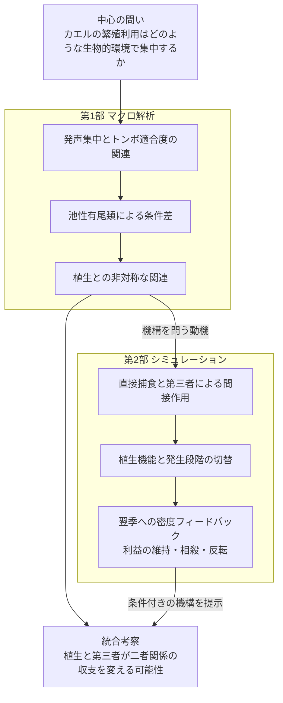

# カエルの繁殖利用を特徴づける生物的環境と植生

## 広域の発声解析と発生段階を組み込んだ三者モデル

英語仮題：Biotic and vegetation context of frog breeding-site use: macroecological associations and stage-structured feedbacks

## 要旨案

カエルの繁殖活動が集中する場所を理解するには、同じ水域を利用する生物と植生が相互作用をどう変えるかを考える必要がある。本研究は北米の4,248音響調査地点を用いたマクロ解析と、カエル・トンボ類・有尾類の段階構造モデルを組み合わせた。強い発声頻度とトンボ類適合度との弱い負の関連は、池性有尾類の適合度が高い地点で強まり、植生との組合せも二つの捕食者群で異なる方向を示した。モデルでは、捕食者間作用からカエルに生じる利益が高いヤゴ供給側で縮小することで、観測と同方向の局所的な関係が生成された。その成立はカエルの保護・ヤゴの採餌支持・羽化関連機能の組合せに依存した。発生時期と逆転捕食は作用の強さを変えたが、段階のずれや逆転捕食そのものは局所パターンの必要条件ではなかった。これらの結果は、植生を直接的な害と間接的な利益の収支を変える条件として捉え、繁殖活動の集中を第三者と生活史を含む関係から理解する機構的な仮説を提示する。

## 序論

繁殖期の発声は、カエルの存在に加えて、繁殖活動がどこで繰り返し高まるかを広域に捉える手がかりになる。強い発声が集中する地点の特徴を知ることは、単に分布可能な環境を知ることとは異なる問いである。音響研究はすでに、発声群集の変化と局所・景観構造、共に発声する種の生態学的文脈との関係を示している（[Sugai et al. 2021](https://doi.org/10.1111/1365-2656.13399)）。本研究は、反復して観測される繁殖活動を焦点に、その空間的な集中と異なる水生生物群との関連を問う。発声は繁殖活動の指標とし、個体数や繁殖成功そのものとは扱わない。

鳴き声を起点にすることは、生活史上の段階を明確にすることでもある。観測されるのは雄成体の繁殖シグナルだが、池の利用価値には成体の活動場所、雌の産卵場所、幼生の生育環境が関わる。植生を操作した実験では、雄が発声する場所と産卵する場所の応答が一致しないことが示されている（[de Herder et al. 2023](https://doi.org/10.1643/h2022014)）。また、捕食者と同種の卵の手がかりを組み合わせた研究は、産卵場所への応答が単一の生物的条件だけでは決まらないことを示す（[Buxton et al. 2017](https://doi.org/10.1111/eth.12608)）。このため、発声の集中を幼生生残や雌の選好に置き換えず、それらを結ぶ経路を明示する必要がある。

その経路を考える焦点が、カエルとトンボ類の関係である。ヤゴはカエル幼生の捕食者となる一方、変態後のカエルが羽化中のトンボを捕食する事例も報告されている（[Beranek et al. 2023](https://doi.org/10.1002/ecy.4108)）。この自然史は、両群の関係を固定した一方向の捕食として理解できないことを示す。成体の発声との関連を考えるには、その場の捕食に加え、どの段階が重なり、死亡が後の生残・加入へどう伝わるかを問わなければならない。

さらに第三者の有尾類は、二者関係の収支を変えうる。ヤゴの危険シグナルが有尾類の活動を抑え、カエル幼生への間接的な利益を生む経路や、ヤゴに対するカエル幼生の避難行動がイモリの採餌効率を下げる経路には実験的な先例がある（[Kishida et al. 2009](https://doi.org/10.1890/08-0238.1); [Davenport & Chalcraft 2013](https://doi.org/10.1002/ece3.691)）。したがって、ヤゴは直接的な害と間接的な利益の双方を持ちうる。本研究で問うのは第三者効果の存在そのものではなく、このような経路を持つ他群の文脈と、カエルの繁殖活動の集中がどう結び付くかである。

植生は、この第三者作用を含む関係をさらに変える候補となる。生息場所構造と捕食者の組合せが池のギルド内捕食を変える実験も存在する（[Anderson & Semlitsch 2016](https://doi.org/10.1111/1365-2656.12462)）。植生はカエルの隠れ場だけでなく、ヤゴの採餌場所、有尾類の退避場所、トンボの羽化場所にも関わりうる。そのため、植生を「多いほど有利」という単独の環境効果にまとめるだけでなく、誰が誰に及ぼす作用をどの段階で変えるかとして検討する。

本研究は、この問いを二部で扱う。第1部では、4,248音響調査地点の発声集中とトンボ類の環境適合度との関連を、池性有尾類と景観植生の条件に分けて記述する。第2部では、段階別の捕食経路と植生機能を操作し、羽化・変態後の加入まで接続することで、逆転捕食の利益が第三者によって維持・相殺・反転する条件を比較する。観測は関連を、モデルは仮定した経路の帰結を示す。

本研究の特色は、**繁殖シグナルの集中を入口に、二者の関連、第三者による修飾、生息場所による経路の変化を、生活史の時間軸とともに扱うこと**にある。ここでいう階層は、二者関係が第三者の条件で変わり、その変わり方が環境に依存するという入れ子の問いを指す。統計的な交互作用項を、機構としての高次相互作用の実証とは同一視しない。特に植生が第三者の修飾そのものを変えるという観測上の主張は、三者項の不確実性に応じて評価する。

## 第1部 マクロ解析による繁殖利用の特徴づけ

### 1.1 データと解析の焦点

NAAMPの反復音響調査から、6回以上・3年以上の調査を持つ4,248地点を対象とした。応答は、各地点の調査回のうち、監視対象のいずれかのカエルでcall indexが2以上だった回の割合とした。「強い発声」はこの調査指標上の区分であり、録音から測った音圧ではない。解析単位は音響調査地点であり、すべてが独立した一つの池に対応するとは仮定しない。

GBIFの出現記録とGloBIの相互作用情報を種候補の整理に用い、分布モデル由来の群別環境適合度を各地点へ投影した。適合度は環境ニッチへの近さを表す相対指標であり、その地点のヤゴや有尾類の実際の密度ではない。GloBIの関係も、音響調査地点で相互作用が観察されたことを意味しない。

トンボ類との関連を基準に、有尾類全体と池性有尾類の区分を比較し、池性有尾類を主要な生態学的文脈として示した。SDMのuniform背景とtarget-group背景を感度解析として比較した。両者は同一観測に対する別仕様であり、独立な追試ではない。

植生にはEarthEnvの冠水植生被覆を用いた。主要な指標は1 km画素を調査地点の半径3 kmで集約した周辺景観の被覆で、半径1 kmの感度解析も比較した。これは池内の茎密度や隠れ場構造の直接測定ではない。発声、適合度、植生の順位を標準化したモデルに、主効果、全二者交互作用、三者交互作用を含め、全域とルート内の関連を区別した。

### 1.2 トンボ類との負の関連は有尾類の文脈で変わる

トンボ類適合度と強い発声の頻度には、全域で弱い負の相関があった。池性有尾類適合度の低い層と高い層を比較すると、その相関はuniform背景で0.101から−0.284、target-group背景で−0.004から−0.183へ変わった。全域の順位モデルでもトンボ類×池性有尾類の係数は負だった。

この結果は、トンボ類に適した環境との関連が、有尾類にも適した環境で異なることを示す。一方、同じルート内に限定すると関連は弱くなるため、局所的な捕食効果と地理的な環境構造を区別する必要がある。

### 1.3 植生との関係は二つの群で非対称だった

主要な全域・半径3 km・池性有尾類モデルの交互作用は以下だった。区間は保存済みbootstrapの95%区間。

| 項 | uniform背景 | target-group背景 |
|---|---|---|
| トンボ類×有尾類 | −0.166［−0.229,−0.108］ | −0.086［−0.151,−0.023］ |
| トンボ類×植生 | −0.087［−0.124,−0.048］ | −0.064［−0.115,−0.014］ |
| 有尾類×植生 | +0.058［+0.015,+0.101］ | +0.046［−0.022,+0.109］ |
| トンボ類×有尾類×植生 | +0.037［+0.008,+0.068］ | +0.027［−0.024,+0.073］ |

植生が多い文脈でトンボ類との負の関連が強まる成分は両仕様に見られた。有尾類×植生の点推定は正だったが、target-group背景では区間に0を含んだ。これらは他の変数を条件としたモデル係数であり、各群の全地点での正負の効果を直接表すものではない。

三者交互作用の正の推定は、植生によってトンボ類×有尾類の負の成分が緩和される可能性に対応する。ただし背景仕様・空間尺度・ルート内解析に対して一貫して明確ではない。したがって、「三者相互作用を実証した」よりも、「第三者と植生を含む条件付き関連が、機構を検討する動機となった」と位置付ける。

### 1.4 利用履歴と時間的な持続性

同時期・環境条件を揃えた強い発声側と無発声側の4,040対では、強い発声側に過去の強い発声履歴が多かった。前年の周辺水面検出頻度には約−1.48ポイントの差があったが、水面の検出頻度を実際の水域持続日数や新しい池への進出と同一視しない。これらは繁殖利用の履歴と水域条件を示す補助結果であり、植生の交互作用モデルですべてを同時調整したわけではない。

独立したベルギーINBO資料では、同種幼生の確認と3年後の発声に正の関連があった（76/82対38/54地点年、差+22.3ポイント、95%区間+7.2〜+38.1）。ただし幼生有無が切り替わった13地点の地点内比較は不確かだった（−3.8ポイント、−34.6〜+26.9）。有尾類幼生との関連も方向が一定しなかった。この補助解析は時間的な利用の連続性を検討する材料であり、幼生からの加入による効果と、継続的に利用されやすい地点条件を分離してはいない。

## 第2部 シミュレーションによる三者関係の機構検討

### 2.1 植生と第三者が直接作用と間接作用を変えるモデル

カエルを焦点とし、カエル幼生、変態後カエル、有尾類の水生段階、ヤゴ、羽化中トンボを区別した。ヤゴと有尾類によるカエル幼生への捕食、捕食者間の捕食と行動抑制、変態後カエルによる羽化中トンボの捕食をモデル化した。すべての捕食関係が同一の調査水域で観測されたと仮定するのではなく、既存の生態学的知見をもとに構成した合成系として扱う。

植生の作用を、カエルの隠れ場、ヤゴの水中遭遇・採餌支持、有尾類の隠れ場、トンボの羽化支持に分けた。カエルの隠れ場については、ヤゴと有尾類のどちらからより強く保護するかを切り替えた。羽化支持は、羽化失敗を下げると同時に、変態後カエルとの接触を増やす仮定を含む。

まず季節内モデルで出現時期と植生経路を操作し、次に変態・羽化完了を成熟遅延、生存、密度依存的な局所加入、外部移入を通じて翌季以降の入力密度に返した。複数年モデルでは二者／三者、植生機能、保護の非対称性、カエル到着時期、局所加入の重み、逆転捕食の有無を組み合わせた864条件を80季節計算した。最後20季節の平均繁殖指数と変態完了密度を比較し、全植生機能の144条件では13設定の感度解析を行った。

### 2.2 季節内の保護効果と逆転捕食は別の経路で作用する

季節内モデルでは、カエルを有尾類から守ることは、ヤゴが有尾類を抑える間接的な利益の必要性を小さくしうる。そのため、カエルの生残そのものが改善しても、ヤゴを加えることの純効果が負に変わる場合があった。植生の保護効果と、ヤゴとの負の関係は両立しうる。

一方、変態後カエルによる羽化中トンボの捕食は、同じ季節の既に終了したカエル幼生期を救わない。従来の固定初期密度モデルでは、この逆転捕食はトンボの羽化完了に作用するだけで、カエルの同季節の変態完了を変えなかった。年をまたぐ接続は、逆転捕食が後年のカエルに返る経路を検討するために必要だった。

### 2.3 第三者は逆転捕食の利益を相殺または反転させる

複数年モデルでは、二者系において、逆転捕食でトンボの羽化生残が減ることが次世代のヤゴ密度を下げ、カエルへの利益につながる場合があった。しかし有尾類が存在すると、ヤゴの減少は有尾類への抑制も弱めるため、カエルに対する純効果は変わった。

例として、局所加入重み0.5、全植生機能、カエル到着50日を用いた対応比較を示す。差は同一条件における逆転捕食あり−なしの、規格化繁殖指数の差である。

| カエルへの植生の保護 | カエル＋ヤゴ | カエル＋ヤゴ＋有尾類 |
|---|---:|---:|
| ヤゴから強く保護 | +0.1252 | −0.0613 |
| 有尾類から強く保護 | +0.0005 | +0.1924 |

前者の三者条件では、有尾類の指数はほぼ変わらなかったが、ヤゴによる行動抑制が弱まり、有尾類によるカエルの死亡割合が上昇した。行動抑制経路を除くと負の効果は消えた。後者では、有尾類からの害を植生が抑えるため、ヤゴ減少による利益が残った。この比較は、第三者の効果を個体数の増減だけでなく、行動と曝露の変化から考える必要を示す。

### 2.4 成立条件と感度

局所加入がなく、入力密度が外部供給で固定される対照では、逆転捕食の翌季以降のカエル指数への効果は0だった。反対に外部供給がない設定では、カエルなどがほぼ0へ向かう場合があり、小さなon/off差を弱い相互作用と解釈できない。

代表例の正負は初期密度の変更、160季節への延長、半刻み積分では維持されたが、加入換算や未成熟期間の生存、成体の年越しを変えると符号も変わった。モデルが示すのは第三者による利益の反転が生じる条件であり、その一般性や自然界での頻度ではない。成熟遅延は季節内の捕食から外れた加入待ち期間で、ヤゴの水中越冬を直接表現しない。繁殖指数を発声頻度に変換する観測モデルも含まない。

### 2.5 外部加入勾配による経路の切り分け

逆転捕食の有無と、トンボ類の勾配に沿う応答を区別するため、年モデルの有尾類・ヤゴの外部供給源を独立に0.25/1/2へ変えた。初期個体数を固定した3,240シナリオで、植生機能の除去と捕食経路の除去を組み合わせた。カエル繁殖指数の最後20季節平均を比較し、負の交互作用だけでなく、ヤゴの効果自体も負かを評価した。

事前に固定した全範囲D=0.25→2の比較では、通常モデル72条件中22で負の修飾があったが、それらは正の効果が縮小する場合であり、観測に相当する「負の効果の強まり」を満たす条件はなかった。保存済み中間点を用いた事後的な隣接区間の探索では、D=1→2の2条件に限り、負のヤゴ効果が高有尾類供給で強まった。この探索的結果を主比較の成功に置き換えない。

そのうち全植生機能・植生1・カエルを有尾類から強く保護・カエル到着50日の設定では、ヤゴ勾配に対する傾きが低有尾類供給で−0.624、高供給で−0.825となった。行動抑制または捕食者間捕食を外すと負の修飾は消えたが、逆転捕食を外しても残った。カエルの隠れ場、ヤゴの採餌支持、羽化関連機能を各々外すと消える一方、有尾類をヤゴから保護する機能を外しても残った。したがって、この局所候補は「植生が有尾類を保護するため」や「逆転捕食があるため」という単独説明では要約できない。

この条件では同じヤゴ供給量におけるカエル指数は高有尾類供給側でなお高く、負の修飾は有尾類を含む系の間接利益が高ヤゴ側で縮小することを表す。危険情報による抑制と捕食者間捕食が実現密度・活動を変える、非線形な利益と害の収支が候補となる。時間刻み半減と160季節への延長でも符号は保たれたが、加入換算・成熟遅延・局所加入重みによって消えるため、普遍的な関係ではない。個別の矢印ではなく複数経路を同時に除去した比較であることにも留意する。

この追加検証は、生息適合度を外部供給量へ、発声を繁殖指数へ直接換算するものではない。野外の原因は未同定だが、観測と同方向の局所パターンを生成しうる条件と、その成立に関わる機能の組合せを提示できた。詳細と全設定は`SOURCE_GRADIENT_RESULTS_2026-10-26.md`に保存した。

### 2.6 発生段階の時間配置

上記の局所候補を対象に、登場時期、段階終了時期、水中期間、サイズ依存の捕食関数、逆転捕食を操作した1,728シナリオを追加した。選択した植生・供給範囲では、登場と終了を揃えても、サイズ依存を一定の捕食係数へ置き換えても負の修飾が残った。したがって、この符号を発生段階のずれに特異的な証拠とはできない。一方、符号の強さと逆転捕食の作用は時間配置に依存した。有尾類とカエルの水中期が重ならない場合にも、有尾類が先にヤゴへ及ぼす作用を通して関連が残り、同時共存だけでなく相互作用の時間的な持越しが研究対象になる。

逆転捕食の利益と傾き修飾は別に評価する必要がある。基本条件では各供給量でカエル指数が増えるが、低有尾類・中程度ヤゴ供給での増加が特に大きいため、有尾類間の傾きの差が縮まる。ヤゴ傾き自体が一律に緩むわけではない。登場を揃えると負の修飾がわずかに強まる条件もあり、逆転機会の存在だけでは緩和を予測できない。

### 2.7 観測された植生の非対称性を同じ条件で生成できるか

モデルの役割は、まず観測されたパターンが設定した仕組みで生じうるかを確認し、そのうえで未観測の逆転捕食や段階の時間配置を操作し、次の実証研究で区別すべき予測を導くことにある。この順序に沿い、保存済み結果から、植生を増やしたときにD側の傾きが負方向、S側の傾きが正方向へ同時に変わるかを検査した。

基本人口学の通常経路36文脈中、D・Sとも全供給範囲0.25→2では12文脈で植生の二方向が同時に生じた。ただし、有尾類による負の修飾まで同時に成立する文脈はなかった。以前の局所条件と同じD=1→2、S=0.25→2では、二方向が12文脈、そのうち有尾類による負の修飾と負のD傾きまで成立する文脈が2あった。

全植生機能・有尾類から強く保護・カエル到着50日の例では、植生0→1で、D傾き（S=1）は−0.0350→−0.9011、S傾き（D=1）は−0.1872→+0.1650となった。同じ植生1で高S−低SのD傾きの差は−0.2009だった。マクロで焦点とした三方向の関係が同じ局所設定で生成された。行動抑制または捕食者間捕食の除去では一致が消え、逆転捕食を除いても基本設定では残った。

比較は条件付き割線の方向であり、順位回帰係数との効果量一致ではない。植生によるS×D修飾そのものの変化はこの例では負で、マクロの三者項の正の点推定まで含めた全面的一致ではない。詳細と全条件はJOINT_VEGETATION_PATTERN_CHECK_2026-10-27.mdに示す。

## 統合考察

### 繁殖活動の集中を、第三者を含む生物的環境から理解する

本研究では、カエルの強い発声の頻度とトンボ類の生息適合度との関連が、池性有尾類と植生の条件によって異なった。これは、繁殖活動の集中を特徴づける生物的環境が、カエルと一種類の捕食者との関係だけでは要約できないことを示す。特に、有尾類適合度が高い地点でトンボ類との負の関連が強まった結果は、第三者が直接作用と間接作用の収支を変えるという観点から解釈できる。

有尾類はカエル幼生の捕食者となる一方、ヤゴへの捕食を通じてカエルに間接的な利益を与えうる。逆に、ヤゴが有尾類の活動を抑えることでもカエルへの利益が生じうる。後者には、ヤゴの危険情報がサンショウウオ幼生の活動と捕食形態を抑制し、オタマジャクシの死亡を減らした実験的先例がある（Kishida et al. 2009）。したがって、有尾類が多いこともヤゴが多いことも、それぞれ一方向の捕食圧に置き換えることはできない。

本研究の複数年モデルでは、高いヤゴ供給側の探索的な範囲に、観測と同方向の関係を生む条件が存在した。全植生機能を含む例では、有尾類供給の増加に伴うカエル繁殖指数の差が、ヤゴ供給1では約+0.289、供給2では約+0.088となった。すなわち、カエルにとっての利益が高ヤゴ側で縮小することで、有尾類の多い系ほどヤゴ勾配に沿った減少が急になった。この関係は捕食者間捕食または行動抑制を除くと消えた。観測された負の条件差の説明候補として、捕食者の害が単純に加算される仕組みに加え、捕食者間作用から生じる利益が維持されなくなる仕組みを考える必要がある。

### 植生は、捕食者ごとに異なる接触と避難の条件を作る

マクロ解析では、トンボ類×植生が負、有尾類×植生が正方向という非対称な関連が見られた。この結果を理解するうえで重要なのは、植生をカエルに一律の安全性を与える環境として扱わず、誰と誰の遭遇を変える構造なのかを問うことである。

先行実験は、避難場所の利用が捕食者によって異なる結果をもたらすことを示している。Davenport and Chalcraft（2013）では、ヤゴの危険情報に応じてオタマジャクシが落葉下を利用し、成体イモリの採餌効率が低下した。この実験は落葉量を変えていないが、共通の構造内での場所利用が、別の捕食者との接触を変える機構を示している。一方、Hossie and Murray（2010）は、落葉量の操作によってヤゴのオタマジャクシに対する機能的反応がII型からIII型へ変わることを示した。構造の作用は、捕食を一様に増減させるのではなく、餌密度に対して捕食がどう変化するかにも及ぶ。

植生は捕食者にも利用される。水生無脊椎動物の実験では、人工植生の追加により、植物上で採餌する捕食者の浮遊性の餌への捕食圧が増す一方、底生の餌の死亡は減少した（Klečka & Boukal 2014）。これは、構造の効果が捕食者と餌の微小生息場所の組合せに依存することを示す。本研究の負のトンボ類×植生の関連も、植生がカエルへの保護とトンボ側の利用機会を同時に変える可能性として解釈できる。ここで想定するのは、植生が常にヤゴの捕食率を高めるという一般則ではなく、保護と捕食機会の相対的な変化である。

### 植生は第三者を介する利益の大きさも変える

植生構造の効果は、カエルとヤゴの接触だけで完結しない。Anderson and Semlitsch（2016）は、二種のサンショウウオ幼生に対する上位捕食者と垂直構造の操作から、構造の主効果が小さくても、捕食者の組合せと中間捕食者の生残を含む関係が、もう一方の幼生の生残に関わることを示した。この先例は、植生の役割を植生量の主効果だけで評価できないことを示している。

今回のモデルでも、植生機能を個別に除去すると、同じヤゴ・有尾類供給条件の帰結が変わった。観測と同方向の局所パターンは、カエルの隠れ場、ヤゴの採餌支持、羽化関連機能のいずれかを外すと消えた一方、有尾類をヤゴから保護する機能を外しても残った。したがって、この条件を「植生が有尾類を保護したため」と説明するよりも、カエルへの非対称な保護とトンボ側を支える機能が組み合わさり、第三者を介する利益と直接的な害の釣り合いを変えたと解釈する方が、結果に即している。

この解釈では、正の有尾類×植生係数を、そのまま有尾類によるカエルへの利益と読む必要はない。観測の非対称な係数は、捕食者ごとに異なる構造利用を検討する根拠となり、モデルの機能除去は、そのような非対称性から関係が変わりうることを示す。景観の冠水植生被覆と池内の隠れ場構造の対応は、今後の局所観測で確かめる対象となる。

### 羽化を支える植生が、水中での作用を後の段階へつなぐ

植生の役割は、水中での捕食回避や採餌にとどまらない。Grof-Tisza et al.（2017）は、植物構造がトンボの羽化場所としての利用に関わることを示した。羽化場所選択と捕食回避は区別する必要があり、固定した餌を用いた鳥による除去実験では、植物の機械的防御の効果が認められた一方、構造複雑性の効果は認められなかった。この結果は、植物のどの形質がどの過程を支えるかを分ける必要を示す。

本研究のモデルでは、羽化・変態完了を後年の加入につなぐことで、植生の作用が当季の生残だけでなく、後の捕食者との関係にも及びうることを示した。羽化関連機能を外すと局所パターンが消えた結果は、植生を隠れ場だけとして捉える説明では不十分であることを示唆する。ただし、実装した羽化関連機能は羽化失敗の低下と変態後カエルとの接触増加を含む複合操作である。先行文献が実測した羽化場所利用から、当該池の翌季のヤゴ加入までを実証済みの連鎖として扱わず、今回のモデルが検討した接続として位置付ける。

### 発生段階は作用の時間配置を変え、逆転捕食は利益の返り方を変える

時期とサイズ依存性の操作は、局所パターンの符号が発生段階のずれに固有ではないことを示した。一方、その強さは段階の出現と終了の配置で変化した。有尾類が水中から去った後にカエルが現れる設定でも、有尾類が先にヤゴへ及ぼした作用を通して関係が残った。繁殖活動の集中を理解する際には、現在同時に存在する生物だけでなく、先行する相互作用が残す条件にも注目する必要がある。

逆転捕食も、この時間的な接続の一部である。基本の局所条件では、変態後カエルによる羽化中トンボの捕食がカエル繁殖指数を増加させ、有尾類の低供給・高供給間の傾きの差を縮めた。これはカエルへの利益と第三者による修飾の変化を示すが、ヤゴ勾配の負の傾き自体が一律に緩和されたことを意味しない。逆転捕食はその局所パターンの必要条件ではなく、発生時期によって利益の大きさと群間の差を変える作用として理解できる。

### 広域の関連から機構の成立条件へ

二つの解析は、異なる側面から同じ生態学的な問いを扱う。マクロ解析は、繁殖活動の集中が第三者と植生の文脈に応じてどう異なるかを示した。モデルは、その文脈依存性を生みうる機構と成立条件を具体化した。モデルの全加入範囲では観測と同方向の条件差は得られず、同方向の関係は高供給側の探索的な区間で現れたため、広域パターン全体の再現ではなく、機構的な可能性の検証として位置付ける。

発声は成体の繁殖活動、適合度は環境ニッチへの近さ、景観植生は周辺の被覆を表す。幼生期の作用が発声集中へつながるには、生残・加入を経て繁殖集団へ返る経路、または成体の場所利用へつながる経路が必要となる。本研究はこの接続を動機として、植生と第三者が利益と害を組み替える仕組みを提示した。個々の係数を特定の捕食経路へ直結させず、観測された関連と経路操作の結果を対応させることで、生態学的な考察を検証可能な説明へ進めている。

## 結論

カエルの強い発声が集中する地点は、トンボ類の生息適合度との関係が、有尾類と植生の条件によって異なることで特徴づけられた。段階構造モデルは、捕食者間の捕食と行動抑制がカエルへの間接的利益を生み、その利益がヤゴの供給に沿って縮小することで、観測と同方向の条件付き関係が生じうることを示した。モデルでは、植生はカエルの避難場所、捕食者の採餌場所、羽化を支える構造として複数の経路に関わり、直接的な害と間接的な利益の収支を変えた。発生段階の時間配置と逆転捕食は、その作用の強さと後年への帰結を変化させた。本研究は、繁殖活動の集中を理解するうえで、捕食者の多さに加えて、第三者・植生・生活史を通じて変わる相互作用の収支に注目する意義を示す。

## 図構成と本文への配置

図1は音響調査・適合度・景観植生の関係と、トンボ×有尾類の主要な関連を示す。図2は植生による条件差を示し、不確かな三者項も区間付きで残す。図3はモデルの段階・経路と植生機能を示す。図4は複数年モデルの対応比較・軌跡・感度を示す。水面、利用履歴、INBO、全モデル格子は補助図表に置き、本文では各部末尾で要点を述べる。

## 執筆用の出典対応

本文の二部構成は最新の研究方向に沿う原稿案であり、投稿形式・引用文献一覧を完成させた稿ではない。文献に基づく個々の捕食・植生経路の引用は、既存の一次文献監査から方法・序論へ配置する。

| 内容 | 保存済み根拠 |
|---|---|
| 背景と新規性、近接する先行研究 | CALLING_HIERARCHY_NOVELTY_2026-10-26.md、NOVELTY_MECHANISM_PRIMARY_AUDIT_2026-10-26.md |
| 符号付き因果経路とモデル・文献の区別 | CAUDATE_VEGETATION_MECHANISTIC_DISCUSSION_2026-10-26.md、CAUDATE_VEGETATION_PATH_AUDIT_2026-10-26.md |
| マクロ解析の解釈と一次文献 | THREE_GUILD_VEGETATION_DISCUSSION_V1_2026-10-26.md、VEGETATION_THREE_GUILD_PRIMARY_EVIDENCE_2026-10-26.md |
| 適合度の層別相関 | ../results/naamp_odonata_caudata_associations_20261026/stratified_correlations.csv |
| 植生の交互作用 | ../results/naamp_remote_vegetation_20261026/network_rank_coefficients.csv |
| 幼生と後年の発声 | PRIOR_LARVAE_CHORUS_RESULTS_2026-10-26.md |
| 季節内モデル | STAGE_VEGETATION_SIMULATION_REPORT_2026-10-26.md |
| 複数年モデルと感度 | MULTIYEAR_STAGE_NETWORK_RESULTS_2026-10-26.md、../results/multiyear_stage_network_20261026/ |

方法の完全な設定、全結果、再現手順は各解析文書を参照する。元のマクロ解析の固定結果は変更していない。

## 引用文献（統合考察）

- Anderson, T. L. & Semlitsch, R. D. (2016). Top predators and habitat complexity alter an intraguild predation module in pond communities. *Journal of Animal Ecology*, 85, 548–558. https://doi.org/10.1111/1365-2656.12462
- Davenport, J. M. & Chalcraft, D. R. (2013). Nonconsumptive effects in a multiple predator system reduce the foraging efficiency of a keystone predator. *Ecology and Evolution*, 3, 3063–3072. https://doi.org/10.1002/ece3.691
- Grof-Tisza, P., LoPresti, E., Heath, S. K. & Karban, R. (2017). Plant structural complexity and mechanical defenses mediate predator–prey interactions in an odonate–bird system. *Ecology and Evolution*, 7, 1650–1659. https://doi.org/10.1002/ece3.2705
- Hossie, T. J. & Murray, D. L. (2010). You can't run but you can hide: refuge use in frog tadpoles elicits density-dependent predation by dragonfly larvae. *Oecologia*, 163, 395–404. https://doi.org/10.1007/s00442-010-1568-6
- Kishida, O., Trussell, G. C. & Nishimura, K. (2009). Top-down effects on antagonistic inducible defense and offense. *Ecology*, 90, 1217–1226. https://doi.org/10.1890/08-0238.1
- Klečka, J. & Boukal, D. S. (2014). The effect of habitat structure on prey mortality depends on predator and prey microhabitat use. *Oecologia*, 176, 183–191. https://doi.org/10.1007/s00442-014-3007-6
