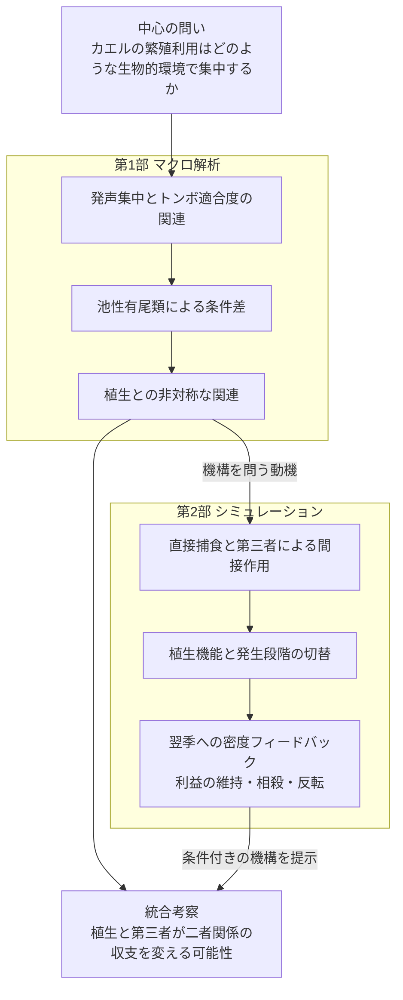

# カエルの繁殖利用を特徴づける生物的環境と植生

## 広域の発声解析と発生段階を組み込んだ三者モデル

英語仮題：Biotic and vegetation context of frog breeding-site use: macroecological associations and stage-structured feedbacks

## 要旨案

カエルの繁殖活動が集中する場所を理解するには、環境の適合性に加え、同じ水域を利用する生物との関係を考える必要がある。本研究では、広域の観測解析と発生段階を組み込んだシミュレーションを用い、カエルとトンボ類の関係が第三者である有尾類および植生の文脈でどう変わるかを検討した。第1部では、北米の4,248音響調査地点における強い発声の記録頻度を、トンボ類・池性有尾類の環境適合度と周辺の冠水植生に関連づけた。トンボ類適合度との弱い負の関連は、池性有尾類に適した地点でより強く、トンボ類と植生の交互作用係数も負だった。有尾類と植生の係数は正方向だったが、その不確実性は解析仕様によって異なった。第2部では、幼生期の捕食と変態後カエルによる羽化中トンボの捕食を結び、羽化・変態完了を翌季以降の密度へ返す三者モデルを構築した。二者系でカエルに返る逆転捕食の利益は、有尾類の存在によって相殺・反転しうる一方、植生による捕食者間で非対称な保護はその利益を維持する場合があった。この結果は、植生を単なる良好な生息環境ではなく、直接捕食と間接作用の収支を変える条件として捉える仮説を提示する。観測解析は条件付き関連を示し、モデルはその背景にありうる機構の成立条件を示す。

## 序論

繁殖期の発声は、カエルの存在に加えて、繁殖活動がどこで繰り返し高まるかを広域に捉える手がかりになる。強い発声が集中する地点の特徴を知ることは、単に分布可能な環境を知ることとは異なる問いである。音響研究はすでに、発声群集の変化と局所・景観構造、共に発声する種の生態学的文脈との関係を示している（[Sugai et al. 2021](https://doi.org/10.1111/1365-2656.13399)）。本研究は、反復して観測される繁殖活動を焦点に、その空間的な集中と異なる水生生物群との関連を問う。発声は繁殖活動の指標とし、個体数や繁殖成功そのものとは扱わない。

鳴き声を起点にすることは、生活史上の段階を明確にすることでもある。観測されるのは雄成体の繁殖シグナルだが、池の利用価値には成体の活動場所、雌の産卵場所、幼生の生育環境が関わる。植生を操作した実験では、雄が発声する場所と産卵する場所の応答が一致しないことが示されている（[de Herder et al. 2023](https://doi.org/10.1643/h2022014)）。また、捕食者と同種の卵の手がかりを組み合わせた研究は、産卵場所への応答が単一の生物的条件だけでは決まらないことを示す（[Buxton et al. 2017](https://doi.org/10.1111/eth.12608)）。このため、発声の集中を幼生生残や雌の選好に置き換えず、それらを結ぶ経路を明示する必要がある。

その経路を考える焦点が、カエルとトンボ類の関係である。ヤゴはカエル幼生の捕食者となる一方、変態後のカエルが羽化中のトンボを捕食する事例も報告されている（[Beranek et al. 2023](https://doi.org/10.1002/ecy.4108)）。この自然史は、両群の関係を固定した一方向の捕食として理解できないことを示す。成体の発声との関連を考えるには、その場の捕食に加え、どの段階が重なり、死亡が後の生残・加入へどう伝わるかを問わなければならない。

さらに第三者の有尾類は、二者関係の収支を変えうる。ヤゴの危険シグナルが有尾類の活動を抑え、カエル幼生への間接的な利益を生む経路や、ヤゴに対するカエル幼生の避難行動がイモリの採餌効率を下げる経路には実験的な先例がある（[Kishida et al. 2009](https://doi.org/10.1890/08-0238.1); [Davenport & Chalcraft 2013](https://doi.org/10.1002/ece3.691)）。したがって、ヤゴは直接的な害と間接的な利益の双方を持ちうる。本研究で問うのは第三者効果の存在そのものではなく、このような経路を持つ他群の文脈と、カエルの繁殖活動の集中がどう結び付くかである。

植生は、この第三者作用を含む関係をさらに変える候補となる。生息場所構造と捕食者の組合せが池のギルド内捕食を変える実験も存在する（[Anderson & Semlitsch 2016](https://doi.org/10.1111/1365-2656.12462)）。植生はカエルの隠れ場だけでなく、ヤゴの採餌場所、有尾類の退避場所、トンボの羽化場所にも関わりうる。そのため、植生を「多いほど有利」という単独の環境効果にまとめるだけでなく、誰が誰に及ぼす作用をどの段階で変えるかとして検討する。

本研究は、この問いを二部で扱う。第1部では、4,248音響調査地点の発声集中とトンボ類の環境適合度との関連を、池性有尾類と景観植生の条件に分けて記述する。第2部では、段階別の捕食経路と植生機能を操作し、羽化・変態後の加入まで接続することで、逆転捕食の利益が第三者によって維持・相殺・反転する条件を比較する。観測は関連を、モデルは仮定した経路の帰結を示す。

本研究の特色は、**繁殖シグナルの集中を入口に、二者の関連、第三者による修飾、生息場所による経路の変化を、生活史の時間軸とともに扱うこと**にある。ここでいう階層は、二者関係が第三者の条件で変わり、その変わり方が環境に依存するという入れ子の問いを指す。統計的な交互作用項を、機構としての高次相互作用の実証とは同一視しない。特に植生が第三者の修飾そのものを変えるという観測上の主張は、三者項の不確実性に応じて評価する。

## 第1部 マクロ解析による繁殖利用の特徴づけ

### 1.1 データと解析の焦点

NAAMPの反復音響調査から、6回以上・3年以上の調査を持つ4,248地点を対象とした。応答は、各地点の調査回のうち、監視対象のいずれかのカエルでcall indexが2以上だった回の割合とした。「強い発声」はこの調査指標上の区分であり、録音から測った音圧ではない。解析単位は音響調査地点であり、すべてが独立した一つの池に対応するとは仮定しない。

GBIFの出現記録とGloBIの相互作用情報を種候補の整理に用い、分布モデル由来の群別環境適合度を各地点へ投影した。適合度は環境ニッチへの近さを表す相対指標であり、その地点のヤゴや有尾類の実際の密度ではない。GloBIの関係も、音響調査地点で相互作用が観察されたことを意味しない。

トンボ類との関連を基準に、有尾類全体と池性有尾類の区分を比較し、池性有尾類を主要な生態学的文脈として示した。SDMのuniform背景とtarget-group背景を感度解析として比較した。両者は同一観測に対する別仕様であり、独立な追試ではない。

植生にはEarthEnvの冠水植生被覆を用いた。主要な指標は1 km画素を調査地点の半径3 kmで集約した周辺景観の被覆で、半径1 kmの感度解析も比較した。これは池内の茎密度や隠れ場構造の直接測定ではない。発声、適合度、植生の順位を標準化したモデルに、主効果、全二者交互作用、三者交互作用を含め、全域とルート内の関連を区別した。

### 1.2 トンボ類との負の関連は有尾類の文脈で変わる

トンボ類適合度と強い発声の頻度には、全域で弱い負の相関があった。池性有尾類適合度の低い層と高い層を比較すると、その相関はuniform背景で0.101から−0.284、target-group背景で−0.004から−0.183へ変わった。全域の順位モデルでもトンボ類×池性有尾類の係数は負だった。

この結果は、トンボ類に適した環境との関連が、有尾類にも適した環境で異なることを示す。一方、同じルート内に限定すると関連は弱くなるため、局所的な捕食効果と地理的な環境構造を区別する必要がある。

### 1.3 植生との関係は二つの群で非対称だった

主要な全域・半径3 km・池性有尾類モデルの交互作用は以下だった。区間は保存済みbootstrapの95%区間。

| 項 | uniform背景 | target-group背景 |
|---|---|---|
| トンボ類×有尾類 | −0.166［−0.229,−0.108］ | −0.086［−0.151,−0.023］ |
| トンボ類×植生 | −0.087［−0.124,−0.048］ | −0.064［−0.115,−0.014］ |
| 有尾類×植生 | +0.058［+0.015,+0.101］ | +0.046［−0.022,+0.109］ |
| トンボ類×有尾類×植生 | +0.037［+0.008,+0.068］ | +0.027［−0.024,+0.073］ |

植生が多い文脈でトンボ類との負の関連が強まる成分は両仕様に見られた。有尾類×植生の点推定は正だったが、target-group背景では区間に0を含んだ。これらは他の変数を条件としたモデル係数であり、各群の全地点での正負の効果を直接表すものではない。

三者交互作用の正の推定は、植生によってトンボ類×有尾類の負の成分が緩和される可能性に対応する。ただし背景仕様・空間尺度・ルート内解析に対して一貫して明確ではない。したがって、「三者相互作用を実証した」よりも、「第三者と植生を含む条件付き関連が、機構を検討する動機となった」と位置付ける。

### 1.4 利用履歴と時間的な持続性

同時期・環境条件を揃えた強い発声側と無発声側の4,040対では、強い発声側に過去の強い発声履歴が多かった。前年の周辺水面検出頻度には約−1.48ポイントの差があったが、水面の検出頻度を実際の水域持続日数や新しい池への進出と同一視しない。これらは繁殖利用の履歴と水域条件を示す補助結果であり、植生の交互作用モデルですべてを同時調整したわけではない。

独立したベルギーINBO資料では、同種幼生の確認と3年後の発声に正の関連があった（76/82対38/54地点年、差+22.3ポイント、95%区間+7.2〜+38.1）。ただし幼生有無が切り替わった13地点の地点内比較は不確かだった（−3.8ポイント、−34.6〜+26.9）。有尾類幼生との関連も方向が一定しなかった。この補助解析は時間的な利用の連続性を検討する材料であり、幼生からの加入による効果と、継続的に利用されやすい地点条件を分離してはいない。

## 第2部 シミュレーションによる三者関係の機構検討

### 2.1 植生と第三者が直接作用と間接作用を変えるモデル

カエルを焦点とし、カエル幼生、変態後カエル、有尾類の水生段階、ヤゴ、羽化中トンボを区別した。ヤゴと有尾類によるカエル幼生への捕食、捕食者間の捕食と行動抑制、変態後カエルによる羽化中トンボの捕食をモデル化した。すべての捕食関係が同一の調査水域で観測されたと仮定するのではなく、既存の生態学的知見をもとに構成した合成系として扱う。

植生の作用を、カエルの隠れ場、ヤゴの水中遭遇・採餌支持、有尾類の隠れ場、トンボの羽化支持に分けた。カエルの隠れ場については、ヤゴと有尾類のどちらからより強く保護するかを切り替えた。羽化支持は、羽化失敗を下げると同時に、変態後カエルとの接触を増やす仮定を含む。

まず季節内モデルで出現時期と植生経路を操作し、次に変態・羽化完了を成熟遅延、生存、密度依存的な局所加入、外部移入を通じて翌季以降の入力密度に返した。複数年モデルでは二者／三者、植生機能、保護の非対称性、カエル到着時期、局所加入の重み、逆転捕食の有無を組み合わせた864条件を80季節計算した。最後20季節の平均繁殖指数と変態完了密度を比較し、全植生機能の144条件では13設定の感度解析を行った。

### 2.2 季節内の保護効果と逆転捕食は別の経路で作用する

季節内モデルでは、カエルを有尾類から守ることは、ヤゴが有尾類を抑える間接的な利益の必要性を小さくしうる。そのため、カエルの生残そのものが改善しても、ヤゴを加えることの純効果が負に変わる場合があった。植生の保護効果と、ヤゴとの負の関係は両立しうる。

一方、変態後カエルによる羽化中トンボの捕食は、同じ季節の既に終了したカエル幼生期を救わない。従来の固定初期密度モデルでは、この逆転捕食はトンボの羽化完了に作用するだけで、カエルの同季節の変態完了を変えなかった。年をまたぐ接続は、逆転捕食が後年のカエルに返る経路を検討するために必要だった。

### 2.3 第三者は逆転捕食の利益を相殺または反転させる

複数年モデルでは、二者系において、逆転捕食でトンボの羽化生残が減ることが次世代のヤゴ密度を下げ、カエルへの利益につながる場合があった。しかし有尾類が存在すると、ヤゴの減少は有尾類への抑制も弱めるため、カエルに対する純効果は変わった。

例として、局所加入重み0.5、全植生機能、カエル到着50日を用いた対応比較を示す。差は同一条件における逆転捕食あり−なしの、規格化繁殖指数の差である。

| カエルへの植生の保護 | カエル＋ヤゴ | カエル＋ヤゴ＋有尾類 |
|---|---:|---:|
| ヤゴから強く保護 | +0.1252 | −0.0613 |
| 有尾類から強く保護 | +0.0005 | +0.1924 |

前者の三者条件では、有尾類の指数はほぼ変わらなかったが、ヤゴによる行動抑制が弱まり、有尾類によるカエルの死亡割合が上昇した。行動抑制経路を除くと負の効果は消えた。後者では、有尾類からの害を植生が抑えるため、ヤゴ減少による利益が残った。この比較は、第三者の効果を個体数の増減だけでなく、行動と曝露の変化から考える必要を示す。

### 2.4 成立条件と感度

局所加入がなく、入力密度が外部供給で固定される対照では、逆転捕食の翌季以降のカエル指数への効果は0だった。反対に外部供給がない設定では、カエルなどがほぼ0へ向かう場合があり、小さなon/off差を弱い相互作用と解釈できない。

代表例の正負は初期密度の変更、160季節への延長、半刻み積分では維持されたが、加入換算や未成熟期間の生存、成体の年越しを変えると符号も変わった。モデルが示すのは第三者による利益の反転が生じる条件であり、その一般性や自然界での頻度ではない。成熟遅延は季節内の捕食から外れた加入待ち期間で、ヤゴの水中越冬を直接表現しない。繁殖指数を発声頻度に変換する観測モデルも含まない。

## 統合考察

### 植生を生息適地から相互作用の条件へ捉え直す

マクロ解析では、トンボ類適合度と発声の関連は、有尾類および植生の文脈で異なった。シミュレーションは、その文脈依存性を考えるために、植生が直接捕食と間接的な利益の収支を変える仕組みを示した。植生がカエルに隠れ場を与えることと、トンボ類との負の関連が強まることは必ずしも矛盾しない。ある捕食経路を弱めると、別の経路の相対的重要性が増すためである。

### 第三者の作用は捕食者の数だけでは決まらない

モデル内で利益が負に転じた例では、有尾類の密度変化は小さく、ヤゴによる行動抑制の解除が重要だった。この点は、広域の有尾類適合度をそのまま捕食圧の大きさに置き換えない理由にもなる。有尾類に適した環境は、カエルとトンボ類の二者関係を別の文脈に置くが、そこでの実際の作用を知るには、密度と行動を分けて調べる必要がある。

### 発生段階の逆転は時間をまたぐ相互作用として働く

発生段階の逆転の意義は、捕食する側が入れ替わることだけではない。ある段階での死亡が、加入と移入を通じて将来の捕食者密度を変え、さらに第三者を介してカエルへ返る点にある。局所への帰還が弱い場合、外部供給が大きい場合、またはいずれかの群が持続しない場合には、この循環の結果も変わる。利用履歴と幼生確認の補助解析は時間的な継続性を示唆するが、個体群更新と地点の持続的な質は引き続き区別すべき説明である。

### 二つのパートを結ぶ範囲

マクロ解析の応答は発声頻度、説明変数は環境適合度と景観植生である。一方、モデルの応答は密度・変態完了、説明変数は捕食経路と植生機能である。両者は同じ数量を測っていないため、モデル内の正負をマクロ解析の交互作用係数に直接対応させることはできない。特に、共有する環境勾配、種組成、発声検出の違いは観測上の代替説明として残る。

本研究の貢献は、発声集中を特徴づける広域の関連を示し、それを二者間の捕食だけで説明することの限界と、第三者・植生・生活史を結ぶ機構の可能性を具体化した点にある。次の検証では、同じ水域での植生構造、段階別の密度・行動、羽化・変態、局所加入を対応づけることが、候補機構の識別に必要となる。

この貢献は、音響指標、第三者効果、構造の作用、段階逆転をそれぞれ新発見とするものではない。これらには上記の先例があり、逆転捕食の個体群動態を扱う理論も存在する。今回の観測とモデルの接続により、繁殖活動の集中という成体段階の現象を、別段階の作用が文脈に応じて変わる問題として捉え直せる。実測で支持された階層と、モデルで検討した候補機構を分けることが、この統合の検証可能性を保つ。

## 図構成と本文への配置

図1は音響調査・適合度・景観植生の関係と、トンボ×有尾類の主要な関連を示す。図2は植生による条件差を示し、不確かな三者項も区間付きで残す。図3はモデルの段階・経路と植生機能を示す。図4は複数年モデルの対応比較・軌跡・感度を示す。水面、利用履歴、INBO、全モデル格子は補助図表に置き、本文では各部末尾で要点を述べる。

## 執筆用の出典対応

本文の二部構成は最新の研究方向に沿う原稿案であり、投稿形式・引用文献一覧を完成させた稿ではない。文献に基づく個々の捕食・植生経路の引用は、既存の一次文献監査から方法・序論へ配置する。

| 内容 | 保存済み根拠 |
|---|---|
| 背景と新規性、近接する先行研究 | CALLING_HIERARCHY_NOVELTY_2026-10-26.md、NOVELTY_MECHANISM_PRIMARY_AUDIT_2026-10-26.md |
| マクロ解析の解釈と一次文献 | THREE_GUILD_VEGETATION_DISCUSSION_V1_2026-10-26.md、VEGETATION_THREE_GUILD_PRIMARY_EVIDENCE_2026-10-26.md |
| 適合度の層別相関 | ../results/naamp_odonata_caudata_associations_20261026/stratified_correlations.csv |
| 植生の交互作用 | ../results/naamp_remote_vegetation_20261026/network_rank_coefficients.csv |
| 幼生と後年の発声 | PRIOR_LARVAE_CHORUS_RESULTS_2026-10-26.md |
| 季節内モデル | STAGE_VEGETATION_SIMULATION_REPORT_2026-10-26.md |
| 複数年モデルと感度 | MULTIYEAR_STAGE_NETWORK_RESULTS_2026-10-26.md、../results/multiyear_stage_network_20261026/ |

方法の完全な設定、全結果、再現手順は各解析文書を参照する。元のマクロ解析の固定結果は変更していない。
