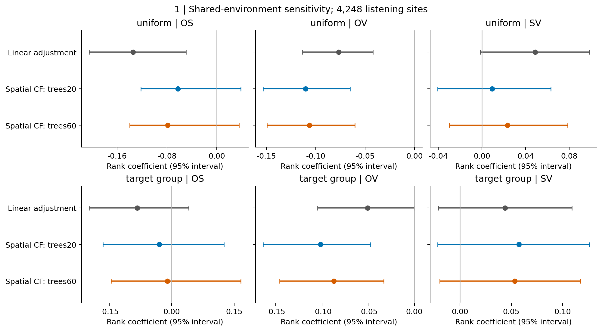
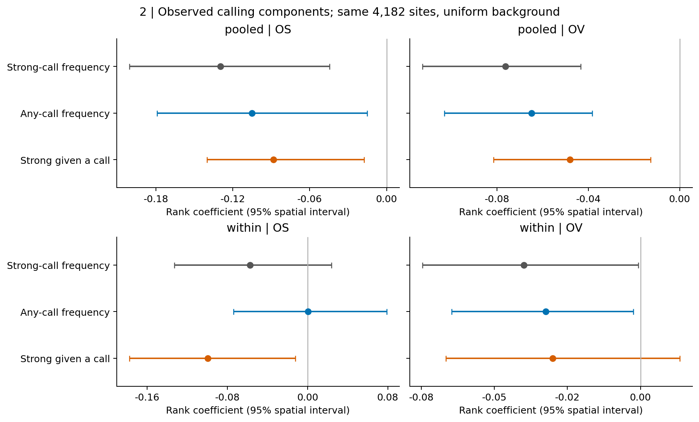
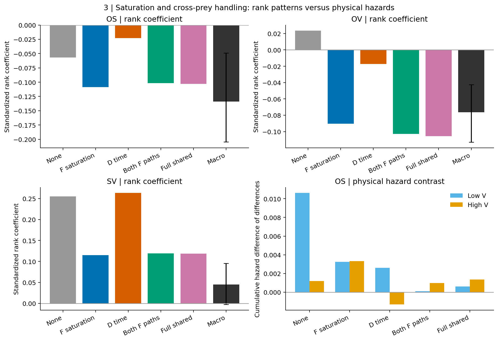
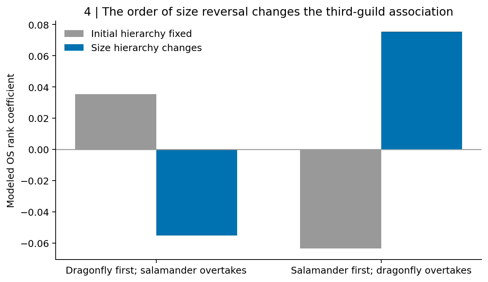
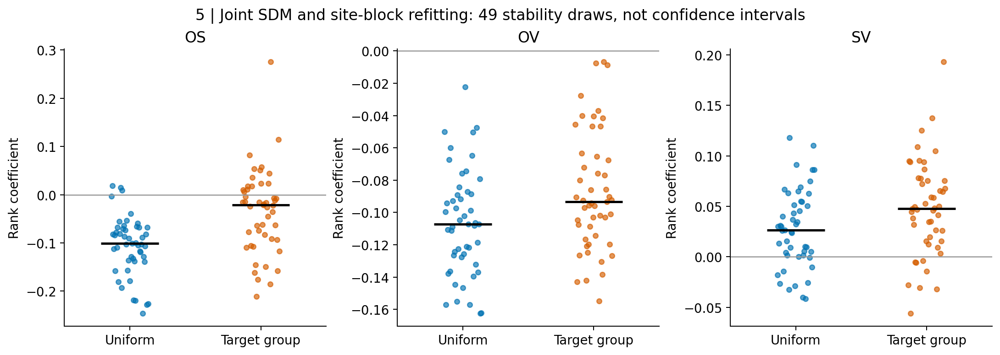
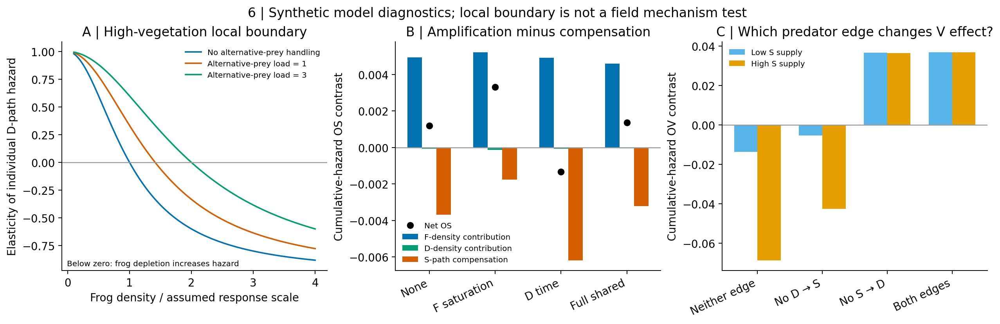

# カエルの鳴き声と捕食者群の文脈依存的な関連：植生、捕食飽和、発生段階による増幅と相殺

**日本語作業稿・2026-10-29。** マクロ解析と機構モデルを一つの論文として統合する。2026-10-27固定稿を上書きせず、その後の共有環境・尺度・経路分離検査を反映した。投稿準備完了稿ではない。追加の季節・種組成・環境支持域・SDM再適合・経路境界検証は[2026-10-29詳細報告](../NEE_EXISTING_DATA_BOUNDARIES_2026-10-29.md)に保存した。

English working title: **Vegetation and predator-guild context in frog calling: separating trophic amplification from compensatory effects**

## 要旨

繁殖期の鳴き声は、カエルによる場所利用と活動の集中を広域で捉える手掛かりとなる。しかし、捕食者群との関連には、共有する環境条件と生物間相互作用の双方が含まれ得る。本研究では北米4,248音響調査地点、63,180回の調査から強い鳴き声の頻度を求め、トンボ類・池性有尾類の環境適合度と景観植生との条件付き関連を解析した。線形の調査・環境・地理調整では、uniform背景のトンボ類×有尾類およびトンボ類×植生の係数は負だった。空間的に分離したデータで共有環境の非線形構造を調整すると、植生×トンボ類の関連は残る一方、有尾類×トンボ類は弱まり、不確実になった。SDM・地点・環境調整を同時に再適合した49回でも植生×トンボ類は両背景ですべて負だったが、有尾類×トンボ類には符号変動が残った。鳴き声確認頻度と確認時の強い鳴き声割合の分解は、観測された関連が活動の複数側面に現れることを示した。段階構造モデルでは、有尾類のカエル捕食の飽和と、ヤゴ処理によるカエル捕食減少を分離した。前者は高植生での捕食危険の増幅を強め、後者は相殺したが、順位上の改善は捕食危険全体の増大を意味しなかった。捕食優位の季節内逆転も、その順序で作用方向を変えた。共通餌減少を残した経路除去では、植生×ヤゴの危険の方向を左右したのは主にヤゴ→有尾類経路であり、双方向捕食そのものは必須ではなかった。本研究は広域の鳴き声の関連から検証すべき捕食過程を絞り込む一方、野外の第三者作用を共有環境から識別するには、対応する段階別個体数と発声の独立観測が必要であることを示す。

## English abstract

Frog calling provides a broad-scale record of breeding activity, but associations with predator guilds may reflect both shared habitat and trophic processes. We analysed strong-call frequency across 4,248 North American listening sites and examined its associations with odonate suitability, pond-breeding caudate suitability and landscape vegetation. Under linear survey, environmental and spatial adjustment, odonate-by-caudate and odonate-by-vegetation associations were negative under uniform-background suitability models. Spatially cross-fitted environmental adjustment retained the vegetation association but attenuated the caudate association. Joint SDM and site-block refitting retained negative vegetation associations across 49 stability draws in both background specifications. Decomposing calling into detection frequency and conditional strong-call frequency identified multiple observational components of these patterns. Stage-structured models then separated saturation of caudate predation on frogs from the cost of processing alternative prey. Saturation increased trophic amplification under high vegetation, whereas alternative-prey processing counteracted it. Stronger rank-scale interactions did not imply stronger amplification throughout the modeled density range. Ontogenetic reversals changed interaction direction according to temporal order. Edge removals retaining shared-prey depletion implicated odonate predation on caudates in the modeled vegetation contrast; reciprocal predation was not necessary in the tested contexts. Together, these analyses narrow mechanistic hypotheses arising from acoustic macroecology while showing why contextual associations alone do not identify field trophic pathways.

## はじめに

カエルの繁殖活動は水域間で均一ではなく、強い合唱が繰り返し生じる場所と、同じ地域でも発声が少ない場所がある。この集中を説明するうえで、気候や水域条件に加え、繁殖後の水生段階が経験する捕食環境は重要な検討対象となる。ただし、成体が鳴く時点と幼生が捕食される時点は異なる。発声を繁殖成功や幼生密度と同一視せず、まず発声が集中する地点の条件を記述し、その関連を生み得る過程を明示的に検査する必要がある。

複数の捕食者が共存する水域では、一種の捕食者による害が別の捕食者によって増えるとは限らない。捕食者が他の捕食者を除く間接利益や、別の餌を処理する時間がカエル捕食を減らす作用がある一方、カエル密度の減少が残存個体の捕食危険を高める可能性もある。植生はそのどこに作用するかによって、直接的な保護と間接的な利益の双方を変える。

例えば、ヤゴに反応したオタマジャクシの落葉下利用がイモリによる捕食を低下させる実験は、植生利用の効果が捕食者によって異なることを示している［1］。また、落葉や代替餌はヤゴの機能的応答を変え得る［2,3］。これらは植生を一律に有益または有害と位置付けることが適切でない理由になる。しかし、景観植生の指標から池内の隠れ場機能を直接推定できるわけではない。

さらに、ヤゴと有尾類は成長・登場時期によって食べる側と食べられる側が変わり得る。大型有尾類幼生による小型ヤゴ捕食と、ヤゴによる有尾類幼生捕食には別々の実験根拠がある［4,5］。変態後のカエルが羽化中のトンボを食べる経路も観察されている［6］。ただし、双方向の捕食が可能であることと、季節内の優位の逆転が特定の広域パターンを生むことは別の命題である。

本研究は二部からなる。第1部では、強い鳴き声とトンボ類適合度の関連が、有尾類と植生の文脈でどう変わるかを調べ、共有環境による説明への感度を検査する。第2部では、対応する三群モデルを用い、捕食飽和、代替餌の処理、発生段階による逆転を分離する。目的はモデルを観測係数へ合わせることではなく、増幅と相殺を担う過程、および観測関連から識別できない部分を明らかにすることである。

## 方法

### 音響調査と環境文脈

NAAMP反復調査のうち、6回以上かつ3年以上の記録を持つ4,248地点・432ルートを固定コホートとした。2001–2015年の有効調査63,180回を用い、いずれかの監視対象カエルのcall indexが2以上だった調査の割合を強い鳴き声の頻度とした。これは音圧の測定値ではなく、調査指数に基づく区分である。調査地点すべてを独立した単一池と仮定しない。

GBIF出現記録とGloBI相互作用情報に基づく既存の種候補・分布モデルから、トンボ類および池性有尾類の平均環境適合度を使用した。uniform背景とtarget-group背景は同一観測に対する二つの仕様として保持した。適合度を局所密度へ、GloBIの関係を対象地点での捕食観察へ読み替えない。植生指標はEarthEnv冠水植生の3-km周辺集約値で、池内の茎密度や当年の隠れ場の測定ではない。

### 条件付き関連と共有環境

応答と説明変数を順位標準化し、主効果、全二者積、三者積を含めた。Oをトンボ類、Sを有尾類、Vを植生と表す。調査回数・年数・気温・騒音・調査時期、気候・水面・草本指標、緯度経度の二次項を調整した。交互作用積を作った後にルート内中心化を行い、地点間の解析と区別した。主解析の植生は連続値である。

共有環境の非線形性への感度として、既存の56空間ブロックを分けた5分割で、応答および七つの説明項を同じ環境・調査共変量から予測し、保持ブロックの残差間の関連を解析した。ExtraTreesは300本、最小葉サイズ20または60に事前固定し、結果による仕様選択を行わなかった。これは同一コホートの内部頑健性検査であり、独立外部検証ではない。999回の空間ブロック再標本化区間を示すが、柔軟モデルの区間は固定した交差適合残差に条件付きで、補助モデルの再学習を毎回行った区間ではない。

### 鳴き声の観測成分

強い鳴き声の頻度を、鳴き声確認頻度と、確認された調査における強い鳴き声割合の積へ分けた。後者が定義できない66地点を除いた共通4,182地点で、元の強い鳴き声頻度も再推定した。この分解は観測事象の恒等式であり、在不在と個体数の因果的分解ではない。鳴き声あり条件への限定に伴う選択と、背景仕様への感度を保持した。

### 捕食モデルと経路介入

カエル、ヤゴ、有尾類の水生期間、相対サイズに依存する捕食、変態・羽化、翌年への加入を含む既存モデルを基準とした。モデル変数は合成供給量と個体群量で、適合度や鳴き声へ校正されていない。植生による有尾類からのカエル保護と、ヤゴの密度応答を含む基準構造を保持した。

有尾類の共有採餌制約を四つに分けた。FFはカエルの処理がカエル捕食自体を飽和させる作用、FDはヤゴの処理がカエル捕食を減らす作用、DF/DDはそれぞれカエル処理／ヤゴ処理がヤゴ捕食を制約する作用である。全16通りを比較し、部分的な経路除去は診断介入として扱った。80年の最後20年を平均し、9×9供給量格子、指定した主要五条件の21×21格子、時間刻み半減で数値整合性を検査した。

モデルとマクロの比較には順位処理と回帰式を固定した。比較用マクロのVは検出ゼロ／正の二値とし、元の連続植生解析と別に表示した。モデル格子には説明変数だけから得た地点分布の重みを用いたが、これは適合度と密度の校正ではない。順位係数に加え、累積捕食危険の差の差、捕食者別の捕殺量、生残を保存した。生残の床効果、順位間隔、年次密度状態を混同しない。

発生段階の検査では、D優位からS優位へ交差する条件と逆順の条件を設定し、S/D間サイズゲートを最初の共存時点に固定した対照と比較した。成長率・処理係数はいずれも合成値であり、文献は経路の候補を制約する根拠とした。

### 追加の不確実性と境界診断

調査回次と暦四半期の発声分母・調査共変量を再集計し、候補捕食者11種の一種除去を行った。有尾類適合度の上下三分位を識別する環境分類器を空間交差適合し、確率0.1–0.9を環境重複域の感度解析とした。残る共変量差を報告し、環境マッチングとは扱わない。原SDMを数値再現後、258地理ブロックから49回再抽出して両背景の11種を再学習した。さらにNAAMP地点ブロック再抽出と環境補助モデル再学習を組み合わせた。49回は安定性診断であり、精密な信頼区間や符号の事後確率には用いない。

局所ヤゴ危険の密度微分を導き、年次モデルの最後20年の各年状態をすべて再生して、危険差をF/D/S状態に対称配分した。和が元の危険差に一致することを検証したが、独立操作による媒介効果とは解釈しない。共通餌の非線形応答を維持したS→D、D→Sの各除去と両除去を比較し、dt半減を行った。

## 結果

### 植生との関連は柔軟な共有環境調整でも残る

連続植生・uniform背景の完全線形調整では、OSは−0.1344（空間95%区間−0.2050〜−0.0496）、OVは−0.0771（−0.1134〜−0.0421）だった。SVは+0.0486（−0.0013〜+0.0983）、三者項は+0.0131（−0.0202〜+0.0503）で、区間がゼロを含んだ。

空間交差適合した柔軟な環境調整では、uniformのOSは−0.0627または−0.0788となり、両区間ともゼロを含んだ。一方OVは−0.1104または−0.1065で負の区間を保った。target-groupでも柔軟調整後のOVは負だったが、OSは不確実だった（図1）。したがって植生に伴う関連と有尾類に伴う関連は、共有環境への頑健性が同じではなかった。

### 関連は鳴き声の確認と強い合唱の双方に現れる

共通4,182地点のuniform地点間解析では、OSは鳴き声確認頻度で−0.1050、確認時強度で−0.0881、OVはそれぞれ−0.0648、−0.0481で、四つとも空間区間が負側だった。ルート内OSは確認頻度で+0.0005、確認時強度で−0.0994となり、両係数差は−0.0999（−0.1856〜−0.0166）だった。ただしtarget-groupではこの差は明瞭でない（図2）。これらは既存の線形調整による観測成分の検査であり、柔軟環境調整後にも同じ成分差が確立したと解釈しない。

### 飽和と代替餌処理は逆向きに働く

21×21格子のuniform対応比較で、基準モデルのOS/OV/SVは−0.0570/+0.0236/+0.2551だった。FFだけを追加すると−0.1087/−0.0903/+0.1150へ変わり、順位上の関係はマクロ参照に近づいた。FDだけでは−0.0230/−0.0172/+0.2633で、有尾類による負の関連は弱まった（図3）。全16通りの対比較でもFFとFDの方向差は保持された。

高植生での累積危険の増幅は、基準+0.001185、FF+0.003313、FD−0.001325だった。しかし低植生ではFFにより+0.010620から+0.003241へ低下し、格子全体の原単位危険のOS係数も小さくなった。従って順位上の増幅改善は、捕食危険が密度領域全体で一様に増幅したことを意味しなかった。主要四条件の有尾類によるヤゴ捕食量は高供給・高植生で同じ0.1015であり、FFの改善をヤゴ捕食量の増加では説明できなかった。

FFでSVの過大さは小さくなったが、uniformの三つの周辺区間へ同時に入る条件は全16通りに存在しなかった。指標の符号や一部の係数の一致を、マクロ全体の適合とは判定しなかった。

### 捕食優位の逆転は順序に依存する

両捕食者の共有制約を含む条件で、D優位からS優位へ変わるサイズ動態を許すとOSは+0.0353から−0.0553へ変わった。逆順では−0.0635から+0.0753へ変わった（図4）。捕食損失の優位も季節内で交代したが、いずれも三つのマクロ関係全体を説明しなかった。変態後カエルによる羽化中トンボ捕食の追加も、今回の不一致を解消しなかった。

### 再適合と支持域は、植生と有尾類の結果を分ける

SDMだけの再学習ではuniformのOS、OVは49回すべて負だった。地点抽出と柔軟環境調整の再学習も含めると、OSの負の回数はuniform46/49、target-group34/49、OVは両方49/49だった（図5）。有尾類適合度上下三分位の環境重複域にはuniform31.3%、target-group22.5%の地点しか残らず、最大標準化環境差も1.09、0.93残った。期間と捕食者種組成の感度解析は一部の負の関連を維持したが、独立な三者作用の識別にはならなかった。

### 食べ合いは、増幅そのものと植生の作用方向に異なる寄与を持つ

高植生でのヤゴ危険はh_D=2ADF/(1+F²+cS)で、F減少による局所増幅の境界はF²>1+cSだった。FとcSは合成モデルの尺度であり、野外閾値ではない。基準登場条件・高植生ではFF追加により総OS危険が+0.001185から+0.003313へ増えたが、その主因は有尾類経路の相殺が−0.003678から−0.001766へ弱まったことであり、F密度を通じたヤゴ経路の寄与は+0.004938から+0.005218への小さい変化だった（図6）。

同じFF条件で、食べ合いを両方除くとOV危険は低Sで−0.013652、高Sで−0.068671だった。両方維持すると+0.036859、+0.036932となり、D→Sだけを除くと負へ戻った。S→Dだけを除いても正は残った。3段階条件×5処理条件の総危険の六隅点方向が全て一致した数は、双方向あり4/15、D→S除去0/15、S→D除去5/15、両除去0/15だった。これは有限のモデル診断であり、マクロの順位係数の再現率や成立確率ではない。

## 考察

### 鳴き声から見える生態学的文脈

本研究で比較的安定して残ったのは、植生条件によってトンボ類適合度と強い鳴き声の関連が変わることだった。これは植生を単なるカエルへの保護として扱うよりも、繁殖場所、捕食者の生息条件、遭遇・避難行動など複数の経路を区別して考える必要性を示す。ただし景観植生はこれらの機能を直接測っておらず、負の関連から植生がカエルへ害を与えるとは結論できない。

有尾類の文脈に関する関連は、通常の線形調整では残ったものの、より柔軟な共有環境調整で弱まった。この結果は有尾類の作用がないことを証明しないが、三者機構を優先的な野外原因として選ぶ根拠を制限する。生物間相互作用への着想として有尾類を残しつつ、環境共変動を除き切った第三者効果とは呼ばないことが適切である。

### 植生保護は、捕食者間の利益と害の釣り合いを変え得る

有尾類がカエル密度を減らすと、非線形応答の条件によって残存個体のヤゴからの危険は増し得る。しかしFF追加による高植生の正味増幅の改善は、この密度経路の大幅な増強ではなく、有尾類経路による相殺の縮小が主だった。FDは相殺を強めた。したがって「採餌の飽和がヤゴの害を強める」と一括することは適切でない。

植生×ヤゴの方向については、ヤゴがカエルの捕食者である有尾類を減らす利益を持つ一方、植生がカエルを有尾類から保護すれば、その間接利益の余地が小さくなる説明が候補となる。今回の経路除去はD→Sへの依存を示したが、景観植生が野外でこの保護を担うことや、適合度が実際の捕食者量を表すことは確認していない。

餌減少・非線形応答による多捕食者効果、およびサイズ・成長を含む期待値には先例がある［7,8］。本研究の境界式を新しい普遍則とは位置付けず、既知の効果を残した対照から植生の作用方向に関わる経路を絞るために用いる。

重要なのは、捕食者同士の拮抗と、カエルへの正味の増幅が両立し得ることである。ただし本研究の追加モデルでは、その両立は密度と植生の条件に依存した。強い順位係数を見つけることより、捕食者別の危険を加算し、どの相殺が残るかを示す方が機構の解釈に有効だった。

### 発生段階の逆転は必要条件ではなく、方向を変える条件である

サイズ順位が交差すること自体は、カエルへの利益または害の方向を決めなかった。どちらの捕食者が先行し、カエルが脆弱な期間と交差がどこで重なるかによって結果が変わった。これは双方向捕食が存在する文献から、直ちに特定の広域パターンを予測できない理由である。実証すべき対象は逆転の有無だけでなく、サイズ分布と水中期間の重なりである。

### 観測と過程の距離

強い鳴き声は成体の繁殖参加・発声・検出を含み、水生段階の生残とは時間的にも観測上も異なる。単純な単調変換では順位の不一致を修正できず、文脈依存の発声モデルを同じマクロ結果に合わせれば独立な検証にならない。既存の発声―雄数資料、過去幼生―後年発声資料、別水域の三群記録はいずれも接続の一部を検討できるが、同じS/V対比で全経路を校正するものではない。

今回取得したヤゴと二種類のオタマジャクシの実験原表も、多餌種捕殺応答を検査できる一方、有尾類のFF/FDを直接識別しない。原著を既に仮説構築に用いているため、その再解析を独立な三者機構支持として数えない。観測とモデルを結ぶために必要なのは、単にモデル構造を増やすことではなく、対応する水域・種・段階・時点で両者を比較することである。

## 結論

カエルの強い鳴き声とトンボ類適合度の植生依存的な関連は、分布モデル・地点・環境調整の再適合でも残った。有尾類の増幅については環境の重複不足と推定感度が残る。モデルでは共通餌の減少だけでも増幅が生じる一方、植生によるヤゴの作用方向には、ヤゴが有尾類を減らす経路が寄与した。逆向きの捕食や季節内逆転は、今回の方向を生む必須条件ではなかった。これらは野外原因の同定ではなく、植生が直接保護と捕食者間の相殺をどう変えるかを独立に検証するための予測である。

## 図と説明

**図1．** 4,248地点の連続植生解析。Oはトンボ類適合度、Sは池性有尾類適合度、Vは景観植生。線形完全調整と、56空間ブロックを分けた5分割の柔軟調整。trees20/60は固定した最小葉サイズ。柔軟調整の95%区間は交差適合残差に条件付きで、補助モデルの再学習を含まない。内部感度検査であり外部再現ではない。

**図2．** 共通4,182地点、uniform背景、植生二値、既存線形調整。鳴き声なしの66地点を条件付き割合から除いた同一集合で比較。区間は999回の空間再標本化。成分の順位係数は加算できず、因果媒介を示す図ではない。target-groupの全結果は原表に保持する。

**図3．** 指定五条件の21×21格子。F saturationはFFのみ、D timeはFDのみ、Both F pathsはFF+FD、Full sharedは四経路全部。マクロ棒は植生二値・uniform・線形完全調整の参照値であり、観測量とモデル量が校正された適合比較ではない。右下は原単位の累積危険の差の差で、正が有尾類による増幅。モデル棒に経験的な推定区間は付けない。

**図4．** 両捕食者の共有処理制約下で、S/D間サイズゲートを最初の共存時点に固定した場合と、成長に応じた交差を許した場合。9×9格子・uniform対応重み。合成成長速度の診断であり、野外で逆転時期を測定した結果ではない。

**図5．** SDM学習地理ブロックとNAAMP地点ブロックを独立再抽出し、各回で環境補助モデルも再適合した49回。線は中央値、点は反復値。精密な95%区間や符号の確率を示す図ではない。

**図6．** Aは仮定した高植生応答の局所密度弾性。代替餌処理負荷の曲線は解析的拡張で、B/Cの追跡モデルではヤゴ側共有処理はゼロ。Bは基準登場順・高植生における総OS危険の代数的分解。CはFF条件の植生×ヤゴ危険を、食べ合いの各方向を除いて比較。モデル供給量の隅点比較で、鳴き声の順位回帰係数ではない。

## 参照文献

1. Davenport & Chalcraft (2013). [10.1002/ece3.691](https://doi.org/10.1002/ece3.691).
2. Hossie & Murray (2010). [10.1007/s00442-010-1568-6](https://doi.org/10.1007/s00442-010-1568-6).
3. Hossie, Chan & Murray (2021). [10.1038/s41598-021-86080-x](https://doi.org/10.1038/s41598-021-86080-x).
4. Hopkins, Gall & Brodie (2011). [10.1111/j.1439-0310.2011.01963.x](https://doi.org/10.1111/j.1439-0310.2011.01963.x).
5. Parris, Davis & Collins (2004). [10.1139/Z04-127](https://doi.org/10.1139/Z04-127).
6. Beranek, Clulow & Mahony (2023). [10.1002/ecy.4108](https://doi.org/10.1002/ecy.4108).

7. McCoy, Stier & Osenberg (2012). [10.1111/ele.12005](https://doi.org/10.1111/ele.12005).
8. McCoy et al. (2022). [10.7717/peerj.13920](https://doi.org/10.7717/peerj.13920).

本稿の参照文献は作業用の主要文献である。データ出典・SDM仕様の完全な投稿用記述、書誌整形、著者・貢献・資金・データ公開文は投稿前に確定する。数値根拠と更新判断は同ディレクトリのEVIDENCE_AND_GATES.mdに対応付ける。
